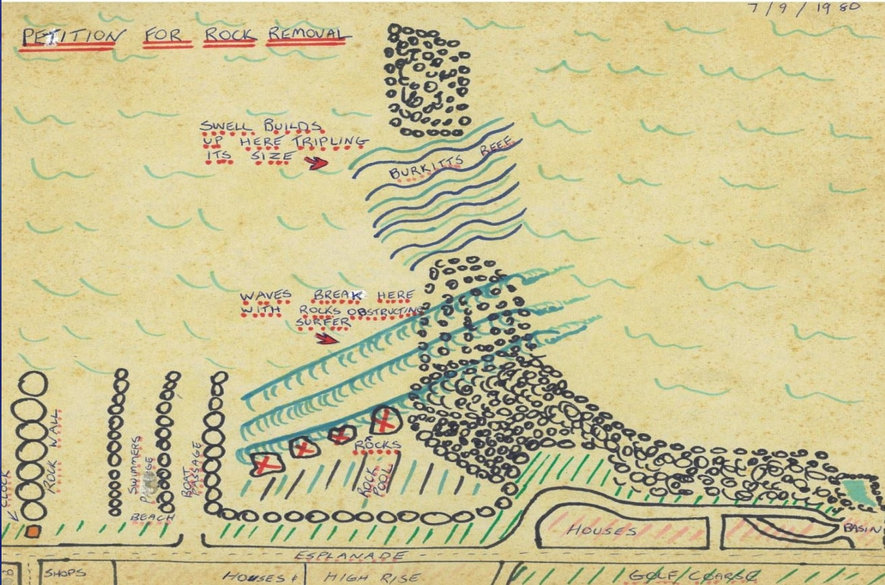
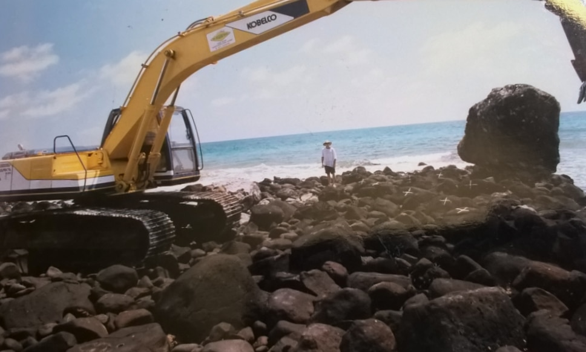
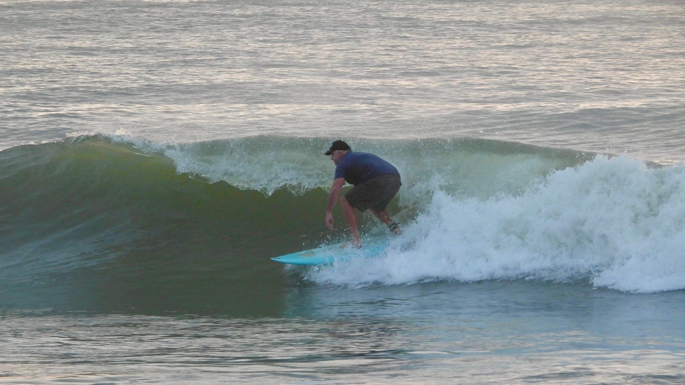
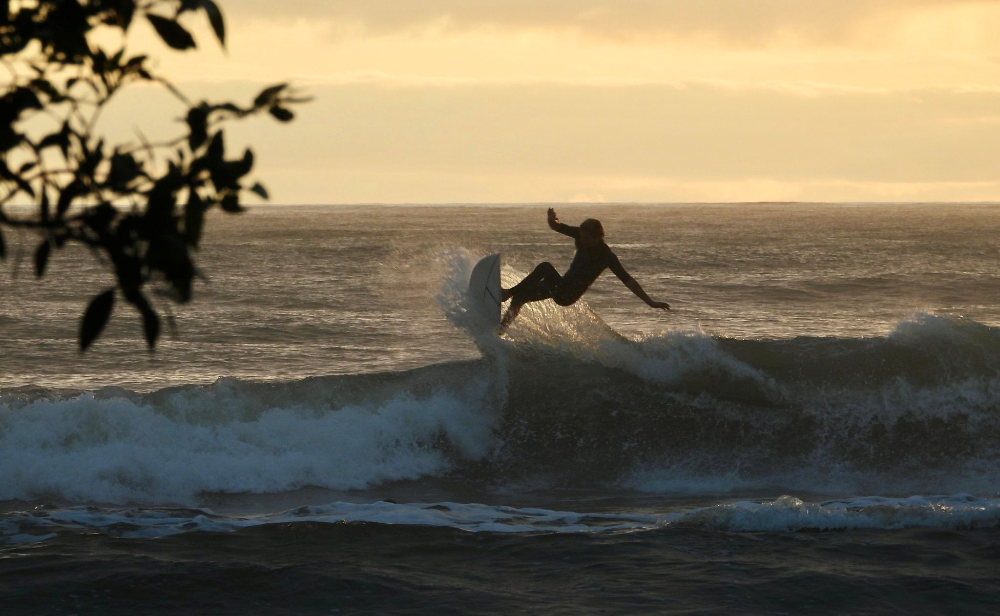
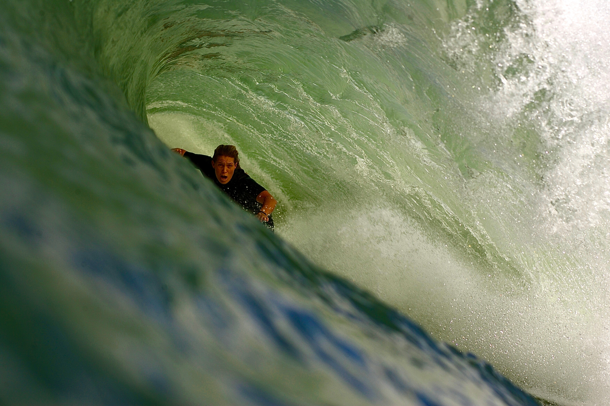
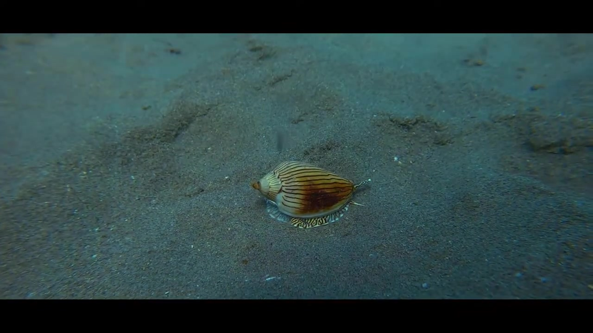
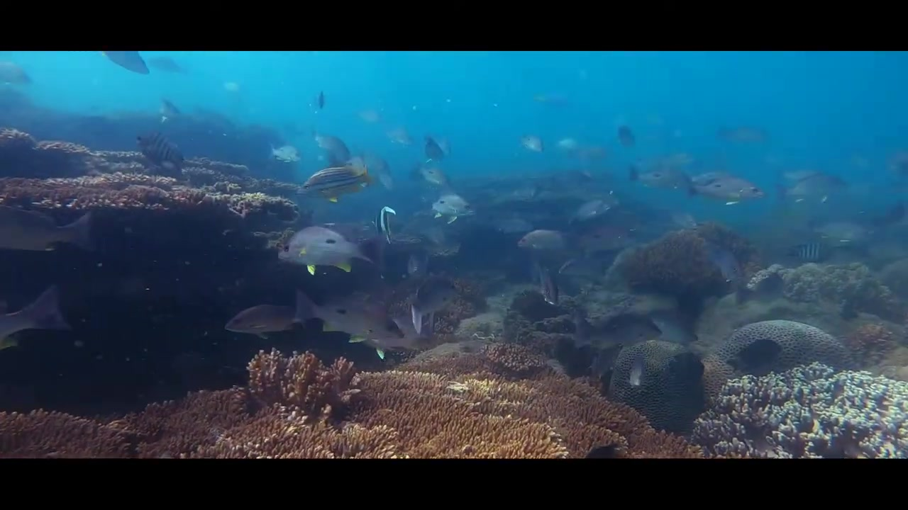
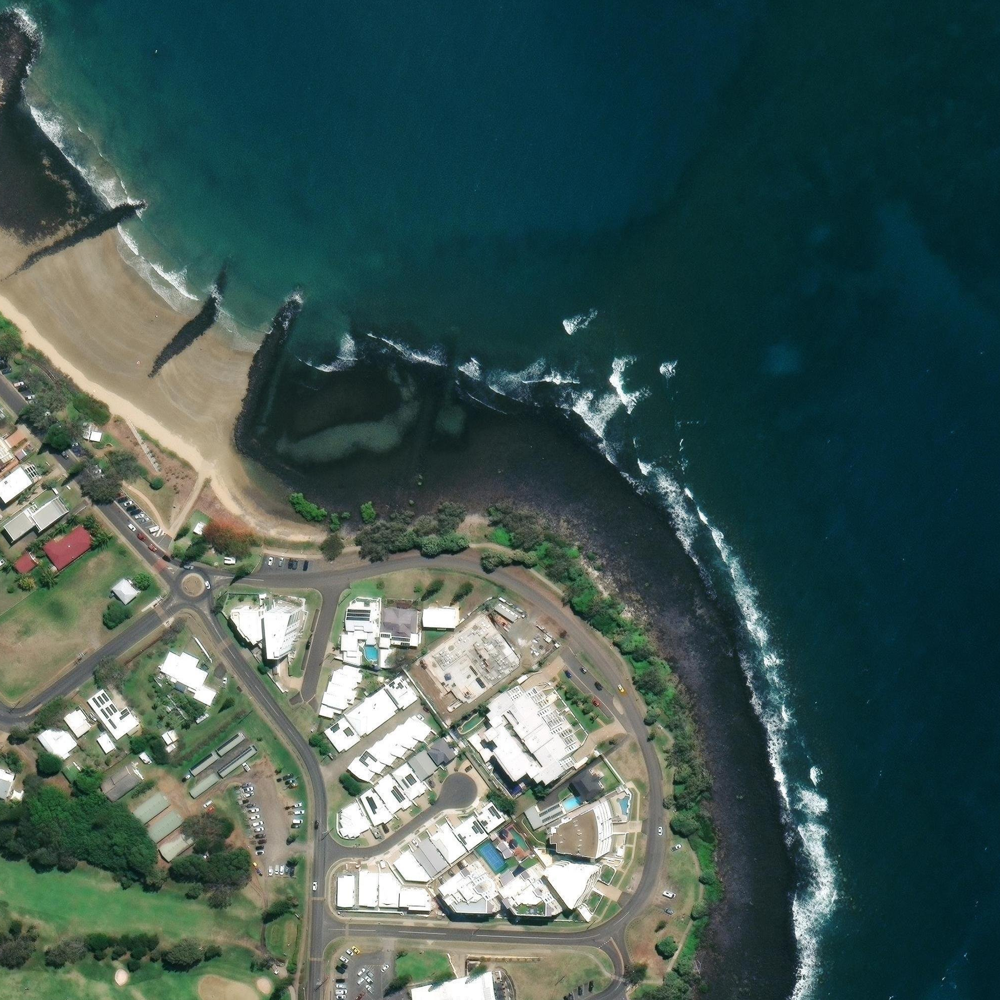

# Image registry - burkitts-reef-bargara

Source of truth: `images.json` in this folder (convention: `_agent_briefs/image_registry.md`; overview: `03_images/reefs/README.md`). This file is generated from it.

8 images registered, 8 with a file, 0 used for the model (any use other than context/not_used).

## burkitts-reef-bargara-img-01 - Greg Redgard's hand-drawn 'PETITION FOR ROCK REMOVAL' sketch, 7 Sept 1980 (via ABC)

- **file**: `03_images/reefs/burkitts-reef-bargara/burkitts-reef-bargara_petition-sketch-1980.jpg`
- **kind**: design_drawing
- **shows**: Hand-drawn coloured sketch headed 'PETITION FOR ROCK REMOVAL', plan view of the headland labelled BURKITTS REEF with notes 'swell builds up here tripling its size' and 'waves break here with rocks obstructing surfer', rocks, houses and the esplanade.
- **structure visible**: True
- **state shown**: pre-construction (1980 proposal)
- **image date**: 1980-09-07 (dated 7/9/80 on the sketch; day/month order assumed Australian)
- **citation**: Supplied: Greg Redgard, via ABC News (photo; article published 2024-01-28 by Sarah Howells). In: How a sugarcane cutter and his mates created a world-first DIY surf break at Burkitts Reef, Bargara. ABC News, https://www.abc.net.au/news/2024-01-28/diy-surf-break-built-by-mates-at-burkitts-reef-bargara/103387450 (caption 'Greg Redgard drew his first submission to council with his children's colouring pencils. (Supplied: Greg Redgard)'). Image file https://live-production.wcms.abc-cdn.net.au/a450bbac522bee4892941b966b64fea8 (full-size file; the card used a cropped/resized variant). Accessed 2026-10-06.
- **image URL**: https://live-production.wcms.abc-cdn.net.au/a450bbac522bee4892941b966b64fea8
- **source page**: https://www.abc.net.au/news/2024-01-28/diy-surf-break-built-by-mates-at-burkitts-reef-bargara/103387450
- **page / figure**: article photo 1 (caption: Greg Redgard drew his first submission to council with his children's colouring pencils. (Supplied: Greg Redgard))
- **credit**: Supplied: Greg Redgard, via ABC News
- **licence**: ABC News / 'Supplied' photo; no reuse licence found - link/research copy only, NOT cleared
- **retrieved**: 2026-10-06
- **used for**: context
- **How used for the model**: Page illustration of the original proposal (rocks to be removed to improve the wave). Hand sketch with no scale or north arrow, so not traced; it is evidence of the rock-field layout before reshaping.
- **3D check pending**: no - 2026-10-10: qualitative match only with img-08 (boulder mass at the point, linear rock rows at the beach side, surf over the north side); no scale or north
- **linked records**: 02_research/reefs/burkitts-reef-bargara.json images[0]; 05_qa/reef/burkitts-reef-bargara_media_recheck.json images[0]
- **size**: 0.28 MB, 1171x775 px
- **sha256**: 4093fcb78a82b7c2f307db13653781e1c2ec307e10c2df2e910f40676ad608f9
- **rights**: Private research copy; reuse rights to be checked before any public release.
- **display in HTML**: True
- **added by**: image-registry backfill, 2026-10-06

## burkitts-reef-bargara-img-02 - Kobelco excavator and basalt boulders at the shoreline during the February 1997 works (via ABC)

- **file**: `03_images/reefs/burkitts-reef-bargara/burkitts-reef-bargara_excavator-boulders-1997.jpg`
- **kind**: photo
- **shows**: Yellow Kobelco hydraulic excavator on a basalt boulder shoreline, a man standing among the rocks near the waterline and white painted X marks on several boulders.
- **structure visible**: True
- **state shown**: under construction (February 1997)
- **image date**: 1997-02 (February 1997 construction)
- **citation**: Supplied: Greg Redgard, via ABC News (photo; article published 2024-01-28 by Sarah Howells). In: How a sugarcane cutter and his mates created a world-first DIY surf break at Burkitts Reef, Bargara. ABC News, https://www.abc.net.au/news/2024-01-28/diy-surf-break-built-by-mates-at-burkitts-reef-bargara/103387450 (caption 'Greg relocated tonnes of rocks using the rented excavator. (Supplied: Greg Redgard)'). Image file https://live-production.wcms.abc-cdn.net.au/a6112bacdcff48646a25f1539549b362 (full-size file; the card used a cropped/resized variant). Accessed 2026-10-06.
- **image URL**: https://live-production.wcms.abc-cdn.net.au/a6112bacdcff48646a25f1539549b362
- **source page**: https://www.abc.net.au/news/2024-01-28/diy-surf-break-built-by-mates-at-burkitts-reef-bargara/103387450
- **page / figure**: article photo 2 (caption: Greg relocated tonnes of rocks using the rented excavator. (Supplied: Greg Redgard))
- **credit**: Supplied: Greg Redgard, via ABC News
- **licence**: ABC News / 'Supplied' photo; no reuse licence found - link/research copy only, NOT cleared
- **retrieved**: 2026-10-06
- **used for**: context
- **How used for the model**: Page illustration of the construction method (boulders marked and relocated by an excavator at low tide); hero image recommended by the 2026-09-25 recheck. No dimension read.
- **3D check pending**: no - none: construction photo without scale
- **linked records**: 02_research/reefs/burkitts-reef-bargara.json images[1]; 05_qa/reef/burkitts-reef-bargara_media_recheck.json images[1]
- **size**: 0.09 MB, 968x583 px
- **sha256**: 30cddf30ae51304097dc9f893fc27526cca6cee19c1dd1c61e9192492059842a
- **rights**: Private research copy; reuse rights to be checked before any public release.
- **display in HTML**: True
- **added by**: image-registry backfill, 2026-10-06

## burkitts-reef-bargara-img-03 - Greg Redgard surfing 'Greg's Reef' (via ABC)

- **file**: `03_images/reefs/burkitts-reef-bargara/burkitts-reef-bargara_greg-surfing-gregs-reef.jpg`
- **kind**: photo
- **shows**: A surfer crouched on a board riding a clean peeling green wave; the rock reef is not visible (submerged).
- **structure visible**: False
- **state shown**: as-built, in service (date unknown)
- **image date**: unknown (before 2024-01-28)
- **citation**: Supplied: Jimmy Scaboo, via ABC News (photo; article published 2024-01-28 by Sarah Howells). In: How a sugarcane cutter and his mates created a world-first DIY surf break at Burkitts Reef, Bargara. ABC News, https://www.abc.net.au/news/2024-01-28/diy-surf-break-built-by-mates-at-burkitts-reef-bargara/103387450 (caption 'Greg surfing on "Greg's Reef" in Bargara, on the Bundaberg coast. (Supplied: Jimmy Scaboo)'). Image file https://live-production.wcms.abc-cdn.net.au/a315cc055a6a5d93d4c292c7857238d7 (full-size file; the card used a cropped/resized variant). Accessed 2026-10-06.
- **image URL**: https://live-production.wcms.abc-cdn.net.au/a315cc055a6a5d93d4c292c7857238d7
- **source page**: https://www.abc.net.au/news/2024-01-28/diy-surf-break-built-by-mates-at-burkitts-reef-bargara/103387450
- **page / figure**: article photo 3 (caption: Greg surfing on "Greg's Reef" in Bargara, on the Bundaberg coast. (Supplied: Jimmy Scaboo))
- **credit**: Supplied: Jimmy Scaboo, via ABC News
- **licence**: ABC News / 'Supplied' photo; no reuse licence found - link/research copy only, NOT cleared
- **retrieved**: 2026-10-06
- **used for**: context
- **How used for the model**: Page illustration of the surf effect. No dimension read.
- **3D check pending**: no - none: surf photo
- **linked records**: 02_research/reefs/burkitts-reef-bargara.json images[2]; 05_qa/reef/burkitts-reef-bargara_media_recheck.json images[2]
- **size**: 0.47 MB, 2048x1152 px
- **sha256**: 84e82710678fd387221c02acf2389fedc5e6abae687a0819c9d997a890ecac07
- **rights**: Private research copy; reuse rights to be checked before any public release.
- **display in HTML**: True
- **added by**: image-registry backfill, 2026-10-06

## burkitts-reef-bargara-img-04 - Surfer making a top turn at Burkitts Reef at sunset (via ABC)

- **file**: `03_images/reefs/burkitts-reef-bargara/burkitts-reef-bargara_surfer-top-turn.jpg`
- **kind**: photo
- **shows**: Backlit silhouette of a surfer performing a top turn on a breaking wave in golden evening light.
- **structure visible**: False
- **state shown**: as-built, in service (date unknown)
- **image date**: unknown (before 2024-01-28)
- **citation**: Supplied: Jimmy Scaboo, via ABC News (photo; article published 2024-01-28 by Sarah Howells). In: How a sugarcane cutter and his mates created a world-first DIY surf break at Burkitts Reef, Bargara. ABC News, https://www.abc.net.au/news/2024-01-28/diy-surf-break-built-by-mates-at-burkitts-reef-bargara/103387450 (caption 'The reef remains a popular surfing location in the Bundaberg region. (Supplied: Jimmy Scaboo)'). Image file https://live-production.wcms.abc-cdn.net.au/8e0f6ec39a17f78926cbc31b5198e6be (full-size file; the card used a cropped/resized variant). Accessed 2026-10-06.
- **image URL**: https://live-production.wcms.abc-cdn.net.au/8e0f6ec39a17f78926cbc31b5198e6be
- **source page**: https://www.abc.net.au/news/2024-01-28/diy-surf-break-built-by-mates-at-burkitts-reef-bargara/103387450
- **page / figure**: article photo 4 (caption: The reef remains a popular surfing location in the Bundaberg region. (Supplied: Jimmy Scaboo))
- **credit**: Supplied: Jimmy Scaboo, via ABC News
- **licence**: ABC News / 'Supplied' photo; no reuse licence found - link/research copy only, NOT cleared
- **retrieved**: 2026-10-06
- **used for**: context
- **How used for the model**: Page illustration of the surf effect. No dimension read.
- **3D check pending**: no - none: surf photo
- **linked records**: 02_research/reefs/burkitts-reef-bargara.json images[3]; 05_qa/reef/burkitts-reef-bargara_media_recheck.json images[3]
- **size**: 0.31 MB, 2048x1262 px
- **sha256**: 0707223416f9275367b0baf9a8f13abe9b24fd5f43645a9c9629c24fec13e298
- **rights**: Private research copy; reuse rights to be checked before any public release.
- **display in HTML**: True
- **added by**: image-registry backfill, 2026-10-06

## burkitts-reef-bargara-img-05 - Surfer in a green barrel at Burkitts Reef (via ABC, Tahlija Redgard)

- **file**: `03_images/reefs/burkitts-reef-bargara/burkitts-reef-bargara_barrel-tahlija.jpg`
- **kind**: photo
- **shows**: Surfer deep inside a large green barrel with the wave curling overhead (the caption says Tahlija Redgard surfs the pro circuit; the photo itself does not name the break).
- **structure visible**: False
- **state shown**: not stated (caption ties the surfer to growing up on the reef, not the photo to the reef)
- **image date**: unknown (before 2024-01-28)
- **citation**: Supplied: Tahlija Redgard, via ABC News (photo; article published 2024-01-28 by Sarah Howells). In: How a sugarcane cutter and his mates created a world-first DIY surf break at Burkitts Reef, Bargara. ABC News, https://www.abc.net.au/news/2024-01-28/diy-surf-break-built-by-mates-at-burkitts-reef-bargara/103387450 (caption 'After growing up surfing on Burkitts Reef, Greg's daughter Tahlija Redgard surfs the pro circuit. (Supplied: Tahlija Redgard)'). Image file https://live-production.wcms.abc-cdn.net.au/69d978b4bf6d26ef7a724e831db9ef5b (full-size file; the card used a cropped/resized variant). Accessed 2026-10-06.
- **image URL**: https://live-production.wcms.abc-cdn.net.au/69d978b4bf6d26ef7a724e831db9ef5b
- **source page**: https://www.abc.net.au/news/2024-01-28/diy-surf-break-built-by-mates-at-burkitts-reef-bargara/103387450
- **page / figure**: article photo 5 (caption: After growing up surfing on Burkitts Reef, Greg's daughter Tahlija Redgard surfs the pro circuit. (Supplied: Tahlija Redgard))
- **credit**: Supplied: Tahlija Redgard, via ABC News
- **licence**: ABC News / 'Supplied' photo; no reuse licence found - link/research copy only, NOT cleared
- **retrieved**: 2026-10-06
- **used for**: context
- **How used for the model**: Page illustration only; the photo's location is not stated, so it is surf context at best. No dimension read.
- **3D check pending**: no - none: surf photo with uncertain location
- **linked records**: 02_research/reefs/burkitts-reef-bargara.json images[4]; 05_qa/reef/burkitts-reef-bargara_media_recheck.json images[4]
- **size**: 1.62 MB, 3504x2336 px
- **sha256**: 1a88d38353eb69261ffa9dba9fc5968fcebd09e181330e5e1c0a8339b7432a68
- **rights**: Private research copy; reuse rights to be checked before any public release.
- **display in HTML**: True
- **added by**: image-registry backfill, 2026-10-06

## burkitts-reef-bargara-img-06 - REJECTED video frame at 00:25: dive video of the (natural) Burkitt's Reef Marine Park, not the surf reef

- **file**: `03_images/video_frames/burkitts-reef-bargara/rejected/wuJ__7Js-cY_0025.jpg`
- **kind**: video_frame
- **shows**: Underwater frame of a striped shell on a sandy seabed (dive video, Burkitt's Reef Marine Park). It does not show the rock-reshaped surf reef.
- **structure visible**: False
- **state shown**: not applicable (different feature: marine-park dive site)
- **image date**: 2021-03-27 (upload date)
- **citation**: Black Beard Diving (2021-03-27). "Diving Bargara, Burkitt's Reef Marine Park" [video]. YouTube, frame at 00:25. https://www.youtube.com/watch?v=wuJ__7Js-cY. Accessed 2026-09-25.
- **image URL**: https://www.youtube.com/watch?v=wuJ__7Js-cY
- **source page**: https://www.youtube.com/watch?v=wuJ__7Js-cY
- **page / figure**: frame at 00:25 (video length 286 s)
- **credit**: Black Beard Diving (YouTube channel)
- **licence**: YouTube standard licence (not an open licence); single frame kept as a private research copy
- **retrieved**: 2026-09-24
- **used for**: not_used
- **How used for the model**: Rejected 2026-09-25 (site_only): a dive video at a marine-park reef (coral and fish) that shares the name; it is not the rock-reshaped Bargara surf break. Kept for the record, not displayed.
- **3D check pending**: no - none: not the surf reef
- **linked records**: 02_research/videos/burkitts-reef-bargara/videos.json; 05_qa/reef/burkitts-reef-bargara_media_recheck.json frames; 04_build/QA/removed_assets/burkitts-reef-bargara/
- **size**: 0.11 MB, 1280x720 px
- **sha256**: c2346be83d85037dc7a756b432c3f3437a444c94d684fbb6ce76227a7ef91d60
- **rights**: Private research copy; reuse rights to be checked before any public release.
- **display in HTML**: False
- **added by**: image-registry backfill, 2026-10-06
- **notes**: display false: rejected by the media recheck / page build (wrong feature).

## burkitts-reef-bargara-img-07 - REJECTED video frame at 02:05: dive video of the (natural) Burkitt's Reef Marine Park, not the surf reef

- **file**: `03_images/video_frames/burkitts-reef-bargara/rejected/wuJ__7Js-cY_0205.jpg`
- **kind**: video_frame
- **shows**: Underwater frame of a coral reef with fish (dive video, Burkitt's Reef Marine Park). It does not show the rock-reshaped surf reef.
- **structure visible**: False
- **state shown**: not applicable (different feature: marine-park dive site)
- **image date**: 2021-03-27 (upload date)
- **citation**: Black Beard Diving (2021-03-27). "Diving Bargara, Burkitt's Reef Marine Park" [video]. YouTube, frame at 02:05. https://www.youtube.com/watch?v=wuJ__7Js-cY. Accessed 2026-09-25.
- **image URL**: https://www.youtube.com/watch?v=wuJ__7Js-cY
- **source page**: https://www.youtube.com/watch?v=wuJ__7Js-cY
- **page / figure**: frame at 02:05 (video length 286 s)
- **credit**: Black Beard Diving (YouTube channel)
- **licence**: YouTube standard licence (not an open licence); single frame kept as a private research copy
- **retrieved**: 2026-09-24
- **used for**: not_used
- **How used for the model**: Rejected 2026-09-25 (site_only): a dive video at a marine-park reef (coral and fish) that shares the name; it is not the rock-reshaped Bargara surf break. Kept for the record, not displayed.
- **3D check pending**: no - none: not the surf reef
- **linked records**: 02_research/videos/burkitts-reef-bargara/videos.json; 05_qa/reef/burkitts-reef-bargara_media_recheck.json frames; 04_build/QA/removed_assets/burkitts-reef-bargara/
- **size**: 0.10 MB, 1280x720 px
- **sha256**: 62e22d7ef5eeb518cb222ee1b24ec7bcc590d5d432bce71b5c3052a56afcc6eb
- **rights**: Private research copy; reuse rights to be checked before any public release.
- **display in HTML**: False
- **added by**: image-registry backfill, 2026-10-06
- **notes**: display false: rejected by the media recheck / page build (wrong feature).

## burkitts-reef-bargara-img-08 - Esri World Imagery current, Burkitts Reef headland, Bargara, z19, r=270 m (2025-09-05)

- **file**: `07_scale/shapes/burkitts-reef-bargara/src/burkitts_esri_2025-09-05_z19.png`
- **kind**: satellite
- **shows**: The basalt headland at the southern end of Bargara Beach with a dark rock ridge extending seaward, surf breaking along its seaward side and a calmer bay behind; Burkitt Street, esplanade and apartments inland.
- **structure visible**: True
- **state shown**: as-built, current (2025; reshaped natural rock reef)
- **image date**: 2025-09-05
- **citation**: Esri, Maxar, Earthstar Geographics, and the GIS User Community (2025). World Imagery (current layer), image captured 2025-09-05. Esri World Imagery tile service, https://server.arcgisonline.com/ArcGIS/rest/services/World_Imagery/MapServer. Accessed 2026-10-04.
- **image URL**: https://server.arcgisonline.com/ArcGIS/rest/services/World_Imagery/MapServer/tile/{z}/{y}/{x}
- **source page**: Esri World Imagery (identify DATE field)
- **page / figure**: centre -24.8153, 152.4671, r=270 m, z19, 1992 x 1992 px, 0.271 m/px; sidecar burkitts_esri_2025-09-05_z19.png.geo.json
- **credit**: Esri, Maxar, Earthstar Geographics, and the GIS User Community
- **licence**: Esri/Maxar imagery terms (not an open licence); private research copy only
- **retrieved**: 2026-10-04
- **used for**: plan_trace, scale
- **How used for the model**: 2026-10-10: georeferenced via sidecar bounds (0.2710 m/px); outline of the visible basalt rock platform traced (38 vertices, 31,485 m2 in frame, south edge cut by the frame) -> shape.json img1, METHOD.md section 3. Not the reshaped zone (no source locates it). Low confidence. Overlay: 07_scale/shapes/burkitts-reef-bargara/overlays/img08_esri_2025-09-05_rock_platform_trace_v1.png
- **3D check pending**: no - planform traced 2026-10-10 (visible platform only); no 3D built (FEASIBILITY.md)
- **linked records**: 07_scale/shapes/burkitts-reef-bargara/src/burkitts_esri_2025-09-05_z19.png.geo.json
- **size**: 4.77 MB, 1992x1992 px
- **sha256**: ff110e6408c49123148033727bf7ad86f49e3de9e23b0f7958fb86937eb2707a
- **rights**: Private research copy; reuse rights to be checked before any public release.
- **display in HTML**: True
- **added by**: image-registry backfill, 2026-10-06

## burkitts-reef-bargara-img-09 - Bargara Reef Phase 3: oblique aerial of the headland with the four work zones marked (page render, 300 dpi, crop of Figure 1)
- **file**: 03_images/reefs/burkitts-reef-bargara/burkitts-reef-bargara_jc2007-fig1-phase3-aerial_p1.png
- **kind**: aerial
- **citation**: Jackson, L.A. and Corbett, B. (2007). Review of Existing Multi-Functional Artificial Reefs. Australasian Conference on Coasts and Ports 2007, International Coastal Management, Queensland (authors L.A. Jackson and B.B. Corbett), p. 1, Figure 1 "Bargara Reef Phase 3 [Source: Greg Redgard]". https://ref.coastalrestorationtrust.org.nz/site/assets/files/7954/2007_cp-review_mfar.pdf. Accessed 2026-10-10.
- **source page**: https://ref.coastalrestorationtrust.org.nz/site/assets/files/7954/2007_cp-review_mfar.pdf
- **page/figure**: p.1 Figure 1 (embedded image xref 86, native 465x285 px; render 300 dpi)
- **image date**: unknown (photo of the headland, before the Phase 3 works; text of 2007 paper: "additional works have been designed [Figure 1]" citing Redgard 2006)
- **credit**: Greg Redgard (photo and annotations), reproduced in Jackson and Corbett 2007
- **licence**: not stated (conference paper; private copy)
- **retrieved**: 2026-10-10
- **shows**: Oblique aerial looking west-north-west over the north side of the Burkitts headland: two rock groynes at the top, a sand-floored rock pool inside the near wall, dark basalt rock flat, a breaking wave line along the platform edge; arrows/ellipse mark: reprofile several surface rocks, remove (ellipse) to lengthen break, improve shore break, reprofile dangerous rocks.
- **state shown**: design: Phase 3 planned work zones on the natural platform (state before those works)
- **used for**: plan_trace, cross_check
- **How used for the model**: 2026-10-10: the ONLY source found that locates reshaped-boulder work areas. Three ground control points (outer tip of rock wall B, its south root, outer tip of groyne A) fitted an affine map onto the Esri Wayback 2016-07-31 frame; the drawn ellipse and the four arrow tips were mapped (scripts/phase3_zone_georef.py, scripts/phase3_zone_v1.json). Ellipse = about 1,750 m2 (43 x 52 m), position +-20-30 m (LOW). Phase 3 = later "designed" additional works; not the same as the Feb 1997 first works (not located).
- **linked records**: 07_scale/shapes/burkitts-reef-bargara/sources.md img3; 07_scale/shapes/burkitts-reef-bargara/METHOD.md section 5; 07_scale/shapes/burkitts-reef-bargara/scripts/phase3_zone_v1.json; 03_images/reefs/burkitts-reef-bargara/burkitts-reef-bargara_phase3-annotated-aerial_rwr.jpg (same photo, RWR copy)
- **annotated versions**: 07_scale/shapes/burkitts-reef-bargara/overlays/img10_phase3_zones_oblique_and_esri2016_v1.png
- **size**: 0.36 MB, 980x667 px
- **sha256**: c7eae8a05825113f7caf30c42daafb630f357870dfe0fc9119a8a9b1136fb23c
- **rights**: Private research copy; reuse rights to be checked before any public release.
- **display in HTML**: True
- **added by**: Burkitts+Mexico network pass, 2026-10-10

## burkitts-reef-bargara-img-10 - Burkitts Reef annotated aerial (RWR copy of the Redgard Phase 3 photo)
- **file**: 03_images/reefs/burkitts-reef-bargara/burkitts-reef-bargara_phase3-annotated-aerial_rwr.jpg
- **kind**: aerial
- **citation**: Raised Water Research (n.d., site (c) 2020). Burkitts Reef, spot page, image "Burkitts.jpg", credit "Image: Redgard". https://raisedwaterresearch.com/spot/artificial-reef/australia/queensland/burkitts-reef/ . Accessed 2026-10-10.
- **source page**: https://raisedwaterresearch.com/spot/artificial-reef/australia/queensland/burkitts-reef/
- **page/figure**: page gallery image 1 (690x419 px)
- **image date**: unknown (same photo as img-09)
- **credit**: Image: Redgard (RWR)
- **licence**: not stated; all rights reserved by RWR; private copy
- **retrieved**: 2026-10-10
- **shows**: Same oblique aerial and annotations as img-09 (reprofile several surface rocks / remove to lengthen break / improve shore break / reprofile dangerous rocks), with a wide dark margin.
- **state shown**: design: Phase 3 planned work zones (same as img-09)
- **used for**: cross_check
- **How used for the model**: 2026-10-10: identical content to img-09 (same photo, same four labels); confirms the figure is Redgard's and shows RWR republished it. Not separately traced; img-09 is the primary (peer-reviewed host).
- **linked records**: 07_scale/shapes/burkitts-reef-bargara/sources.md img4
- **annotated versions**: -
- **size**: 0.16 MB, 690x419 px
- **sha256**: 6ab3863c2924fcbe3129f62bee9d9d365a648278734ddf9402d0b9727028e16d
- **rights**: Private research copy; reuse rights to be checked before any public release.
- **display in HTML**: True
- **added by**: Burkitts+Mexico network pass, 2026-10-10

## burkitts-reef-bargara-img-11 - Excavator moving boulders at low tide (Figure 2 of Jackson and Corbett 2007)
- **file**: 03_images/reefs/burkitts-reef-bargara/burkitts-reef-bargara_jc2007-fig2-excavator.png
- **kind**: photo
- **citation**: Jackson, L.A. and Corbett, B. (2007). Review of Existing Multi-Functional Artificial Reefs. Australasian Conference on Coasts and Ports 2007, International Coastal Management, Queensland (authors L.A. Jackson and B.B. Corbett), p. 1, Figure 2 "Excavator moving boulders at low tide (Source: Greg Redgard)". https://ref.coastalrestorationtrust.org.nz/site/assets/files/7954/2007_cp-review_mfar.pdf. Accessed 2026-10-10.
- **source page**: https://ref.coastalrestorationtrust.org.nz/site/assets/files/7954/2007_cp-review_mfar.pdf
- **page/figure**: p.1 Figure 2 (embedded image, 461x234 px)
- **image date**: 1997 (works Feb 1997; date of photo not stated)
- **credit**: Greg Redgard
- **licence**: not stated (conference paper; private copy)
- **retrieved**: 2026-10-10
- **shows**: Large yellow excavator on a boulder field at low tide moving a boulder; sea and horizon behind. No landmark.
- **state shown**: during works 1997 (inferred)
- **used for**: context
- **How used for the model**: 2026-10-10: context only. Shows boulder size and the method; no landmark, scale or location. Probably the same scene as img-02 (ABC copy); not pixel-compared.
- **linked records**: 07_scale/shapes/burkitts-reef-bargara/sources.md img3
- **annotated versions**: -
- **size**: 0.09 MB, 461x234 px
- **sha256**: 8110ec988e71ebdb16903f950f73abc6a7349745965e24bee5cfe82734871566
- **rights**: Private research copy; reuse rights to be checked before any public release.
- **display in HTML**: True
- **added by**: Burkitts+Mexico network pass, 2026-10-10

## burkitts-reef-bargara-img-12 - Surf at Bargara (Figure 3 of Jackson and Corbett 2007)
- **file**: 03_images/reefs/burkitts-reef-bargara/burkitts-reef-bargara_jc2007-fig3-surf.jpeg
- **kind**: photo
- **citation**: Jackson, L.A. and Corbett, B. (2007). Review of Existing Multi-Functional Artificial Reefs. Australasian Conference on Coasts and Ports 2007, International Coastal Management, Queensland (authors L.A. Jackson and B.B. Corbett), p. 2, Figure 3 "Surf at Bargara (Source: Greg Redgard)". https://ref.coastalrestorationtrust.org.nz/site/assets/files/7954/2007_cp-review_mfar.pdf. Accessed 2026-10-10.
- **source page**: https://ref.coastalrestorationtrust.org.nz/site/assets/files/7954/2007_cp-review_mfar.pdf
- **page/figure**: p.2 Figure 3 (embedded image, 462x215 px)
- **image date**: unknown (before 2007)
- **credit**: Greg Redgard
- **licence**: not stated (conference paper; private copy)
- **retrieved**: 2026-10-10
- **shows**: A surfer on a right-hand wave with a long peeling face; no land or reef visible.
- **state shown**: in use (post-1997)
- **used for**: context
- **How used for the model**: 2026-10-10: context only (the wave works as a longer point break near high tide); no geometry.
- **linked records**: 07_scale/shapes/burkitts-reef-bargara/sources.md img3
- **annotated versions**: -
- **size**: 0.02 MB, 462x215 px
- **sha256**: c079572561bb2534f6e8a8a50fce05e14fc8348c66428ecdf5494a01ab615fab
- **rights**: Private research copy; reuse rights to be checked before any public release.
- **display in HTML**: True
- **added by**: Burkitts+Mexico network pass, 2026-10-10

## burkitts-reef-bargara-img-13 - Surfer on a right-hander at Burkitts (RWR page image Burkit-Right.jpg)
- **file**: 03_images/reefs/burkitts-reef-bargara/burkitts-reef-bargara_surf-right-rwr-burkit-right.jpg
- **kind**: photo
- **citation**: Raised Water Research. Burkitts Reef, spot page, image "Burkit-Right.jpg" (credit not stated on the image; page credits "Photo: Pitt" and "Image: Redgard"). https://raisedwaterresearch.com/spot/artificial-reef/australia/queensland/burkitts-reef/ . Accessed 2026-10-10.
- **source page**: https://raisedwaterresearch.com/spot/artificial-reef/australia/queensland/burkitts-reef/
- **page/figure**: page header image (747x159 px)
- **image date**: unknown
- **credit**: RWR page (Pitt / Redgard; which one not stated)
- **licence**: not stated; private copy
- **retrieved**: 2026-10-10
- **shows**: Surfer on a peeling right with whitewater behind; no land visible.
- **state shown**: in use
- **used for**: context
- **How used for the model**: 2026-10-10: context only; no landmark or geometry.
- **linked records**: 07_scale/shapes/burkitts-reef-bargara/sources.md
- **annotated versions**: -
- **size**: 0.01 MB, 747x159 px
- **sha256**: 17292a985ff8f979913b5d647793d76c852e2604043707bbce5fdc5638fec3cd
- **rights**: Private research copy; reuse rights to be checked before any public release.
- **display in HTML**: True
- **added by**: Burkitts+Mexico network pass, 2026-10-10

## burkitts-reef-bargara-img-14 - Surfer on a wave at Burkitts (RWR page image Burkitts-Right.jpg)
- **file**: 03_images/reefs/burkitts-reef-bargara/burkitts-reef-bargara_surf-right-rwr-burkitts-right.jpg
- **kind**: photo
- **citation**: Raised Water Research. Burkitts Reef, spot page, image "Burkitts-Right.jpg" (credit "Photo: Pitt" per page captions). https://raisedwaterresearch.com/spot/artificial-reef/australia/queensland/burkitts-reef/ . Accessed 2026-10-10.
- **source page**: https://raisedwaterresearch.com/spot/artificial-reef/australia/queensland/burkitts-reef/
- **page/figure**: page gallery image (622x286 px)
- **image date**: unknown
- **credit**: Pitt (per RWR caption; assignment to this image not certain)
- **licence**: not stated; private copy
- **retrieved**: 2026-10-10
- **shows**: Surfer on a small green wave in sunlight glitter; no land visible.
- **state shown**: in use
- **used for**: context
- **How used for the model**: 2026-10-10: context only.
- **linked records**: 07_scale/shapes/burkitts-reef-bargara/sources.md
- **annotated versions**: -
- **size**: 0.17 MB, 622x286 px
- **sha256**: 09c9ca10f08939630df3ed7190db4aed944ab446c1b50e08fe3f6c3f5da309fe
- **rights**: Private research copy; reuse rights to be checked before any public release.
- **display in HTML**: True
- **added by**: Burkitts+Mexico network pass, 2026-10-10

## burkitts-reef-bargara-img-15 - Esri Wayback release 23264, Burkitts headland, z18, wide frame (r=450 m) - image captured 2016-07-31
- **file**: 07_scale/shapes/burkitts-reef-bargara/src/wayback/burkitts_esri_wayback-rel23264_img2016-07-31_z18_wide.png
- **kind**: satellite
- **citation**: Esri, Maxar/DigitalGlobe, Earthstar Geographics and the GIS User Community. World Imagery Wayback release 23264 (2017-10-25) (2017-10-25); source image captured 2016-07-31 per the release metadata layer. https://wayback.maptiles.arcgis.com/arcgis/rest/services/World_Imagery/WMTS/1.0.0/default028mm/MapServer/tile/23264/{z}/{y}/{x} . Accessed 2026-10-10.
- **source page**: Esri World Imagery Wayback (metadata layer World_Imagery_Metadata_2017_r18 layer 5: SRC_DATE 20160731, DigitalGlobe Vivid, 0.5 m)
- **page/figure**: src/wayback/burkitts_esri_wayback-rel23264_img2016-07-31_z18_wide.png + .geo.json sidecar (exact bounds)
- **image date**: 2016-07-31
- **credit**: Esri, Maxar / DigitalGlobe, Earthstar Geographics, GIS User Community
- **licence**: Esri/Maxar imagery terms (not an open licence); private research copy only
- **retrieved**: 2026-10-10
- **shows**: Whole basalt headland from the groynes in the north to the southern pool; the rock platform is largely exposed (low-water tide state unknown), a dark band of submerged rock lies seaward; breaking waves along the platform edge.
- **state shown**: as-built, natural headland as at 2016-07-31
- **used for**: plan_trace, context, cross_check
- **How used for the model**: 2026-10-10: wide south frame requested by the HANDOFF. Used as base for the DEM-coverage figure (overlays/img11...) and to see that the platform continues south of the 2025-09-05 frame (southern end read by eye at roughly lat -24.8205, not traced). Platform outline not re-traced (not the reef).
- **linked records**: 07_scale/shapes/burkitts-reef-bargara/sources.md
- **annotated versions**: 07_scale/shapes/burkitts-reef-bargara/overlays/img11_brc2016_dem_valid_cells_on_esri2016_v1.png
- **size**: 3.42 MB, 1660x1660 px
- **sha256**: cf6e6dfbd0a430fcc564a57a8b799df4c7a9ed58504d199412a603369e7fbbf1
- **rights**: Private research copy; reuse rights to be checked before any public release.
- **display in HTML**: True
- **added by**: Burkitts+Mexico network pass, 2026-10-10

## burkitts-reef-bargara-img-16 - Esri Wayback release 23264, north part of the headland, z18, r=160 m - image captured 2016-07-31
- **file**: 07_scale/shapes/burkitts-reef-bargara/src/wayback/burkitts_esri_wayback-rel23264_img2016-07-31_z18_north.png
- **kind**: satellite
- **citation**: Esri, Maxar/DigitalGlobe, Earthstar Geographics and the GIS User Community. World Imagery Wayback release 23264 (2017-10-25) (2017-10-25); source image captured 2016-07-31 per the release metadata layer. https://wayback.maptiles.arcgis.com/arcgis/rest/services/World_Imagery/WMTS/1.0.0/default028mm/MapServer/tile/23264/{z}/{y}/{x} . Accessed 2026-10-10.
- **source page**: Esri World Imagery Wayback (metadata layer World_Imagery_Metadata_2017_r18 layer 5: SRC_DATE 20160731, DigitalGlobe Vivid, 0.5 m)
- **page/figure**: src/wayback/burkitts_esri_wayback-rel23264_img2016-07-31_z18_north.png + .geo.json sidecar (exact bounds)
- **image date**: 2016-07-31
- **credit**: Esri, Maxar / DigitalGlobe, Earthstar Geographics, GIS User Community
- **licence**: Esri/Maxar imagery terms (not an open licence); private research copy only
- **retrieved**: 2026-10-10
- **shows**: Two rock groynes (A far, B near) with a sand-floored rock pool inside B, the dark basalt rock flat seaward of the pool and the white-water edge of the platform; the clearest view of the north side.
- **state shown**: as-built, natural headland as at 2016-07-31
- **used for**: context, cross_check
- **How used for the model**: 2026-10-10: PRIMARY base for the Phase 3 zone: GCPs (tips and root of the groynes) read on a 2x upscale; zone polygon and arrow tips georeferenced onto it (scripts/phase3_zone_georef.py).
- **linked records**: 07_scale/shapes/burkitts-reef-bargara/sources.md
- **annotated versions**: 07_scale/shapes/burkitts-reef-bargara/overlays/img10_phase3_zones_oblique_and_esri2016_v1.png
- **size**: 0.43 MB, 591x591 px
- **sha256**: eca697705e4c26a5d46941d1f56d142439e2a9265032a07b103161f4a04a2cac
- **rights**: Private research copy; reuse rights to be checked before any public release.
- **display in HTML**: True
- **added by**: Burkitts+Mexico network pass, 2026-10-10

## burkitts-reef-bargara-img-17 - Esri Wayback release 25285, Burkitts headland, z18, wide frame - image captured 2025-02-26
- **file**: 07_scale/shapes/burkitts-reef-bargara/src/wayback/burkitts_esri_wayback-rel25285_img2025-02-26_z18_wide.png
- **kind**: satellite
- **citation**: Esri, Maxar/DigitalGlobe, Earthstar Geographics and the GIS User Community. World Imagery Wayback release 25285 (2025-05-29) (2025-05-29); source image captured 2025-02-26 per the release metadata layer. https://wayback.maptiles.arcgis.com/arcgis/rest/services/World_Imagery/WMTS/1.0.0/default028mm/MapServer/tile/25285/{z}/{y}/{x} . Accessed 2026-10-10.
- **source page**: Esri World Imagery Wayback (metadata layer World_Imagery_Metadata_2025 layer 4/5: SRC_DATE 20250226, Maxar Vivid Advanced, 0.34 m)
- **page/figure**: src/wayback/burkitts_esri_wayback-rel25285_img2025-02-26_z18_wide.png + .geo.json sidecar (exact bounds)
- **image date**: 2025-02-26
- **credit**: Esri, Maxar / DigitalGlobe, Earthstar Geographics, GIS User Community
- **licence**: Esri/Maxar imagery terms (not an open licence); private research copy only
- **retrieved**: 2026-10-10
- **shows**: Headland with heavy surf on the platform edge (white water along the whole seaward side); platform partly awash.
- **state shown**: as-built, natural headland as at 2025-02-26
- **used for**: context, cross_check
- **How used for the model**: 2026-10-10: cross-check only: same platform geometry as 2016 and 2025-09-05; groynes and platform outline look unchanged by eye (not measured). Waves hide the edge.
- **linked records**: 07_scale/shapes/burkitts-reef-bargara/sources.md
- **annotated versions**: -
- **size**: 3.14 MB, 1660x1660 px
- **sha256**: 2a4f8a562474e8624ff72e2680ffe234fc29127953994851f683f12ffb386e14
- **rights**: Private research copy; reuse rights to be checked before any public release.
- **display in HTML**: True
- **added by**: Burkitts+Mexico network pass, 2026-10-10

## burkitts-reef-bargara-img-18 - Esri Wayback release 10 (2014-02-20), Burkitts headland, z17, r=300 m - image captured 2010-09-11
- **file**: 07_scale/shapes/burkitts-reef-bargara/src/wayback/burkitts_esri_wayback-rel10_img2010-09-11_z17.png
- **kind**: satellite
- **citation**: Esri, Maxar/DigitalGlobe, Earthstar Geographics and the GIS User Community. World Imagery Wayback release 10 (2014-02-20) (2014-02-20); source image captured 2010-09-11 per the release metadata layer. https://wayback.maptiles.arcgis.com/arcgis/rest/services/World_Imagery/WMTS/1.0.0/default028mm/MapServer/tile/10/{z}/{y}/{x} . Accessed 2026-10-10.
- **source page**: Esri World Imagery Wayback (metadata layer World_Imagery_Metadata_2014_r01 layer 6/7: SRC_DATE 20100911, DigitalGlobe, 0.5 m)
- **page/figure**: src/wayback/burkitts_esri_wayback-rel10_img2010-09-11_z17.png + .geo.json sidecar (exact bounds)
- **image date**: 2010-09-11
- **credit**: Esri, Maxar / DigitalGlobe, Earthstar Geographics, GIS User Community
- **licence**: Esri/Maxar imagery terms (not an open licence); private research copy only
- **retrieved**: 2026-10-10
- **shows**: Oldest imagery Wayback holds for the site (z17 only; z18 tiles missing): groynes and pool already present, platform largely covered at a high-ish tide with surf along its edge.
- **state shown**: as-built, natural headland as at 2010-09-11
- **used for**: context, cross_check
- **How used for the model**: 2026-10-10: shows nothing older than 2010; no pre-1997 imagery exists in Wayback (starts 2014). Context only.
- **linked records**: 07_scale/shapes/burkitts-reef-bargara/sources.md
- **annotated versions**: -
- **size**: 0.37 MB, 554x554 px
- **sha256**: c8b4c7fbfa7ef5ccb4f2e026af82a1e474e5b8707a4cbe5f5beb3d112cd332e7
- **rights**: Private research copy; reuse rights to be checked before any public release.
- **display in HTML**: True
- **added by**: Burkitts+Mexico network pass, 2026-10-10

## burkitts-reef-bargara-img-19 - Phase 3 work zones: oblique aerial with ground control points (left) and mapped zone on Esri 2016 imagery (right)
- **file**: 07_scale/shapes/burkitts-reef-bargara/overlays/img10_phase3_zones_oblique_and_esri2016_v1.png
- **kind**: diagram
- **citation**: Our overlay, drawn 2026-10-10 from img-09 (J&C 2007 Fig 1, Redgard) and img-16 (Esri Wayback release 23264, image 2016-07-31).
- **source page**: n/a
- **page/figure**: n/a
- **image date**: 2026-10-10 (overlay); inputs: unknown / 2016-07-31
- **credit**: Our work; inputs credited at img-09 and img-16
- **licence**: Derived; inherits the restrictions of img-09 and img-16 (private)
- **retrieved**: 2026-10-10
- **shows**: Left: GCPs on the oblique. Right: affine-mapped ellipse (red), arrow tips 1-4 (yellow) and GCPs (cyan) on the 2016 satellite frame.
- **state shown**: derived interpretation
- **used for**: plan_trace
- **How used for the model**: 2026-10-10: visual QA of the georeferencing. Ellipse sits on the dark rock flat east of the rock pool at the start of the break; arrow tips 3-4 fall on the platform edge; arrow 1 falls inside the rock pool near wall B (it points at an isolated white-water patch in the oblique; the mapped point is about 5-10 m from a white patch seen in the 2016 frame, ASSUMED to be the same feature). Position uncertainty +-20-30 m.
- **linked records**: 07_scale/shapes/burkitts-reef-bargara/scripts/phase3_zone_v1.json
- **annotated versions**: -
- **size**: 0.85 MB, 1200x600 px
- **sha256**: 7b7123f22c6771b371d286c6886558745d486e0d339559c4b6ed3946f3d50b76
- **rights**: Private research copy; reuse rights to be checked before any public release.
- **display in HTML**: True
- **added by**: Burkitts+Mexico network pass, 2026-10-10

## burkitts-reef-bargara-img-20 - Bundaberg Regional Council 2016 1 m DEM: cells with valid elevation (8 m grid, coloured by height) on the Esri 2016 frame, with the Phase 3 ellipse
- **file**: 07_scale/shapes/burkitts-reef-bargara/overlays/img11_brc2016_dem_valid_cells_on_esri2016_v1.png
- **kind**: diagram
- **citation**: Bundaberg Regional Council (2016). BRC Elevation Basemap 2016, 1 m DEM (ArcGIS MapServer, layer 0), sampled by REST identify. https://mappingdata.bundaberg.qld.gov.au/arcgis/rest/services/BRC_2016_DEM_1m/MapServer . Accessed 2026-10-10. Base: Esri Wayback release 23264.
- **source page**: same
- **page/figure**: n/a (derived figure)
- **image date**: DEM 2016 (capture date not stated by the service); base image 2016-07-31
- **credit**: Bundaberg Regional Council (DEM); Esri/Maxar (base); our rendering
- **licence**: DEM licence not stated on the service; private copy
- **retrieved**: 2026-10-10
- **shows**: Valid DEM cells exist only on land and the upper shore (orange = 0.6-1.8 m, yellow 1.8-2.5 m, green above); the whole rock platform and the zone are NoData (below the LiDAR floor / water).
- **state shown**: derived
- **used for**: context, cross_check
- **How used for the model**: 2026-10-10: shows the LiDAR DEM does not see the platform (lowest valid cell 0.58 m, datum not stated, assumed AHD). It therefore gives no platform or crest level; it only says the platform is below about 0.6 m. 3,841 of 9,025 grid points valid.
- **linked records**: 07_scale/shapes/burkitts-reef-bargara/src/dem/brc2016_dem1m_identify_grid_8m.json
- **annotated versions**: -
- **size**: 1.63 MB, 1100x1100 px
- **sha256**: 0c9073e0f520bb736e29047b9436d4e33629d2e34c202b937d6428f629f8aa98
- **rights**: Private research copy; reuse rights to be checked before any public release.
- **display in HTML**: True
- **added by**: Burkitts+Mexico network pass, 2026-10-10
