# Image registry - cables-reef-wa

Source of truth: `images.json` in this folder (convention: `_agent_briefs/image_registry.md`; overview: `03_images/reefs/README.md`). This file is generated from it.

23 images registered, 23 with a file, 9 used for the model (any use other than context/not_used).

## cables-reef-wa-img-01 - Cables-Reef.jpg: a left-hand wave breaking with surfers in the lineup (RWR main photo)

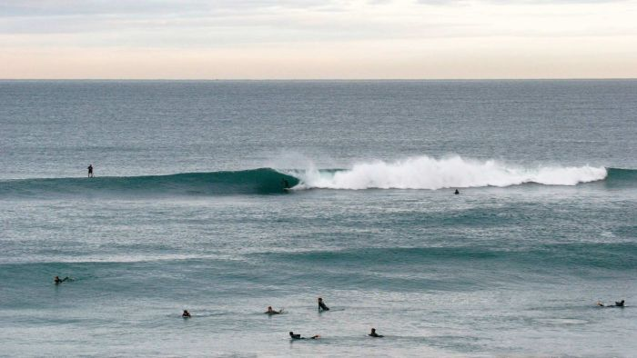

- **file**: `03_images/reefs/cables-reef-wa/cables-reef-wa_rwr-reef-surf-lineup_unknown-date.jpg`
- **kind**: photo
- **shows**: Clean peeling left-hand wave breaking with about eight surfers in the lineup, overcast light; the reef itself is submerged.
- **structure visible**: False
- **state shown**: as-built, in service (date unknown)
- **image date**: unknown (reef in service since Dec 1999; before 2019)
- **citation**: Raised Water Research (2019). Cables Reef [spot profile page]; image 'Cables Reef'. https://raisedwaterresearch.com/spot/artificial-reef/australia/western-australia/cables-reef/. Image file https://raisedwaterresearch.com/wp-content/uploads/2019/11/Cables-Reef.jpg. Accessed 2026-10-06.
- **image URL**: https://raisedwaterresearch.com/wp-content/uploads/2019/11/Cables-Reef.jpg
- **source page**: https://raisedwaterresearch.com/spot/artificial-reef/australia/western-australia/cables-reef/
- **page / figure**: page gallery image 'Cables-Reef.jpg'
- **credit**: Raised Water Research (a nearby page image is credited 'LifeOnPerth.com'; this file's own credit is not stated)
- **licence**: Unknown / all rights reserved (no licence on the page); link/research copy only - NOT cleared
- **retrieved**: 2026-10-06
- **used for**: context
- **How used for the model**: Page illustration of the surf effect (hero image recommended by the 2026-09-25 recheck). The page credits one image near the 'rideable waves ... 150 days per year' paragraph to LifeOnPerth.com without tying it to a file. No dimension read.
- **3D check pending**: no - none: surf photo without scale
- **linked records**: 02_research/reefs/cables-reef-wa.json images[0]; 05_qa/reef/cables-reef-wa_media_recheck.json images[0]
- **size**: 0.04 MB, 700x394 px
- **sha256**: d844f02f1fc33e5407ceb744d0ac0bed8472f816efc619166b811595d2b703b6
- **rights**: Private research copy; reuse rights to be checked before any public release.
- **display in HTML**: True
- **added by**: image-registry backfill, 2026-10-06

## cables-reef-wa-img-02 - cabletopturn.jpg: a surfer making a top turn at Cables (RWR)

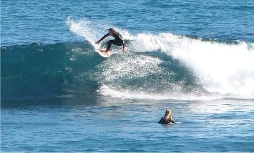

- **file**: `03_images/reefs/cables-reef-wa/cables-reef-wa_rwr-surfer-top-turn_unknown-date.jpg`
- **kind**: photo
- **shows**: A surfer performing a top turn on a clean wave face with another surfer in the water nearby.
- **structure visible**: False
- **state shown**: as-built, in service (date unknown)
- **image date**: unknown (reef in service since Dec 1999; before 2019)
- **citation**: Raised Water Research (2019). Cables Reef [spot profile page]; image 'cabletopturn'. https://raisedwaterresearch.com/spot/artificial-reef/australia/western-australia/cables-reef/. Image file https://raisedwaterresearch.com/wp-content/uploads/2019/11/cabletopturn.jpg. Accessed 2026-10-06.
- **image URL**: https://raisedwaterresearch.com/wp-content/uploads/2019/11/cabletopturn.jpg
- **source page**: https://raisedwaterresearch.com/spot/artificial-reef/australia/western-australia/cables-reef/
- **page / figure**: page gallery image 'cabletopturn.jpg'
- **credit**: Raised Water Research (photographer not stated)
- **licence**: Unknown / all rights reserved (no licence on the page); link/research copy only - NOT cleared
- **retrieved**: 2026-10-06
- **used for**: context
- **How used for the model**: Page illustration of the surf effect. No dimension read.
- **3D check pending**: no - none: surf photo
- **linked records**: 02_research/reefs/cables-reef-wa.json images[1]; 05_qa/reef/cables-reef-wa_media_recheck.json images[1]
- **size**: 0.03 MB, 501x301 px
- **sha256**: 615030aa901535ae625b092cfc4b808d9bf9de3432e9ce216ad7589e114ad9a4
- **rights**: Private research copy; reuse rights to be checked before any public release.
- **display in HTML**: True
- **added by**: image-registry backfill, 2026-10-06

## cables-reef-wa-img-03 - Cables-Reef-2.jpg: a surfer on a green wave breaking right-to-left over the reef (RWR)

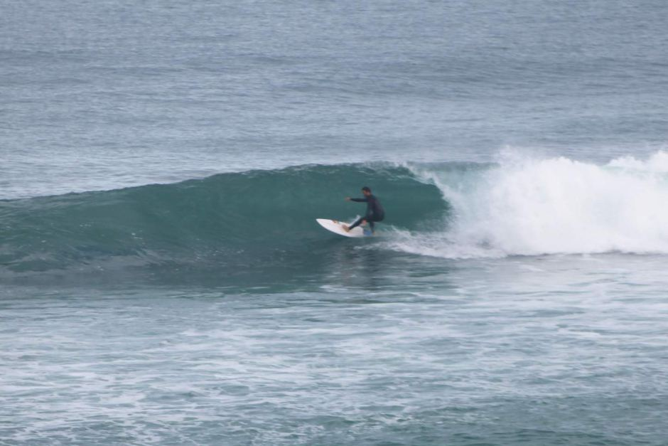

- **file**: `03_images/reefs/cables-reef-wa/cables-reef-wa_rwr-surf-wave-2_unknown-date.jpg`
- **kind**: photo
- **shows**: Surfer on a green wave face with whitewater breaking behind; the reef is not visible.
- **structure visible**: False
- **state shown**: as-built, in service (date unknown)
- **image date**: unknown (reef in service since Dec 1999; before 2019)
- **citation**: Raised Water Research (2019). Cables Reef [spot profile page]; image 'Cables Reef 2'. https://raisedwaterresearch.com/spot/artificial-reef/australia/western-australia/cables-reef/. Image file https://raisedwaterresearch.com/wp-content/uploads/2019/11/Cables-Reef-2.jpg. Accessed 2026-10-06.
- **image URL**: https://raisedwaterresearch.com/wp-content/uploads/2019/11/Cables-Reef-2.jpg
- **source page**: https://raisedwaterresearch.com/spot/artificial-reef/australia/western-australia/cables-reef/
- **page / figure**: page gallery image 'Cables-Reef-2.jpg'
- **credit**: Raised Water Research (photographer not stated)
- **licence**: Unknown / all rights reserved (no licence on the page); link/research copy only - NOT cleared
- **retrieved**: 2026-10-06
- **used for**: context
- **How used for the model**: Page illustration of the surf effect (not on the card). No dimension read.
- **3D check pending**: no - none: surf photo
- **linked records**: not on the card (found on the RWR page 2026-10-06); 05_qa/reef/cables-reef-wa_media_recheck.json
- **size**: 0.07 MB, 940x627 px
- **sha256**: ebad6b06800708dddaac06a8cb0b9a2b33599cff8fceb057e6b7c96ce6ddb5d8
- **rights**: Private research copy; reuse rights to be checked before any public release.
- **display in HTML**: True
- **added by**: image-registry backfill, 2026-10-06

## cables-reef-wa-img-04 - cablesmissed.jpg: a long, empty barrelling left-hand wave at Cables (RWR)

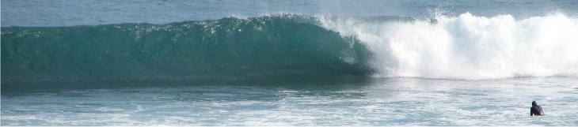

- **file**: `03_images/reefs/cables-reef-wa/cables-reef-wa_rwr-empty-wave_unknown-date.jpg`
- **kind**: photo
- **shows**: Wide crop of a clean hollow wave breaking with one surfer far right (alt text 'Cables Artificial Surfing Reef Empty').
- **structure visible**: False
- **state shown**: as-built, in service (date unknown)
- **image date**: unknown (reef in service since Dec 1999; before 2019)
- **citation**: Raised Water Research (2019). Cables Reef [spot profile page]; image 'cablesmissed'. https://raisedwaterresearch.com/spot/artificial-reef/australia/western-australia/cables-reef/. Image file https://raisedwaterresearch.com/wp-content/uploads/2019/11/cablesmissed.jpg. Accessed 2026-10-06.
- **image URL**: https://raisedwaterresearch.com/wp-content/uploads/2019/11/cablesmissed.jpg
- **source page**: https://raisedwaterresearch.com/spot/artificial-reef/australia/western-australia/cables-reef/
- **page / figure**: page gallery image 'cablesmissed.jpg'
- **credit**: Raised Water Research (photographer not stated)
- **licence**: Unknown / all rights reserved (no licence on the page); link/research copy only - NOT cleared
- **retrieved**: 2026-10-06
- **used for**: context
- **How used for the model**: Page illustration of the surf effect (not on the card). No dimension read.
- **3D check pending**: no - none: surf photo
- **linked records**: not on the card (found on the RWR page 2026-10-06); 05_qa/reef/cables-reef-wa_media_recheck.json
- **size**: 0.02 MB, 730x161 px
- **sha256**: 06bbac44c53db8800d503bc48f6d929a20a6043430a7a8b9e0eb006efa09b616
- **rights**: Private research copy; reuse rights to be checked before any public release.
- **display in HTML**: True
- **added by**: image-registry backfill, 2026-10-06

## cables-reef-wa-img-05 - Cables-Design.jpg: plan of the original reef design with depth contours (RWR; same file as Lior's Cable-reef-design.jpg)

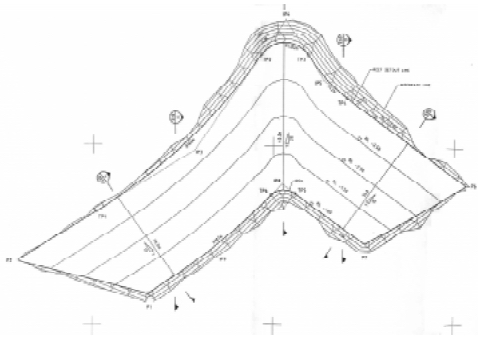

- **file**: `03_images/reefs/cables-reef-wa/cables-reef-wa_rwr-original-design-plan_1990s.jpg`
- **kind**: design_drawing
- **shows**: Plan-view contour drawing of the V/chevron reef (unequal arms, apex at the top of the sheet; the sheet orientation is not stated), with depth contours, dimension call-outs, benchmark marks and '+' grid ticks; no scale bar is legible.
- **structure visible**: True
- **state shown**: design (the original design, before the extension on the right)
- **image date**: design stage, 1990s (before Feb 1999 construction); exact date not stated
- **citation**: Raised Water Research (2019). Cables Reef [spot profile page]; image 'Cables Design (caption 'The original design.')'. https://raisedwaterresearch.com/spot/artificial-reef/australia/western-australia/cables-reef/. Image file https://raisedwaterresearch.com/wp-content/uploads/2019/11/Cables-Design.jpg. Accessed 2026-10-06. A byte-identical copy was supplied by Lior at 'Initial info from Lior/Cable-reef-design.jpg'.
- **image URL**: https://raisedwaterresearch.com/wp-content/uploads/2019/11/Cables-Design.jpg
- **source page**: https://raisedwaterresearch.com/spot/artificial-reef/australia/western-australia/cables-reef/
- **page / figure**: design section: 'After multiple studies and iterations, the Committee landed on the designs below.' - 'The original design.' (478 x 339 px)
- **credit**: Raised Water Research (drawing from the reef design reports; credit for this file not stated)
- **licence**: Unknown / all rights reserved (no licence on the page); link/research copy only - NOT cleared
- **retrieved**: 2026-10-06
- **used for**: cross_check
- **How used for the model**: Candidate plan source for the shape trace of Cables (not traced yet: no shape.json; METHOD.md stops at Step 1a). It was supplied by Lior as 'Cable-reef-design.jpg'. Needs a scale (e.g. the printed 140 m x 70 m or the dimension call-outs) before use.
- **3D check pending**: YES - Planform, V apex direction and arm lengths/angles of the original design vs the satellite-visible footprint and the text (140 m N-S x 70 m max width, 275 m offshore, 3-6 m depth); also contour values for seabed (values: planform, seabed, crest_z)
- **linked records**: Initial info from Lior/Cable-reef-design.jpg (byte-identical copy supplied by Lior); 07_scale/shapes/cables-reef-wa/METHOD.md; 02_research/reefs/cables-reef-wa.json (RWR design images)
- **size**: 0.06 MB, 478x339 px
- **sha256**: 4222f0a09b7e9c8f15f2f45b214c45517f64273bf3f24816130c95ddf77c16d2
- **rights**: Private research copy; reuse rights to be checked before any public release.
- **display in HTML**: True
- **added by**: image-registry backfill, 2026-10-06

## cables-reef-wa-img-06 - Cables-Additional-Fill-Area.jpg: plan of the extension to the right ('Additional fill area', volume 320 m3) (RWR)

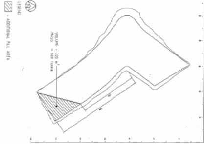

- **file**: `03_images/reefs/cables-reef-wa/cables-reef-wa_rwr-additional-fill-area-plan_1990s.jpg`
- **kind**: design_drawing
- **shows**: Plan outline of the V reef with a hatched triangular legend area 'ADDITIONAL FILL AREA' and a printed volume/mass annotation; the extension adds fill to one arm.
- **structure visible**: True
- **state shown**: design (extension of one arm)
- **image date**: design stage, 1990s
- **citation**: Raised Water Research (2019). Cables Reef [spot profile page]; image 'Cables Additional Fill Area (caption 'The extension to the right.')'. https://raisedwaterresearch.com/spot/artificial-reef/australia/western-australia/cables-reef/. Image file https://raisedwaterresearch.com/wp-content/uploads/2019/11/Cables-Additional-Fill-Area.jpg. Accessed 2026-10-06.
- **image URL**: https://raisedwaterresearch.com/wp-content/uploads/2019/11/Cables-Additional-Fill-Area.jpg
- **source page**: https://raisedwaterresearch.com/spot/artificial-reef/australia/western-australia/cables-reef/
- **page / figure**: design section: 'The extension to the right.' (417 x 296 px)
- **credit**: Raised Water Research (drawing from the reef design reports; credit for this file not stated)
- **licence**: Unknown / all rights reserved (no licence on the page); link/research copy only - NOT cleared
- **retrieved**: 2026-10-06
- **used for**: cross_check
- **How used for the model**: Evidence that the reef was extended on one arm (so the built planform differs from the original design); not traced. Text annotation 'volume 320 m3 / mass 688 tonne' is rotated and small - not verified.
- **3D check pending**: YES - Planform change from the original design: the extension arm and its fill volume vs the footprint measured on satellite or other imagery (values: planform, volume)
- **linked records**: 02_research/reefs/cables-reef-wa.json (RWR design images); Initial info from Lior/Cables-reef-more-info-and-design.png (shows this figure as 'The extension to the right')
- **size**: 0.02 MB, 417x296 px
- **sha256**: bfe40e48bcdbc5e2457e36504a82132e60052199211501cd46533020df90cae2
- **rights**: Private research copy; reuse rights to be checked before any public release.
- **display in HTML**: True
- **added by**: image-registry backfill, 2026-10-06

## cables-reef-wa-img-07 - Cables-Drawing.jpg: sketch plan 'PLAN - PROPOSED CABLES SURFING REEF' (Pitt sketch, RWR)

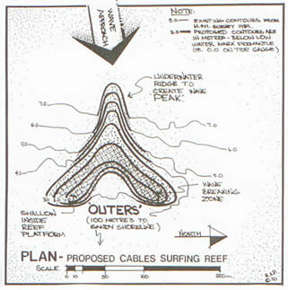

- **file**: `03_images/reefs/cables-reef-wa/cables-reef-wa_rwr-pitt-sketch-plan_1990s.jpg`
- **kind**: design_drawing
- **shows**: Hand-drawn plan of the proposed V reef ('OUTERS', 100 m to shoreline, wave approach arrow, north arrow, depth contours 3-7 m, scale bar 0-10-50-100-200 m) with notes on wave breaking zone, shallow inside reef platform and underwater ridge to create the peak.
- **structure visible**: True
- **state shown**: design (early concept)
- **image date**: 1991 (the sketches are signed/dated '91' per the drawing; best bound) - concept stage
- **citation**: Raised Water Research (2019). Cables Reef [spot profile page]; image 'Cables Drawing'. https://raisedwaterresearch.com/spot/artificial-reef/australia/western-australia/cables-reef/. Image file https://raisedwaterresearch.com/wp-content/uploads/2019/11/Cables-Drawing.jpg. Accessed 2026-10-06.
- **image URL**: https://raisedwaterresearch.com/wp-content/uploads/2019/11/Cables-Drawing.jpg
- **source page**: https://raisedwaterresearch.com/spot/artificial-reef/australia/western-australia/cables-reef/
- **page / figure**: page gallery image 'Cables-Drawing.jpg'
- **credit**: Pitt (Andrew Pitt, SurfingRamps.com.au; credit per the RWR page 'Image: Pitt' - the page does not tie it to this file)
- **licence**: Unknown / all rights reserved (no licence on the page); link/research copy only - NOT cleared
- **retrieved**: 2026-10-06
- **used for**: context; cross_check
- **How used for the model**: Early concept sketch (the page credits 'Image: Pitt' to Andrew Pitt, who supplied sketches). It carries a scale bar and depth contours (3.0-7.0 m labelled), so it could give an approximate planform and the distance-to-shore note (100 m); not traced yet.
- **3D check pending**: YES - Concept planform/contours vs the built reef (peak and wing geometry, depth contours 3-7 m) (values: planform, seabed)
- **linked records**: 02_research/reefs/cables-reef-wa.json (RWR design images)
- **size**: 0.02 MB, 321x323 px
- **sha256**: 7a4d3af15d7c172deb0079cbd80d3f9f87ddf43f5f7d5277d117ecb8a6095ea5
- **rights**: Private research copy; reuse rights to be checked before any public release.
- **display in HTML**: True
- **added by**: image-registry backfill, 2026-10-06
- **notes**: Date '91' read from the faint signature on the drawing; not verified.

## cables-reef-wa-img-08 - Cables-Drawing-2.jpg: 'FRONTAL ELEVATION - PROPOSED CABLES SURFING REEF' sketch (Pitt, RWR)

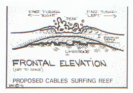

- **file**: `03_images/reefs/cables-reef-wa/cables-reef-wa_rwr-pitt-sketch-frontal_1990s.jpg`
- **kind**: cross_section
- **shows**: Hand-drawn frontal elevation: a peaked limestone/boulder reef with 'fast turning right' and 'fast turning left' arrows and a 'minimum depth' label; not to scale.
- **structure visible**: True
- **state shown**: design (early concept)
- **image date**: 1991 (the sketches are signed/dated '91' per the drawing; best bound) - concept stage
- **citation**: Raised Water Research (2019). Cables Reef [spot profile page]; image 'Cables Drawing 2'. https://raisedwaterresearch.com/spot/artificial-reef/australia/western-australia/cables-reef/. Image file https://raisedwaterresearch.com/wp-content/uploads/2019/11/Cables-Drawing-2.jpg. Accessed 2026-10-06.
- **image URL**: https://raisedwaterresearch.com/wp-content/uploads/2019/11/Cables-Drawing-2.jpg
- **source page**: https://raisedwaterresearch.com/spot/artificial-reef/australia/western-australia/cables-reef/
- **page / figure**: page gallery image 'Cables-Drawing-2.jpg'
- **credit**: Pitt (per the RWR page credit 'Image: Pitt')
- **licence**: Unknown / all rights reserved (no licence on the page); link/research copy only - NOT cleared
- **retrieved**: 2026-10-06
- **used for**: context
- **How used for the model**: Concept sketch of the reef profile (not to scale); no dimension read.
- **3D check pending**: no - none: unscaled concept sketch
- **linked records**: 02_research/reefs/cables-reef-wa.json (RWR design images)
- **size**: 0.05 MB, 270x189 px
- **sha256**: 0e03f4a7a56946e55dd196bba3d0483efdc23b8a3d0f47c5021a000d7af88a9b
- **rights**: Private research copy; reuse rights to be checked before any public release.
- **display in HTML**: True
- **added by**: image-registry backfill, 2026-10-06
- **notes**: Date '91' read from the faint signature on the drawing; not verified.

## cables-reef-wa-img-09 - Cables-Drawing-3.jpg: 'SECTIONAL ELEVATION' sketch (thick concrete capping, large boulders, limestone bedrock, re-growth of marine weed) (RWR)

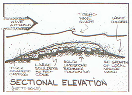

- **file**: `03_images/reefs/cables-reef-wa/cables-reef-wa_rwr-pitt-sketch-section_1990s.jpg`
- **kind**: cross_section
- **shows**: Hand-drawn section of the reef with wave approach and turning wave shape: thick concrete capping, large boulders as reef core, solid limestone bedrock foundation and re-growth of local marine weed; not to scale.
- **structure visible**: True
- **state shown**: design (early concept)
- **image date**: 1991 (the sketches are signed/dated '91' per the drawing; best bound) - concept stage
- **citation**: Raised Water Research (2019). Cables Reef [spot profile page]; image 'Cables Drawing 3'. https://raisedwaterresearch.com/spot/artificial-reef/australia/western-australia/cables-reef/. Image file https://raisedwaterresearch.com/wp-content/uploads/2019/11/Cables-Drawing-3.jpg. Accessed 2026-10-06.
- **image URL**: https://raisedwaterresearch.com/wp-content/uploads/2019/11/Cables-Drawing-3.jpg
- **source page**: https://raisedwaterresearch.com/spot/artificial-reef/australia/western-australia/cables-reef/
- **page / figure**: page gallery image 'Cables-Drawing-3.jpg'
- **credit**: Pitt (per the RWR page credit 'Image: Pitt')
- **licence**: Unknown / all rights reserved (no licence on the page); link/research copy only - NOT cleared
- **retrieved**: 2026-10-06
- **used for**: context
- **How used for the model**: Concept sketch of the reef construction layers (not to scale); no dimension read.
- **3D check pending**: no - none: unscaled concept sketch
- **linked records**: 02_research/reefs/cables-reef-wa.json (RWR design images)
- **size**: 0.06 MB, 268x194 px
- **sha256**: 6fe4d0e483ea01e17aaf56190504b8e0e66faedbedb55bff44c5b366bd25f37f
- **rights**: Private research copy; reuse rights to be checked before any public release.
- **display in HTML**: True
- **added by**: image-registry backfill, 2026-10-06
- **notes**: Date '91' read from the faint signature on the drawing; not verified.

## cables-reef-wa-img-10 - Cables-Side-View.jpg: 'Side view of Cables Reef' - existing sea bed and proposed enhancement (RWR)

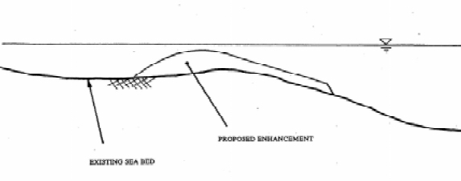

- **file**: `03_images/reefs/cables-reef-wa/cables-reef-wa_rwr-side-view-section_1990s.jpg`
- **kind**: cross_section
- **shows**: Hand-drawn cross-section labelled 'EXISTING SEA BED' and 'PROPOSED ENHANCEMENT': a rock mound raising the seabed profile, with the water surface line.
- **structure visible**: True
- **state shown**: design (typical cross-section)
- **image date**: design stage, 1990s (same as Pattiaratchi 1999 Fig. 3)
- **citation**: Raised Water Research (2019). Cables Reef [spot profile page]; image 'Cables Side View (caption 'Side view of Cables Reef.')'. https://raisedwaterresearch.com/spot/artificial-reef/australia/western-australia/cables-reef/. Image file https://raisedwaterresearch.com/wp-content/uploads/2019/11/Cables-Side-View.jpg. Accessed 2026-10-06.
- **image URL**: https://raisedwaterresearch.com/wp-content/uploads/2019/11/Cables-Side-View.jpg
- **source page**: https://raisedwaterresearch.com/spot/artificial-reef/australia/western-australia/cables-reef/
- **page / figure**: design section (573 x 226 px)
- **credit**: Raised Water Research (drawing from the reef design reports; credit for this file not stated)
- **licence**: Unknown / all rights reserved (no licence on the page); link/research copy only - NOT cleared
- **retrieved**: 2026-10-06
- **used for**: cross_check
- **How used for the model**: Qualitative cross-section (no scale): the same drawing as Fig. 3 of the Pattiaratchi 1999 paper; supports the crest/slope description (mound with a gentle shoreward and a steeper seaward face) but no number was read.
- **3D check pending**: YES - Cross-section shape (gentle back / steeper front) vs the 3D crest and slopes once a model exists; text gives crest 1-3 m below the surface and slope 1:20 in the lab design (values: height_above_seabed, crest_z)
- **linked records**: 02_research/reefs/cables-reef-wa.json images[2]; 05_qa/reef/cables-reef-wa_media_recheck.json images[2]; 07_scale/shapes/cables-reef-wa/src/S1_pattiaratchi_reefdesign.pdf (Fig. 3)
- **size**: 0.03 MB, 573x226 px
- **sha256**: d2803294efb2b34e846976f2ef3abf68acf50ea9b73e132cb1e236f00615f544
- **rights**: Private research copy; reuse rights to be checked before any public release.
- **display in HTML**: True
- **added by**: image-registry backfill, 2026-10-06

## cables-reef-wa-img-11 - Cables-Before.jpg: table of surf days / breaker height at the Cables site BEFORE the reef (RWR)

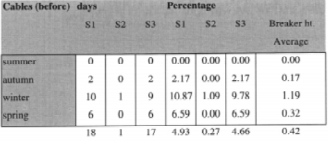

- **file**: `03_images/reefs/cables-reef-wa/cables-reef-wa_rwr-stats-before_1999.jpg`
- **kind**: diagram
- **shows**: Table (not a picture of the reef): days with surfable waves per season for S1-S3 and percentages and average breaker height at Cables before the reef (e.g. winter 10 days, 4.93% overall).
- **structure visible**: False
- **state shown**: as-built (performance data 1999)
- **image date**: monitoring through 1999
- **citation**: Raised Water Research (2019). Cables Reef [spot profile page]; image 'Cables Before'. https://raisedwaterresearch.com/spot/artificial-reef/australia/western-australia/cables-reef/. Image file https://raisedwaterresearch.com/wp-content/uploads/2019/11/Cables-Before.jpg. Accessed 2026-10-06.
- **image URL**: https://raisedwaterresearch.com/wp-content/uploads/2019/11/Cables-Before.jpg
- **source page**: https://raisedwaterresearch.com/spot/artificial-reef/australia/western-australia/cables-reef/
- **page / figure**: results section (table image)
- **credit**: Raised Water Research (tables from the 1999 monitoring study; original author per the page text: Stacey Bancroft)
- **licence**: Unknown / all rights reserved (no licence on the page); link/research copy only - NOT cleared
- **retrieved**: 2026-10-06
- **used for**: context
- **How used for the model**: Performance data for the card (pre-reef baseline); not a geometry source. Shows no reef structure.
- **3D check pending**: no - none: statistics table
- **linked records**: 02_research/reefs/cables-reef-wa.json (performance claims)
- **size**: 0.05 MB, 474x206 px
- **sha256**: b46792e65162fd75f9ed5d62ef12ccafe752a88d9fed154796cf5b44fe1e6bd9
- **rights**: Private research copy; reuse rights to be checked before any public release.
- **display in HTML**: True
- **added by**: image-registry backfill, 2026-10-06
- **notes**: Not a reef image; registered as a data figure because it is hosted as an image on the page.

## cables-reef-wa-img-12 - Cables-After.jpg: table of surf days / breaker height at Cables AFTER the reef (RWR)

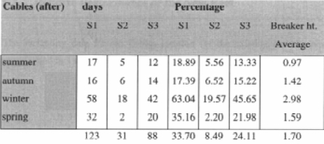

- **file**: `03_images/reefs/cables-reef-wa/cables-reef-wa_rwr-stats-after_1999.jpg`
- **kind**: diagram
- **shows**: Table (not a picture of the reef): days with surfable waves per season after the reef (e.g. winter 58 days, 33.70% overall, average breaker height 1.70 m).
- **structure visible**: False
- **state shown**: as-built (performance data 1999)
- **image date**: monitoring through 1999
- **citation**: Raised Water Research (2019). Cables Reef [spot profile page]; image 'Cables After'. https://raisedwaterresearch.com/spot/artificial-reef/australia/western-australia/cables-reef/. Image file https://raisedwaterresearch.com/wp-content/uploads/2019/11/Cables-After.jpg. Accessed 2026-10-06.
- **image URL**: https://raisedwaterresearch.com/wp-content/uploads/2019/11/Cables-After.jpg
- **source page**: https://raisedwaterresearch.com/spot/artificial-reef/australia/western-australia/cables-reef/
- **page / figure**: results section (table image)
- **credit**: Raised Water Research (tables from the 1999 monitoring study; original author per the page text: Stacey Bancroft)
- **licence**: Unknown / all rights reserved (no licence on the page); link/research copy only - NOT cleared
- **retrieved**: 2026-10-06
- **used for**: context
- **How used for the model**: Performance data for the card (post-reef); not a geometry source. Shows no reef structure.
- **3D check pending**: no - none: statistics table
- **linked records**: 02_research/reefs/cables-reef-wa.json (performance claims)
- **size**: 0.05 MB, 464x206 px
- **sha256**: ef459603f162be51aae7ad9fb21b248336c7cf6f0a06955685021d2887a7eea6
- **rights**: Private research copy; reuse rights to be checked before any public release.
- **display in HTML**: True
- **added by**: image-registry backfill, 2026-10-06
- **notes**: Not a reef image; registered as a data figure because it is hosted as an image on the page.

## cables-reef-wa-img-13 - Stacey-Observations-from-Study.jpg: observed vs predicted breaking / surfable days per month at Cables (RWR)

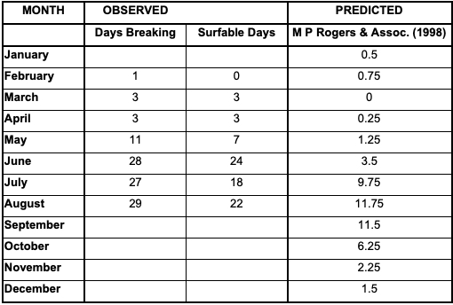

- **file**: `03_images/reefs/cables-reef-wa/cables-reef-wa_rwr-stacey-observations_1999.jpg`
- **kind**: diagram
- **shows**: Table (not a picture of the reef): observed days breaking and surfable days by month (Feb-Aug 1999) against the M P Rogers & Assoc. (1998) prediction.
- **structure visible**: False
- **state shown**: as-built (performance data 1999)
- **image date**: monitoring through 1999
- **citation**: Raised Water Research (2019). Cables Reef [spot profile page]; image 'Stacey Observations from Study'. https://raisedwaterresearch.com/spot/artificial-reef/australia/western-australia/cables-reef/. Image file https://raisedwaterresearch.com/wp-content/uploads/2019/11/Stacey-Observations-from-Study.jpg. Accessed 2026-10-06.
- **image URL**: https://raisedwaterresearch.com/wp-content/uploads/2019/11/Stacey-Observations-from-Study.jpg
- **source page**: https://raisedwaterresearch.com/spot/artificial-reef/australia/western-australia/cables-reef/
- **page / figure**: results section (table image)
- **credit**: Raised Water Research (tables from the 1999 monitoring study; original author per the page text: Stacey Bancroft)
- **licence**: Unknown / all rights reserved (no licence on the page); link/research copy only - NOT cleared
- **retrieved**: 2026-10-06
- **used for**: context
- **How used for the model**: Performance data (Stacey Bancroft's 1999 monitoring study vs the 1998 prediction); not a geometry source. Shows no reef structure.
- **3D check pending**: no - none: statistics table
- **linked records**: 02_research/reefs/cables-reef-wa.json (performance claims)
- **size**: 0.07 MB, 510x344 px
- **sha256**: 7be066b4c41da89459d212125fbbf9c2281274de88fe468f7fcaa3be6e07e3c4
- **rights**: Private research copy; reuse rights to be checked before any public release.
- **display in HTML**: True
- **added by**: image-registry backfill, 2026-10-06
- **notes**: Not a reef image; registered as a data figure because it is hosted as an image on the page.

## cables-reef-wa-img-14 - Screenshot supplied by Lior: RWR Cables page section 'The original design / The extension to the right / Side view of Cables Reef' with the size text

- **file**: `Initial info from Lior/Cables-reef-more-info-and-design.png`
- **kind**: diagram
- **shows**: Three figures (original design plan, extension plan, side view) with the page text: reef length about 140 m N-S, max width 70 m, about 275 m offshore in 3-6 m of water, crest 1-3 m below the surface on average tides.
- **structure visible**: True
- **state shown**: design
- **image date**: screenshot before 2026-10-04 (page content 2019)
- **citation**: Screenshot by Lior (before 2026-10-04) of: Raised Water Research (2019). Cables Reef [spot profile page], design section. https://raisedwaterresearch.com/spot/artificial-reef/australia/western-australia/cables-reef/. Registered from Lior's folder 'Initial info from Lior' on 2026-10-06 (not copied).
- **source page**: https://raisedwaterresearch.com/spot/artificial-reef/australia/western-australia/cables-reef/
- **page / figure**: screenshot of the design section
- **credit**: Raised Water Research (content); screenshot supplied by Lior
- **licence**: RWR content: no licence stated, all rights reserved; private copy
- **retrieved**: 2026-10-04 (supplied)
- **used for**: context
- **How used for the model**: Not used directly; its three figures are registered individually from the original files (design plan, additional fill area, side view). The text values 140 m / 70 m / 275 m / 3-6 m / crest 1-3 m are the dossier's dimension source.
- **3D check pending**: no - none: duplicate composite of registered figures
- **linked records**: Initial info from Lior/Cable-reef-design.jpg
- **size**: 0.16 MB, 664x657 px
- **sha256**: a49aa92d058a0bcefee6124150be0991470b9dad94de767e3e954cb4e8c5c046
- **rights**: Private research copy; reuse rights to be checked before any public release.
- **display in HTML**: False
- **added by**: image-registry backfill, 2026-10-06
- **notes**: display false: duplicate composite of rows registered individually; kept so Lior's supplied file is documented.

## cables-reef-wa-img-15 - Pattiaratchi (1999) Fig. 1: location map showing bathymetry and study sites (Cable Station, Fremantle / Cottesloe, Perth)

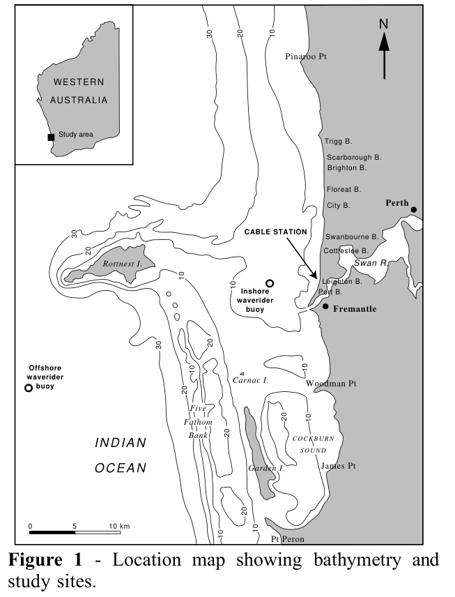

- **file**: `03_images/reefs/cables-reef-wa/cables-reef-wa_pattiaratchi1999-fig1-location-map_1999.png`
- **kind**: plan_figure
- **shows**: Regional map of the Perth coast with 10/20/30 m bathymetry, the Cable Station site (arrow) between Cottesloe and Fremantle, the inshore and offshore waverider buoys, Rottnest Island and Cockburn Sound.
- **structure visible**: False
- **state shown**: not applicable (location map)
- **image date**: 1999
- **citation**: Pattiaratchi, C. (1999). Design Studies for an Artificial Surfing Reef: Cable Station, Western Australia. Centre for Water Research, University of Western Australia, report ref. ED1483CP (5 pp.; PDF created 1999-04-13), p.2, Figure 1 'Location map showing bathymetry and study sites.' (vector figure rendered at 200 dpi and cropped). http://joas.free.fr/studies/bei/g2s/reefdesign.pdf (mirror; byte-identical re-download 2026-10-05, MD5 02a6075b1eac84a68180bbfd89226fea). Accessed 2026-10-05.
- **image URL**: http://joas.free.fr/studies/bei/g2s/reefdesign.pdf
- **source page**: http://joas.free.fr/studies/bei/g2s/reefdesign.pdf
- **page / figure**: PDF p.2, Figure 1
- **credit**: C. Pattiaratchi / Centre for Water Research, UWA
- **licence**: unknown / all rights reserved - private research copy
- **retrieved**: 2026-10-06
- **used for**: context
- **How used for the model**: Context only: confirms the site location and the offshore/inshore waverider buoy positions; no value used.
- **3D check pending**: no - none: regional location map
- **source PDF**: `07_scale/shapes/cables-reef-wa/src/S1_pattiaratchi_reefdesign.pdf`
- **linked records**: 07_scale/shapes/cables-reef-wa/sources.md S1; 07_scale/shapes/cables-reef-wa/src/S1_fig1_sitemap_full_page.png
- **size**: 0.10 MB, 653x856 px
- **sha256**: 91962d0d94c1dd37617b46f6e6ef45c7cc8bfad42fa617cdb4d096d7cede172b
- **rights**: Private research copy; reuse rights to be checked before any public release.
- **display in HTML**: True
- **added by**: image-registry backfill, 2026-10-06

## cables-reef-wa-img-16 - Pattiaratchi (1999) Fig. 3: conceptual design of the proposed enhancement (typical cross-section of existing reef and proposed enhancement)

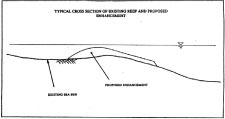

- **file**: `03_images/reefs/cables-reef-wa/cables-reef-wa_pattiaratchi1999-fig3-conceptual-cross-section_1999.png`
- **kind**: cross_section
- **shows**: Typical cross-section of the existing reef with the proposed enhancement mound and the water surface (not to scale).
- **structure visible**: True
- **state shown**: design (1999 design studies; reef built Feb-Dec 1999)
- **image date**: 1999
- **citation**: Pattiaratchi, C. (1999). Design Studies for an Artificial Surfing Reef: Cable Station, Western Australia. Centre for Water Research, University of Western Australia, report ref. ED1483CP (5 pp.; PDF created 1999-04-13), p.3, Figure 3 (embedded raster, native resolution). http://joas.free.fr/studies/bei/g2s/reefdesign.pdf (mirror; byte-identical re-download 2026-10-05, MD5 02a6075b1eac84a68180bbfd89226fea). Accessed 2026-10-05.
- **image URL**: http://joas.free.fr/studies/bei/g2s/reefdesign.pdf
- **source page**: http://joas.free.fr/studies/bei/g2s/reefdesign.pdf
- **page / figure**: PDF p.3, Figure 3 (embedded raster xref 25)
- **credit**: C. Pattiaratchi / Centre for Water Research, UWA
- **licence**: unknown / all rights reserved - private research copy
- **retrieved**: 2026-10-06
- **used for**: cross_check
- **How used for the model**: Same drawing as RWR 'Side view of Cables Reef'; qualitative (a 1:20 slope step in the lab tests is stated in the text).
- **3D check pending**: no - none: qualitative duplicate of the RWR side view
- **source PDF**: `07_scale/shapes/cables-reef-wa/src/S1_pattiaratchi_reefdesign.pdf`
- **linked records**: 07_scale/shapes/cables-reef-wa/sources.md S1; 07_scale/shapes/cables-reef-wa/METHOD.md step 1a
- **size**: 0.01 MB, 225x119 px
- **sha256**: 520c4cc7789bd614cd9a39a5f74fbe0e2e20f19b339ddd522e81cf377283b018
- **rights**: Private research copy; reuse rights to be checked before any public release.
- **display in HTML**: True
- **added by**: image-registry backfill, 2026-10-06

## cables-reef-wa-img-17 - Pattiaratchi (1999) Fig. 4: final design of the Cable Station artificial reef (3D contour sketch used in the wave-basin tests)

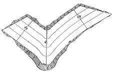

- **file**: `03_images/reefs/cables-reef-wa/cables-reef-wa_pattiaratchi1999-fig4-final-design-wave-basin_1999.png`
- **kind**: design_drawing
- **shows**: Oblique contour sketch of the final V/chevron design with unequal arms as built in the wave basin; no scale.
- **structure visible**: True
- **state shown**: design (1999 design studies; reef built Feb-Dec 1999)
- **image date**: 1999
- **citation**: Pattiaratchi, C. (1999). Design Studies for an Artificial Surfing Reef: Cable Station, Western Australia. Centre for Water Research, University of Western Australia, report ref. ED1483CP (5 pp.; PDF created 1999-04-13), p.3, Figure 4 (embedded raster, native resolution). http://joas.free.fr/studies/bei/g2s/reefdesign.pdf (mirror; byte-identical re-download 2026-10-05, MD5 02a6075b1eac84a68180bbfd89226fea). Accessed 2026-10-05.
- **image URL**: http://joas.free.fr/studies/bei/g2s/reefdesign.pdf
- **source page**: http://joas.free.fr/studies/bei/g2s/reefdesign.pdf
- **page / figure**: PDF p.3, Figure 4 (embedded raster xref 26)
- **credit**: C. Pattiaratchi / Centre for Water Research, UWA
- **licence**: unknown / all rights reserved - private research copy
- **retrieved**: 2026-10-06
- **used for**: cross_check
- **How used for the model**: Qualitative only: oblique, no scale, so not traceable in plan (METHOD.md step 1a); gives the V typology with unequal arms.
- **3D check pending**: YES - V arm lengths/angles of the final design vs the satellite-visible footprint and the text (left-hander 30-40 m, right-hander 50-80 m) (values: planform)
- **source PDF**: `07_scale/shapes/cables-reef-wa/src/S1_pattiaratchi_reefdesign.pdf`
- **linked records**: 07_scale/shapes/cables-reef-wa/sources.md S1; 07_scale/shapes/cables-reef-wa/METHOD.md step 1a
- **size**: 0.01 MB, 226x145 px
- **sha256**: 19a2834b899aeaa8802c8897b01cda14c4105f7f10fc45bd53d48c9896606a08
- **rights**: Private research copy; reuse rights to be checked before any public release.
- **display in HTML**: True
- **added by**: image-registry backfill, 2026-10-06

## cables-reef-wa-img-18 - Pattiaratchi (1999) Fig. 5: performance of the existing reef at Cable Station (peel angle vs breaker height)

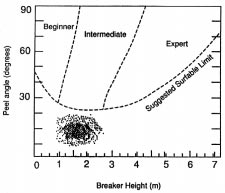

- **file**: `03_images/reefs/cables-reef-wa/cables-reef-wa_pattiaratchi1999-fig5-existing-reef-performance_1999.png`
- **kind**: chart_screenshot
- **shows**: Scatter of predicted wave conditions on the peel angle / breaker height classification (beginner, intermediate, expert, suggested surfable limit) for the existing reef: mostly below the surfable limit.
- **structure visible**: False
- **state shown**: design (1999 design studies; reef built Feb-Dec 1999)
- **image date**: 1999
- **citation**: Pattiaratchi, C. (1999). Design Studies for an Artificial Surfing Reef: Cable Station, Western Australia. Centre for Water Research, University of Western Australia, report ref. ED1483CP (5 pp.; PDF created 1999-04-13), p.4, Figure 5 (embedded raster, native resolution). http://joas.free.fr/studies/bei/g2s/reefdesign.pdf (mirror; byte-identical re-download 2026-10-05, MD5 02a6075b1eac84a68180bbfd89226fea). Accessed 2026-10-05.
- **image URL**: http://joas.free.fr/studies/bei/g2s/reefdesign.pdf
- **source page**: http://joas.free.fr/studies/bei/g2s/reefdesign.pdf
- **page / figure**: PDF p.4, Figure 5 (embedded raster xref 30)
- **credit**: C. Pattiaratchi / Centre for Water Research, UWA
- **licence**: unknown / all rights reserved - private research copy
- **retrieved**: 2026-10-06
- **used for**: context
- **How used for the model**: Context: shows why the existing reef is rarely surfable; no model value used.
- **3D check pending**: no - none: wave statistics chart
- **source PDF**: `07_scale/shapes/cables-reef-wa/src/S1_pattiaratchi_reefdesign.pdf`
- **linked records**: 07_scale/shapes/cables-reef-wa/sources.md S1; 07_scale/shapes/cables-reef-wa/METHOD.md step 1a
- **size**: 0.01 MB, 225x193 px
- **sha256**: 03e289658215ebfd663419a71b203e3d73b40f3e941c87c44bbac956a5487bea
- **rights**: Private research copy; reuse rights to be checked before any public release.
- **display in HTML**: True
- **added by**: image-registry backfill, 2026-10-06

## cables-reef-wa-img-19 - Pattiaratchi (1999) Fig. 6: performance of the proposed artificial reef (peel angle vs breaker height)

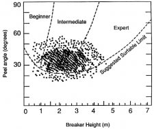

- **file**: `03_images/reefs/cables-reef-wa/cables-reef-wa_pattiaratchi1999-fig6-proposed-reef-performance_1999.png`
- **kind**: chart_screenshot
- **shows**: Scatter of predicted wave conditions for the proposed reef: clustered at peel angles about 30-45 deg and breaker heights 1-4 m, in the beginner/intermediate fields.
- **structure visible**: False
- **state shown**: design (1999 design studies; reef built Feb-Dec 1999)
- **image date**: 1999
- **citation**: Pattiaratchi, C. (1999). Design Studies for an Artificial Surfing Reef: Cable Station, Western Australia. Centre for Water Research, University of Western Australia, report ref. ED1483CP (5 pp.; PDF created 1999-04-13), p.4, Figure 6 (embedded raster, native resolution). http://joas.free.fr/studies/bei/g2s/reefdesign.pdf (mirror; byte-identical re-download 2026-10-05, MD5 02a6075b1eac84a68180bbfd89226fea). Accessed 2026-10-05.
- **image URL**: http://joas.free.fr/studies/bei/g2s/reefdesign.pdf
- **source page**: http://joas.free.fr/studies/bei/g2s/reefdesign.pdf
- **page / figure**: PDF p.4, Figure 6 (embedded raster xref 31)
- **credit**: C. Pattiaratchi / Centre for Water Research, UWA
- **licence**: unknown / all rights reserved - private research copy
- **retrieved**: 2026-10-06
- **used for**: context
- **How used for the model**: Context: design performance claim (peel angle about 45 deg); no model value used.
- **3D check pending**: no - none: wave statistics chart
- **source PDF**: `07_scale/shapes/cables-reef-wa/src/S1_pattiaratchi_reefdesign.pdf`
- **linked records**: 07_scale/shapes/cables-reef-wa/sources.md S1; 07_scale/shapes/cables-reef-wa/METHOD.md step 1a
- **size**: 0.02 MB, 225x189 px
- **sha256**: eb8bda7b0e06daa794f55a27e8542c29945e78975e159c77333420d56e8f78ea
- **rights**: Private research copy; reuse rights to be checked before any public release.
- **display in HTML**: True
- **added by**: image-registry backfill, 2026-10-06

## cables-reef-wa-img-20 - Pattiaratchi (1999) Fig. 7: the geographic location of the proposed surfing reef at Cable Station (plan map, printed rotated 90 deg, V outline over depth contours)

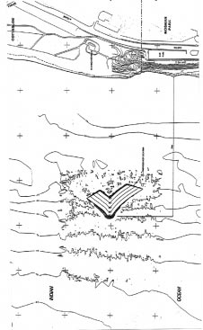

- **file**: `03_images/reefs/cables-reef-wa/cables-reef-wa_pattiaratchi1999-fig7-geographic-location_1999.png`
- **kind**: plan_figure
- **shows**: Plan map (printed rotated 90 deg, north to the left) of the Cable Station shore with Cottesloe / Mosman Park labels, roads, depth contours and the bold V outline of the reef with internal contour lines; the apex points offshore.
- **structure visible**: True
- **state shown**: design (1999 design studies; reef built Feb-Dec 1999)
- **image date**: 1999
- **citation**: Pattiaratchi, C. (1999). Design Studies for an Artificial Surfing Reef: Cable Station, Western Australia. Centre for Water Research, University of Western Australia, report ref. ED1483CP (5 pp.; PDF created 1999-04-13), p.4, Figure 7 (embedded raster, native resolution). http://joas.free.fr/studies/bei/g2s/reefdesign.pdf (mirror; byte-identical re-download 2026-10-05, MD5 02a6075b1eac84a68180bbfd89226fea). Accessed 2026-10-05.
- **image URL**: http://joas.free.fr/studies/bei/g2s/reefdesign.pdf
- **source page**: http://joas.free.fr/studies/bei/g2s/reefdesign.pdf
- **page / figure**: PDF p.4, Figure 7 (embedded raster xref 32)
- **credit**: C. Pattiaratchi / Centre for Water Research, UWA
- **licence**: unknown / all rights reserved - private research copy
- **retrieved**: 2026-10-06
- **used for**: plan_trace; cross_check
- **How used for the model**: Resolved the V apex direction (apex offshore = west) from the printed rotation (METHOD.md step 1a). Only 226 x 367 px at ~1 px per point, no scale bar read yet, so the outline has not been traced.
- **3D check pending**: YES - Apex direction (offshore) and V outline position/orientation vs the satellite and the 275 m offshore text; use the '+' grid marks as scale if their spacing is known (values: planform, position)
- **source PDF**: `07_scale/shapes/cables-reef-wa/src/S1_pattiaratchi_reefdesign.pdf`
- **linked records**: 07_scale/shapes/cables-reef-wa/sources.md S1; 07_scale/shapes/cables-reef-wa/METHOD.md step 1a
- **size**: 0.03 MB, 226x367 px
- **sha256**: 5ce314619e3bfabfd48952692ecd3533686b9cf371d85cb59c9419079df1cd44
- **rights**: Private research copy; reuse rights to be checked before any public release.
- **display in HTML**: True
- **added by**: image-registry backfill, 2026-10-06

## cables-reef-wa-img-21 - Pattiaratchi (1999) page 2 full-page render (Fig. 1 location map and Fig. 2 wave classification)

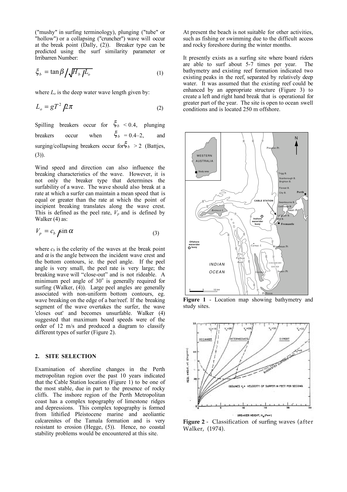

- **file**: `07_scale/shapes/cables-reef-wa/src/S1_fig1_sitemap_full_page.png`
- **kind**: diagram
- **shows**: Full page 2 of the paper: text on breaker types and surf quality, Figure 1 (location map with bathymetry) and Figure 2 (classification of surfing waves).
- **structure visible**: False
- **state shown**: not applicable (paper page)
- **image date**: 1999
- **citation**: Pattiaratchi, C. (1999). Design Studies for an Artificial Surfing Reef: Cable Station, Western Australia. Centre for Water Research, University of Western Australia, report ref. ED1483CP (5 pp.; PDF created 1999-04-13), p.2 (full-page render of the PDF page). http://joas.free.fr/studies/bei/g2s/reefdesign.pdf (mirror; byte-identical re-download 2026-10-05, MD5 02a6075b1eac84a68180bbfd89226fea). Accessed 2026-10-05.
- **image URL**: http://joas.free.fr/studies/bei/g2s/reefdesign.pdf
- **source page**: http://joas.free.fr/studies/bei/g2s/reefdesign.pdf
- **page / figure**: PDF p.2 (page render, 2480 px wide)
- **credit**: C. Pattiaratchi / Centre for Water Research, UWA
- **licence**: unknown / all rights reserved - private research copy
- **retrieved**: 2026-10-04
- **used for**: context
- **How used for the model**: Page render saved in the first run (sources.md S1); the figures are registered individually from native extracts and a vector crop (Fig. 1).
- **3D check pending**: no - none: page render
- **source PDF**: `07_scale/shapes/cables-reef-wa/src/S1_pattiaratchi_reefdesign.pdf`
- **linked records**: 07_scale/shapes/cables-reef-wa/sources.md S1
- **size**: 0.84 MB, 2480x3509 px
- **sha256**: 8630388469df4bb690c40fd183e91de8393621bafad2d18b745d4102648151a2
- **rights**: Private research copy; reuse rights to be checked before any public release.
- **display in HTML**: True
- **added by**: image-registry backfill, 2026-10-06

## cables-reef-wa-img-22 - Pattiaratchi (1999) page 3 full-page render (wave-flume and wave-basin studies, Figs 3 and 4)

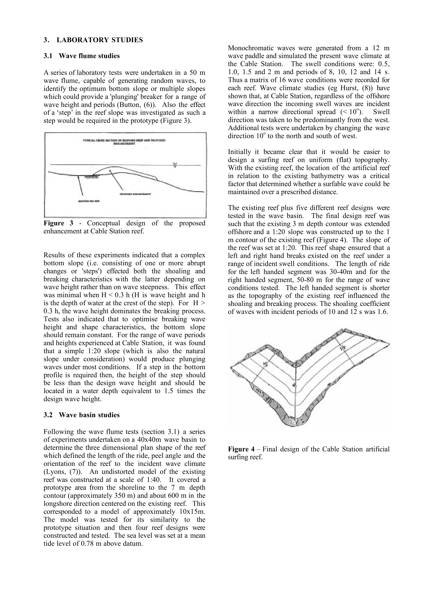

- **file**: `07_scale/shapes/cables-reef-wa/src/S1_fig4_wavebasin_full_page.png`
- **kind**: diagram
- **shows**: Full page 3: laboratory studies text with Figure 3 (conceptual cross-section) and Figure 4 (final design 3D contour sketch).
- **structure visible**: True
- **state shown**: design (1999)
- **image date**: 1999
- **citation**: Pattiaratchi, C. (1999). Design Studies for an Artificial Surfing Reef: Cable Station, Western Australia. Centre for Water Research, University of Western Australia, report ref. ED1483CP (5 pp.; PDF created 1999-04-13), p.3 (full-page render of the PDF page). http://joas.free.fr/studies/bei/g2s/reefdesign.pdf (mirror; byte-identical re-download 2026-10-05, MD5 02a6075b1eac84a68180bbfd89226fea). Accessed 2026-10-05.
- **image URL**: http://joas.free.fr/studies/bei/g2s/reefdesign.pdf
- **source page**: http://joas.free.fr/studies/bei/g2s/reefdesign.pdf
- **page / figure**: PDF p.3 (page render, 2480 x 3509 px)
- **credit**: C. Pattiaratchi / Centre for Water Research, UWA
- **licence**: unknown / all rights reserved - private research copy
- **retrieved**: 2026-10-04
- **used for**: cross_check
- **How used for the model**: Page render saved in the first run; text used for the lab design (1:20 slope reef, left-hand segment 30-40 m, right-hand segment 50-80 m, 3 m depth contour extended offshore). Figures registered individually.
- **3D check pending**: no - none: page render
- **source PDF**: `07_scale/shapes/cables-reef-wa/src/S1_pattiaratchi_reefdesign.pdf`
- **linked records**: 07_scale/shapes/cables-reef-wa/sources.md S1; 07_scale/shapes/cables-reef-wa/METHOD.md step 1a
- **size**: 0.84 MB, 2480x3509 px
- **sha256**: 6bc4e3e747017a16d55246ce539d8223f61b7e8d268818814b83830afe0a19de
- **rights**: Private research copy; reuse rights to be checked before any public release.
- **display in HTML**: True
- **added by**: image-registry backfill, 2026-10-06

## cables-reef-wa-img-23 - Pattiaratchi (1999) page 4 render: Figure 7 geographic location of the proposed reef (upscaled)

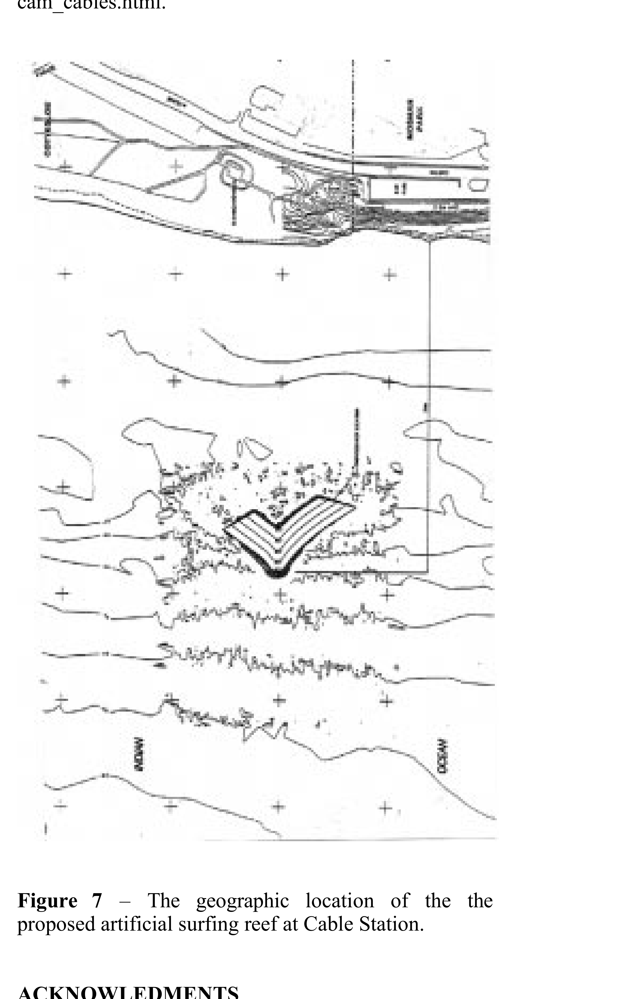

- **file**: `07_scale/shapes/cables-reef-wa/src/S1_fig7_location_map.png`
- **kind**: plan_figure
- **shows**: Page-4 render showing Figure 7: the rotated plan map with the V outline over contours; the native raster is only 226 x 367 px, so this is an upscale.
- **structure visible**: True
- **state shown**: design (1999)
- **image date**: 1999
- **citation**: Pattiaratchi, C. (1999). Design Studies for an Artificial Surfing Reef: Cable Station, Western Australia. Centre for Water Research, University of Western Australia, report ref. ED1483CP (5 pp.; PDF created 1999-04-13), p.4, Figure 7 (page render, 2409 x 3900 px). http://joas.free.fr/studies/bei/g2s/reefdesign.pdf (mirror; byte-identical re-download 2026-10-05, MD5 02a6075b1eac84a68180bbfd89226fea). Accessed 2026-10-05.
- **image URL**: http://joas.free.fr/studies/bei/g2s/reefdesign.pdf
- **source page**: http://joas.free.fr/studies/bei/g2s/reefdesign.pdf
- **page / figure**: PDF p.4, Figure 7 (page render)
- **credit**: C. Pattiaratchi / Centre for Water Research, UWA
- **licence**: unknown / all rights reserved - private research copy
- **retrieved**: 2026-10-04
- **used for**: plan_trace; cross_check
- **How used for the model**: Used to read the apex direction (offshore) in METHOD.md step 1a; not traced (low native resolution, no scale bar).
- **3D check pending**: YES - Apex direction/outline orientation vs satellite (see the native Fig. 7 row) (values: planform, position)
- **source PDF**: `07_scale/shapes/cables-reef-wa/src/S1_pattiaratchi_reefdesign.pdf`
- **linked records**: 07_scale/shapes/cables-reef-wa/METHOD.md step 1a
- **size**: 0.23 MB, 2409x3900 px
- **sha256**: 623d7ad3e0b1755b7c294e2d5e0599d46614bd93ed1ef4d24adb4c94a1df3802
- **rights**: Private research copy; reuse rights to be checked before any public release.
- **display in HTML**: True
- **added by**: image-registry backfill, 2026-10-06

## cables-reef-wa-img-24 - Blacka et al. (2013) Fig. 2.14: placing rock on the Cable Station reef by barge-mounted excavator
- **file**: `03_images/reefs/cables-reef-wa/cables-reef-wa_p8-fig2-14-rock-placement_1999.png`
- **kind**: report_photo
- **shows**: Excavator on a barge placing granite boulders at sea.
- **structure visible**: False
- **state shown**: as-built (construction)
- **image date**: 1999 (construction); date not stated
- **citation**: Blacka, M.J., Shand, T.D., Carley, J.T. and Mariani, A. (2013). A Review of Artificial Reefs for Coastal Protection in NSW. WRL Technical Report 2012/08 (Final, 11 June 2013), UNSW Water Research Laboratory, for the NSW Office of Environment and Heritage. p.31 (PDF p.43), Figure 2.14; credit Jackson and Corbett (2007). https://doi.org/10.4225/53/58e1dc7368c7a. Accessed 2026-10-07.
- **image URL**: https://doi.org/10.4225/53/58e1dc7368c7a
- **source page**: https://doi.org/10.4225/53/58e1dc7368c7a
- **page / figure**: report p.31 (PDF p.43), Figure 2.14 (clip, 200 dpi)
- **credit**: Jackson and Corbett (2007) as reproduced in Blacka et al. (2013)
- **licence**: CC BY-NC-ND 3.0 AU (as recorded in REQUESTS_FOR_LIOR.md P8; not re-checked on the PDF)
- **retrieved**: 2026-10-10
- **used for**: context
- **How used for the model**: Context for the construction method (1.5 t body stones with a 3.0 t keyed perimeter, from a barge; p.93). No geometry read.
- **3D check pending**: no - none
- **linked records**: 05_qa/papers_intake/P8_blacka_2013.md
- **size**: 0.40 MB, 1098x487 px
- **sha256**: 8e1c65a27ed5949ba204d2912a65846c4d99260529403028f92460316afcb014
- **rights**: Private research copy; reuse rights to be checked before any public release.
- **display in HTML**: True
- **added by**: papers intake P3/P8, 2026-10-10

## cables-reef-wa-img-25 - Blacka et al. (2013) Fig. A.1: location of Cable Station ASR (satellite)
- **file**: `03_images/reefs/cables-reef-wa/cables-reef-wa_p8-figA1-location_2013.png`
- **kind**: satellite
- **shows**: Satellite map of Perth coast with Rottnest Island offshore and the reef marker south of Cottesloe; 5 km scale bar.
- **structure visible**: False
- **state shown**: context (location)
- **image date**: unknown (imagery before 2013)
- **citation**: Blacka, M.J., Shand, T.D., Carley, J.T. and Mariani, A. (2013). A Review of Artificial Reefs for Coastal Protection in NSW. WRL Technical Report 2012/08 (Final, 11 June 2013), UNSW Water Research Laboratory, for the NSW Office of Environment and Heritage. p.92 (PDF p.104), Figure A.1. https://doi.org/10.4225/53/58e1dc7368c7a. Accessed 2026-10-07.
- **image URL**: https://doi.org/10.4225/53/58e1dc7368c7a
- **source page**: https://doi.org/10.4225/53/58e1dc7368c7a
- **page / figure**: report p.92 (PDF p.104), Figure A.1 (clip, 200 dpi)
- **credit**: Blacka et al. (2013) over satellite imagery (provider not stated)
- **licence**: CC BY-NC-ND 3.0 AU (as recorded in REQUESTS_FOR_LIOR.md P8; not re-checked on the PDF)
- **retrieved**: 2026-10-10
- **used for**: context
- **How used for the model**: Location context; shows the sheltering by Rottnest Island noted in P3 p.2.
- **3D check pending**: no - none
- **linked records**: 05_qa/papers_intake/P8_blacka_2013.md
- **size**: 1.08 MB, 1209x723 px
- **sha256**: 80e59359528cfafde18f140adbe1fa82e2fa45e98d331cf148325a2d0723ce40
- **rights**: Private research copy; reuse rights to be checked before any public release.
- **display in HTML**: True
- **added by**: papers intake P3/P8, 2026-10-10

## cables-reef-wa-img-26 - Blacka et al. (2013) Fig. A.2: Cable Station ASR design (after Lyons, 1992), plan with contours
- **file**: `03_images/reefs/cables-reef-wa/cables-reef-wa_p8-figA2-design-lyons-1992_1992.png`
- **kind**: design_drawing
- **shows**: Line plan of the V-shaped reef with design contour and perimeter lines and labelled points; no scale readable at this size.
- **structure visible**: True
- **state shown**: design (1992 concept; the built reef was extended at the south end per card)
- **image date**: 1992 (design drawing, pre-construction)
- **citation**: Blacka, M.J., Shand, T.D., Carley, J.T. and Mariani, A. (2013). A Review of Artificial Reefs for Coastal Protection in NSW. WRL Technical Report 2012/08 (Final, 11 June 2013), UNSW Water Research Laboratory, for the NSW Office of Environment and Heritage. p.93 (PDF p.105), Figure A.2. https://doi.org/10.4225/53/58e1dc7368c7a. Accessed 2026-10-07.
- **image URL**: https://doi.org/10.4225/53/58e1dc7368c7a
- **source page**: https://doi.org/10.4225/53/58e1dc7368c7a
- **page / figure**: report p.93 (PDF p.105), Figure A.2 (clip, 200 dpi); original Lyons (1992) BEng thesis, UWA
- **credit**: Lyons (1992) as reproduced in Blacka et al. (2013)
- **licence**: CC BY-NC-ND 3.0 AU (as recorded in REQUESTS_FOR_LIOR.md P8; not re-checked on the PDF)
- **retrieved**: 2026-10-10
- **used for**: plan_trace, cross_check
- **How used for the model**: Not traced: low resolution, no legible scale. Candidate for cross-checking the planform vs the traced shape (V, ~140 m long x ~70 m wide per p.92).
- **3D check pending**: yes - Compare the V planform and arm proportions with the traced shape.json; built reef later extended at the south end.
- **linked records**: 05_qa/papers_intake/P8_blacka_2013.md
- **size**: 0.18 MB, 917x682 px
- **sha256**: 3c860197ca9ff1a86341733107a2f8d2d257f55d9b77bae1ec1bf659466d3061
- **rights**: Private research copy; reuse rights to be checked before any public release.
- **display in HTML**: True
- **added by**: papers intake P3/P8, 2026-10-10

## cables-reef-wa-img-27 - Outline versions of the Cable Station reef compared in metres (own figure)

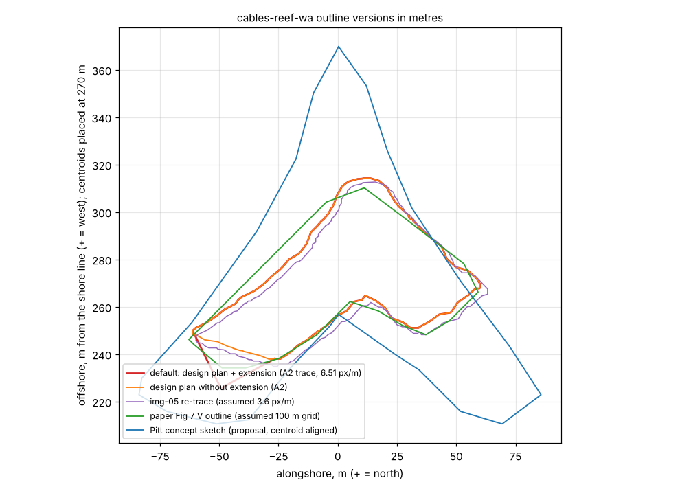

- **file**: `07_scale/shapes/cables-reef-wa/overlays/cables-reef-wa_versions_compare_m.png`
- **kind**: diagram
- **shows**: The four outline versions (default design plan + extension, design plan, paper Fig 7 V, Pitt concept) plotted in the canonical frame.
- **state shown**: design (model)
- **image date**: 2026-10-10
- **citation**: Own figure made for this project (cables-reef-wa shape + 3D task, 2026-10-10), derived from the registered sources named in SOURCES_3D.md.
- **licence**: own work; derived from sources whose reuse rights are not cleared
- **used for**: plan_trace, cross_check
- **How used for the model**: Shows how the versions differ in size and shape; the Pitt concept is about 2.4 times the built footprint.
- **rights**: Private research copy; reuse rights to be checked before any public release.
- **display in HTML**: True
- **added by**: cables-reef-wa shape + 3D task, 2026-10-10

## cables-reef-wa-img-28 - Modelled section through the apex of the Cable Station reef (own figure)

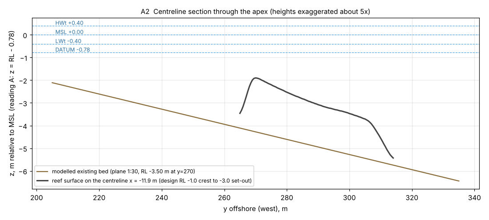

- **file**: `07_scale/shapes/cables-reef-wa/3d/annotated/A2_centreline_section.png`
- **kind**: diagram
- **shows**: Section along the apex centreline: reef surface (RL -1.0 crest to -3.0 set-out), modelled bed and the water levels.
- **state shown**: design (model)
- **image date**: 2026-10-10
- **citation**: Own figure made for this project (cables-reef-wa shape + 3D task, 2026-10-10), derived from the registered sources named in SOURCES_3D.md.
- **licence**: own work; derived from sources whose reuse rights are not cleared
- **used for**: 3d_crest, 3d_height_slopes, 3d_seabed
- **How used for the model**: Shows the modelled crest depth (1.78 m below MSL under reading A) and the thickness over the bed; a check, not a source.
- **rights**: Private research copy; reuse rights to be checked before any public release.
- **display in HTML**: True
- **added by**: cables-reef-wa shape + 3D task, 2026-10-10

## cables-reef-wa-img-29 - Bed level fitted to the stated rock volume (Cable Station reef) (own figure)

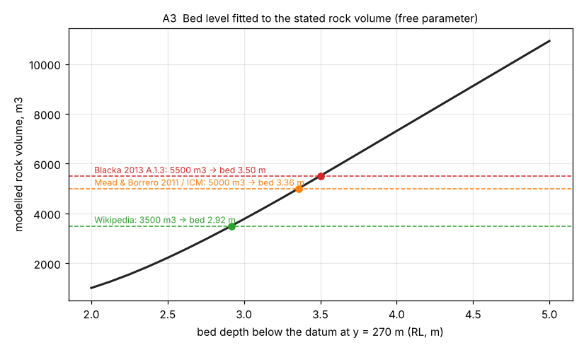

- **file**: `07_scale/shapes/cables-reef-wa/3d/annotated/A3_bed_level_vs_volume.png`
- **kind**: diagram
- **shows**: Modelled rock volume versus the assumed bed depth, with the stated volumes 3,500 / 5,000 / 5,500 m3 and the bed depth each implies.
- **state shown**: design (model)
- **image date**: 2026-10-10
- **citation**: Own figure made for this project (cables-reef-wa shape + 3D task, 2026-10-10), derived from the registered sources named in SOURCES_3D.md.
- **licence**: own work; derived from sources whose reuse rights are not cleared
- **used for**: 3d_seabed, 3d_height_slopes
- **How used for the model**: Documents the single free parameter of the model (bed level D0 = 3.50 m at y = 270 m).
- **rights**: Private research copy; reuse rights to be checked before any public release.
- **display in HTML**: True
- **added by**: cables-reef-wa shape + 3D task, 2026-10-10

## cables-reef-wa-img-30 - Screenshot of the three.js viewer, plan view (Cable Station reef) (own figure)

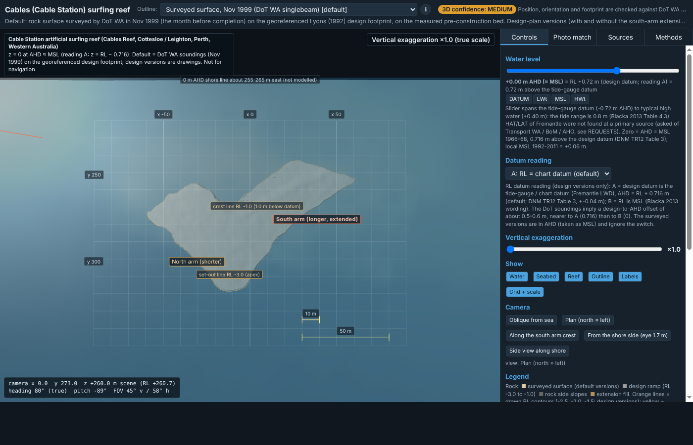

- **file**: `07_scale/shapes/cables-reef-wa/3d/preview_plan.png`
- **kind**: diagram
- **shows**: Plan view of the modelled reef on the modelled seabed with the 10 m grid and scale bars (north = left).
- **state shown**: design (model)
- **image date**: 2026-10-10
- **citation**: Own figure made for this project (cables-reef-wa shape + 3D task, 2026-10-10), derived from the registered sources named in SOURCES_3D.md.
- **licence**: own work; derived from sources whose reuse rights are not cleared
- **used for**: camera_match, context
- **How used for the model**: Preview of the delivered model viewer (index.html) for the page and for camera-match planning.
- **rights**: Private research copy; reuse rights to be checked before any public release.
- **display in HTML**: True
- **added by**: cables-reef-wa shape + 3D task, 2026-10-10

## cables-reef-wa-img-31 - Screenshot of the three.js viewer, oblique view from the sea (Cable Station reef) (own figure)

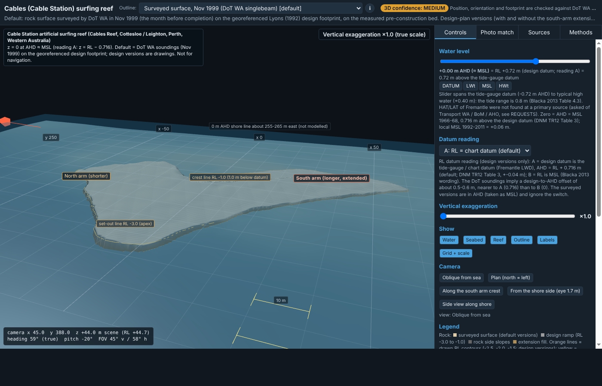

- **file**: `07_scale/shapes/cables-reef-wa/3d/preview_oblique.png`
- **kind**: diagram
- **shows**: Oblique view from the sea of the modelled V-shaped reef under a translucent MSL water surface.
- **state shown**: design (model)
- **image date**: 2026-10-10
- **citation**: Own figure made for this project (cables-reef-wa shape + 3D task, 2026-10-10), derived from the registered sources named in SOURCES_3D.md.
- **licence**: own work; derived from sources whose reuse rights are not cleared
- **used for**: camera_match, context
- **How used for the model**: Preview of the delivered model viewer (index.html).
- **rights**: Private research copy; reuse rights to be checked before any public release.
- **display in HTML**: True
- **added by**: cables-reef-wa shape + 3D task, 2026-10-10

## Added 2026-10-10 (imagery + bathymetry run)

### cables-reef-wa-img-32 - Esri World Imagery (current), Cable Station reef site, zoom 19
- file: 07_scale/shapes/cables-reef-wa/src/imagery/esri_world_imagery_2025-12-06_z19.png
- kind: satellite; date: 2025-12-06 (capture date from the service identify DATE field)
- citation: Esri, Maxar, Earthstar Geographics, and the GIS User Community (2026). World Imagery current layer, tile mosaic around 32.0155 S 115.7478 E. Esri. https://server.arcgisonline.com/ArcGIS/rest/services/World_Imagery/MapServer/tile/19/{y}/{x} Accessed 2026-10-10.
- licence: Esri / Maxar imagery terms, not cleared for redistribution
- shows: Dark rock patch of the V-shaped reef 250 m off the beach in clear water, seagrass and sand around it; no waves breaking.
- how used for the model: Independent check of the outline georeferenced from the DoT soundings (position, orientation, extent, south-arm extension): outline drawn on the image by scripts/make_imagery_figs.py; no image information entered the fit. Result in VERIFY.md and METHODS_3D 3.7.

### cables-reef-wa-img-33 - Esri Wayback release 2020-03-23, Cable Station reef, zoom 19
- file: 07_scale/shapes/cables-reef-wa/src/imagery/esri_wayback_2020-03-23_z19.png
- kind: satellite; date: release 2020-03-23; capture date not available (earlier than the release)
- citation: Esri, Maxar, Earthstar Geographics, and the GIS User Community (2026). World Imagery Wayback release 2020-03-23 (release id 16062). Esri. https://wayback.maptiles.arcgis.com/arcgis/rest/services/World_Imagery/WMTS/1.0.0/default028mm/MapServer/tile/16062/19/{y}/{x} Accessed 2026-10-10.
- licence: Esri / Maxar imagery terms, not cleared for redistribution
- shows: Reef patch with a wave breaking on its north-east arm; clearest view of the structure in the series.
- how used for the model: Independent check of the outline georeferenced from the DoT soundings (position, orientation, extent, south-arm extension): outline drawn on the image by scripts/make_imagery_figs.py; no image information entered the fit. Result in VERIFY.md and METHODS_3D 3.7.

### cables-reef-wa-img-34 - Esri Wayback release 2022-06-08, Cable Station reef, zoom 19
- file: 07_scale/shapes/cables-reef-wa/src/imagery/esri_wayback_2022-06-08_z19.png
- kind: satellite; date: release 2022-06-08; capture date not available
- citation: Esri, Maxar, Earthstar Geographics, and the GIS User Community (2026). World Imagery Wayback release 2022-06-08 (release id 44710). Esri. https://wayback.maptiles.arcgis.com/arcgis/rest/services/World_Imagery/WMTS/1.0.0/default028mm/MapServer/tile/44710/19/{y}/{x} Accessed 2026-10-10.
- licence: Esri / Maxar imagery terms, not cleared for redistribution
- shows: Dark, sharp-edged reef patch; the best contrast between rock and the surrounding sand.
- how used for the model: Independent check of the outline georeferenced from the DoT soundings (position, orientation, extent, south-arm extension): outline drawn on the image by scripts/make_imagery_figs.py; no image information entered the fit. Result in VERIFY.md and METHODS_3D 3.7.

### cables-reef-wa-img-35 - Esri Wayback release 2014-12-03, Cable Station reef, zoom 19
- file: 07_scale/shapes/cables-reef-wa/src/imagery/esri_wayback_2014-12-03_z19.png
- kind: satellite; date: release 2014-12-03; capture date not available
- citation: Esri, Maxar, Earthstar Geographics, and the GIS User Community (2026). World Imagery Wayback release 2014-12-03 (release id 23383). Esri. https://wayback.maptiles.arcgis.com/arcgis/rest/services/World_Imagery/WMTS/1.0.0/default028mm/MapServer/tile/23383/19/{y}/{x} Accessed 2026-10-10.
- licence: Esri / Maxar imagery terms, not cleared for redistribution
- shows: Reef patch (dark, reddish in this version) on the seagrass terrace; oldest release at zoom 19.
- how used for the model: Independent check of the outline georeferenced from the DoT soundings (position, orientation, extent, south-arm extension): outline drawn on the image by scripts/make_imagery_figs.py; no image information entered the fit. Result in VERIFY.md and METHODS_3D 3.7.

### cables-reef-wa-img-36 - Esri Wayback release 2024-08-15, Cable Station reef, zoom 19
- file: 07_scale/shapes/cables-reef-wa/src/imagery/esri_wayback_2024-08-15_z19.png
- kind: satellite; date: release 2024-08-15; capture date not available
- citation: Esri, Maxar, Earthstar Geographics, and the GIS User Community (2026). World Imagery Wayback release 2024-08-15 (release id 32553). Esri. https://wayback.maptiles.arcgis.com/arcgis/rest/services/World_Imagery/WMTS/1.0.0/default028mm/MapServer/tile/32553/19/{y}/{x} Accessed 2026-10-10.
- licence: Esri / Maxar imagery terms, not cleared for redistribution
- shows: Dark water, reef patch faint; kept for completeness of the series.
- how used for the model: Independent check of the outline georeferenced from the DoT soundings (position, orientation, extent, south-arm extension): outline drawn on the image by scripts/make_imagery_figs.py; no image information entered the fit. Result in VERIFY.md and METHODS_3D 3.7.

### cables-reef-wa-img-37 - Georeferenced outline on four Esri images (2014, 2020, 2022, 2025)
- file: 07_scale/shapes/cables-reef-wa/src/imagery/annotated/overlay_montage_4dates.png
- kind: diagram; date: 2026-10-10
- citation: Own figure made for this project (cables-reef-wa imagery + bathymetry run, 2026-10-10), derived from the sources named in 3d/SOURCES_3D.md (Esri imagery; DoT WA bathymetry, CC BY 4.0).
- licence: own work; derived from sources whose reuse rights are not cleared
- shows: Four contrast-stretched crops of the reef with the georeferenced original-plan outline (magenta) and the extension triangle (yellow).
- how used for the model: Visual verification of position, orientation and extent; the extension triangle is not distinguishable from the surroundings.

### cables-reef-wa-img-38 - DoT WA soundings Nov 1999: rock thickness over the 1998 bed, with the fitted outline
- file: 07_scale/shapes/cables-reef-wa/src/bathymetry/figures/survey_1999_thickness.png
- kind: survey_plot; date: 2026-10-10
- citation: Own figure made for this project (cables-reef-wa imagery + bathymetry run, 2026-10-10), derived from the sources named in 3d/SOURCES_3D.md (Esri imagery; DoT WA bathymetry, CC BY 4.0).
- licence: own work; derived from sources whose reuse rights are not cleared
- shows: 840 soundings coloured by thickness above the pre-construction bed; the V of the reef with the fitted design outline.
- how used for the model: Georeference fit and default 3D surface (version survey_surface_1999_11); thickness values read as sounding minus bed.

### cables-reef-wa-img-39 - DoT WA soundings Feb 2002: thickness over the 1998 bed, with the fitted outlines
- file: 07_scale/shapes/cables-reef-wa/src/bathymetry/figures/survey_2002_thickness.png
- kind: survey_plot; date: 2026-10-10
- citation: Own figure made for this project (cables-reef-wa imagery + bathymetry run, 2026-10-10), derived from the sources named in 3d/SOURCES_3D.md (Esri imagery; DoT WA bathymetry, CC BY 4.0).
- licence: own work; derived from sources whose reuse rights are not cleared
- shows: Singlebeam lines (about 5 m apart) coloured by thickness above the 1998 bed; the south-arm extension triangle (SE) shows little rock.
- how used for the model: Surveyed surface version survey_surface_2002_02; extension test (+0.43 m, n = 23).

### cables-reef-wa-img-40 - DoT WA composite surface Perth_5m around the reef (m AHD) with the reef outline
- file: 07_scale/shapes/cables-reef-wa/src/bathymetry/figures/bed_perth5m_contours.png
- kind: survey_plot; date: 2026-10-10
- citation: Own figure made for this project (cables-reef-wa imagery + bathymetry run, 2026-10-10), derived from the sources named in 3d/SOURCES_3D.md (Esri imagery; DoT WA bathymetry, CC BY 4.0).
- licence: own work; derived from sources whose reuse rights are not cleared
- shows: Seabed contours every 1 m from the 0 m AHD shoreline to 9 m, with the reef as a smoothed shallow mound.
- how used for the model: Seabed beyond the 1998 survey coverage; shoreline bearing (7.8 deg T) and offshore distance (254-263 m).

## Added 2026-10-24 (page agent, Lior's page requests D12)

### cables-reef-wa-img-41 - Four reefs at one scale: Narrowneck, Cables, Mount Reef, Pratte's Reef (Raised Water Research satellite comparison, original graphic)
- File: 03_images/reefs/prattes-reef-el-segundo/rwr_4reef-satellite-comparison_narrowneck-cables-mount-prattes_original.png (812 x 660 px, 726495 bytes)
- Citation: Raised Water Research (n.d.). Four-panel satellite comparison of artificial surf reefs at one scale: Narrowneck, Cables, Mount Reef (Mount Maunganui), Pratte's Reef, with the caption 'Size wasn't the only problem... Divers who surveyed the reef saw bags had moved, sunken and got covered by sand. And the black polypropylene bags were falling apart.' Web graphic reproduced (as a screenshot of the web page including its caption) on slide 12 of Lior Baruch's PowerPoint 'surfable swells measurments, key people, and photoes from goldcoast artificial reef.pptx' (extracted file 03_images/from_lior/goldcoast_pptx/image26.png, 812 x 660 px); the slide names raisedwaterresearch.com as the source. The composite's own web URL was not located (raisedwaterresearch.com answered HTTP 406 to a scripted request on 2026-10-24; not bypassed). Saved 2026-10-24 at Lior's explicit request.
- Link: https://raisedwaterresearch.com/ (composite's own page not located; Pratte's spot page: https://raisedwaterresearch.com/spot/artificial-reef/us/california/prattes-reef/)
- Date: unknown (undated web graphic; Pratte's Reef existed 2000-2008); credit Raised Water Research (composite); copy from Lior Baruch's PowerPoint; licence all rights reserved (Raised Water Research; no licence stated) - private research copy saved at the author's request (Lior, 2026-10-24); retrieved 2026-10-24
- Shows: Four vertical satellite panels with each reef outlined in white and labelled, one shared 200 m scale bar, and the caption about Pratte's bags moving, sinking and falling apart. Composite: each panel is a satellite image with the reef outline drawn in white; one 200 m scale bar for all four panels, which is NOT valid across panels (see 07_scale/shapes/prattes-reef-el-segundo/sources.md); the Pratte's V is the Skelly design drawing, not a survey.
- State shown: design / as-built outlines drawn over undated satellite images; structure visible: true
- How used: Shown on the page as media of all four reefs it shows (Lior 2026-10-24, D12). Not used for any trace or model value.
- Private research copy saved at the author's request; reuse rights not cleared. Keep the repo private.

### cables-reef-wa-img-42 - Cables panel cropped from the Raised Water Research four-reef satellite comparison
- File: 03_images/reefs/cables-reef-wa/cables-reef-wa_rwr-4reef-comparison-panel-crop.png (187 x 595 px, 143164 bytes)
- Citation: Raised Water Research (n.d.). Four-panel satellite comparison of artificial surf reefs at one scale: Narrowneck, Cables, Mount Reef (Mount Maunganui), Pratte's Reef, with the caption 'Size wasn't the only problem... Divers who surveyed the reef saw bags had moved, sunken and got covered by sand. And the black polypropylene bags were falling apart.' Web graphic reproduced (as a screenshot of the web page including its caption) on slide 12 of Lior Baruch's PowerPoint 'surfable swells measurments, key people, and photoes from goldcoast artificial reef.pptx' (extracted file 03_images/from_lior/goldcoast_pptx/image26.png, 812 x 660 px); the slide names raisedwaterresearch.com as the source. The composite's own web URL was not located (raisedwaterresearch.com answered HTTP 406 to a scripted request on 2026-10-24; not bypassed). Saved 2026-10-24 at Lior's explicit request.
- Link: https://raisedwaterresearch.com/ (composite's own page not located; Pratte's spot page: https://raisedwaterresearch.com/spot/artificial-reef/us/california/prattes-reef/)
- Date: unknown (undated web graphic; Pratte's Reef existed 2000-2008); credit Raised Water Research (composite); copy from Lior Baruch's PowerPoint; licence all rights reserved (Raised Water Research; no licence stated) - private research copy saved at the author's request (Lior, 2026-10-24); retrieved 2026-10-24
- Shows: Satellite image of the Cables site with the reef outline drawn in white and the label 'Cables'. Composite: each panel is a satellite image with the reef outline drawn in white; one 200 m scale bar for all four panels, which is NOT valid across panels (see 07_scale/shapes/prattes-reef-el-segundo/sources.md); the Pratte's V is the Skelly design drawing, not a survey.
- State shown: design / as-built outline drawn over an undated satellite image; structure visible: true
- How used: Shown on the page as extra media of Cables (Lior 2026-10-24, D12). Not used for any trace or model value.
- Private research copy saved at the author's request; reuse rights not cleared. Keep the repo private.
