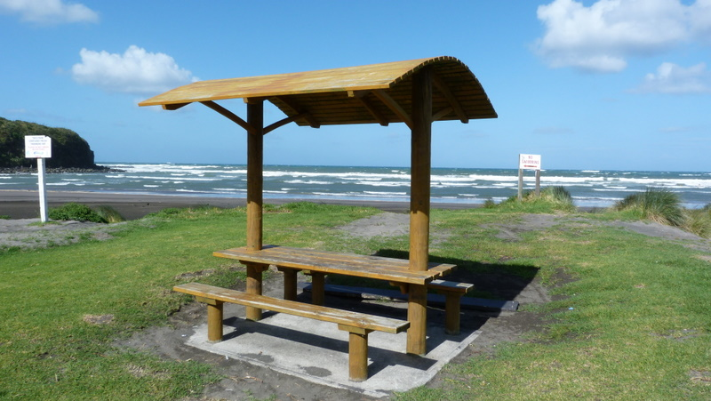
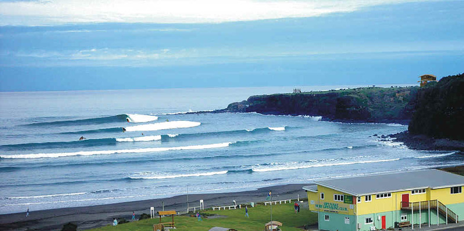
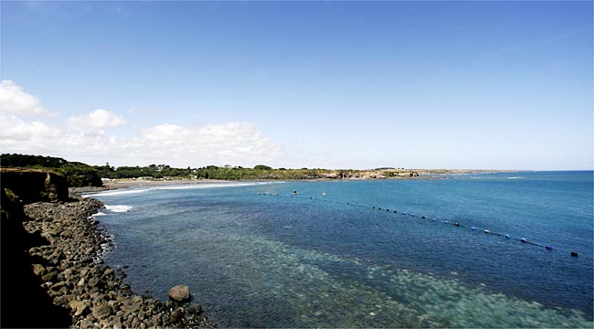
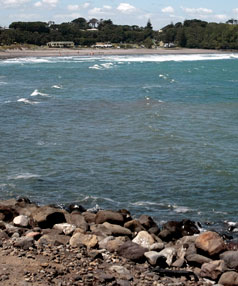
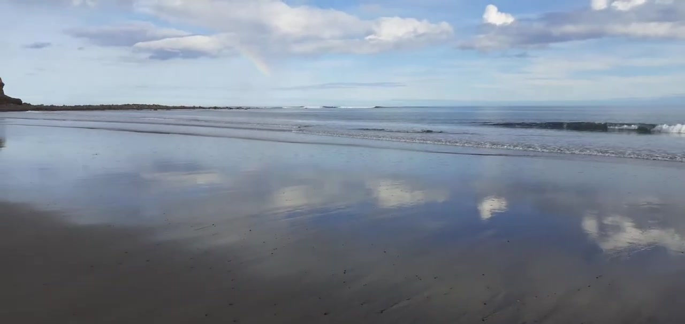
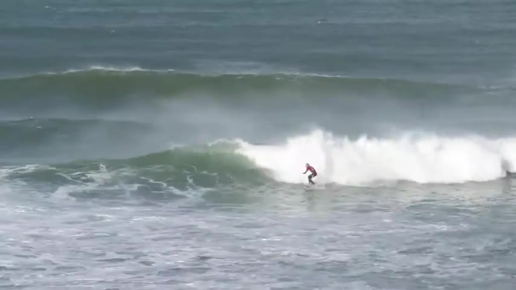
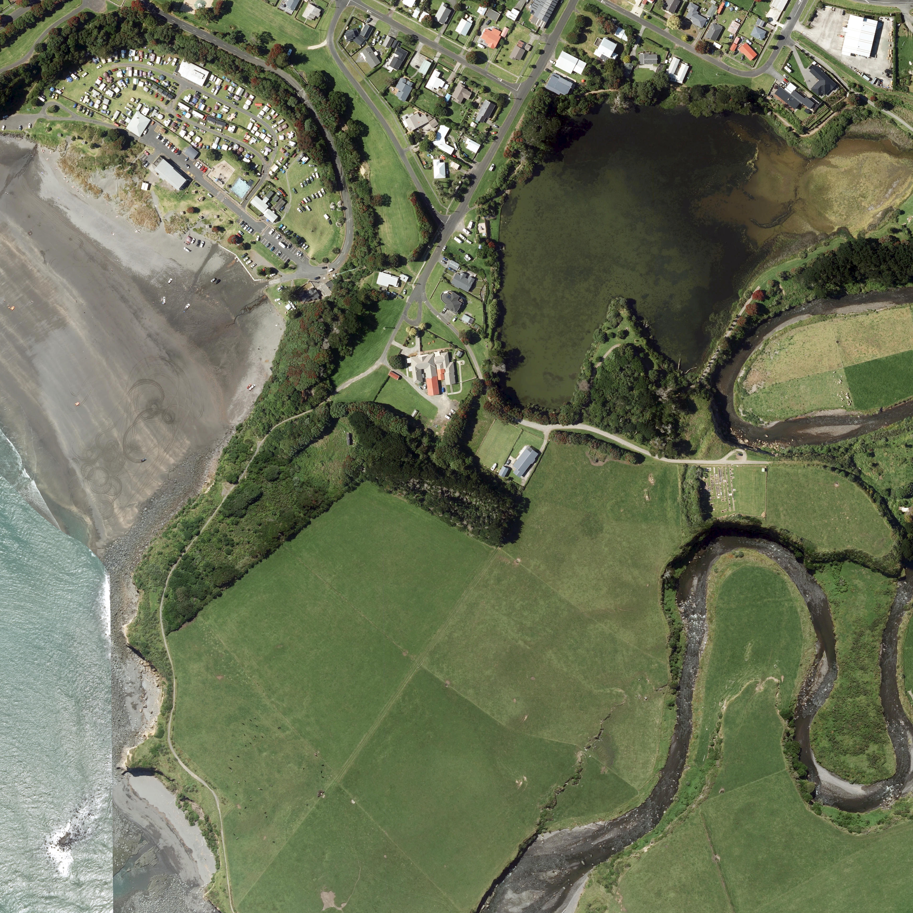
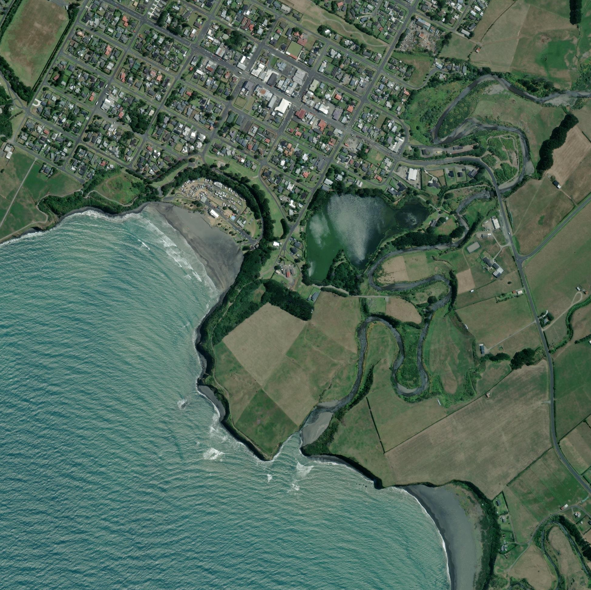

# Image registry - opunake-reef

Source of truth: `images.json` in this folder (convention: `_agent_briefs/image_registry.md`; overview: `03_images/reefs/README.md`). This file is generated from it.

10 images registered, 10 with a file, 0 used for the model (any use other than context/not_used).

## opunake-reef-img-01 - Opunake Beach: picnic shelter on the grassed foreshore (Gonzalobaeza, 2012)

- Page (2026-10-20): hero tile and Media list now show the LOCAL copy (04_build/assets/opunake-reef/), not the Wikimedia hot-link.

- **file**: `03_images/reefs/opunake-reef/opunake-reef_picnic-shelter-foreshore_2012-02.jpg`
- **kind**: photo
- **shows**: A timber picnic shelter and table on the grassed foreshore with the beach and surf line behind; general site view, the submerged reef is not visible.
- **structure visible**: False
- **state shown**: not applicable (site context)
- **image date**: 2012-02-24
- **citation**: Gonzalobaeza (2012-02-24). Opunake Beach [photo]. Wikimedia Commons, File:Opunake_Beach.JPG. https://commons.wikimedia.org/wiki/File:Opunake_Beach.JPG. Accessed 2026-10-06.
- **image URL**: https://upload.wikimedia.org/wikipedia/commons/8/86/Opunake_Beach.JPG
- **source page**: https://commons.wikimedia.org/wiki/File:Opunake_Beach.JPG
- **page / figure**: whole photo (800 x 451 px)
- **credit**: Gonzalobaeza (own work), via Wikimedia Commons
- **licence**: CC BY-SA 3.0 (https://creativecommons.org/licenses/by-sa/3.0) - attribution required, share-alike
- **retrieved**: 2026-10-06
- **used for**: context
- **How used for the model**: Page illustration (site context only). Nothing measured.
- **3D check pending**: no - none: image already used as a model source or is context only
- **linked records**: 02_research/reefs/opunake-reef.json images[0]; 05_qa/reef/opunake-reef_media_recheck.json images[0] (that recheck could not view the file correctly - viewer artifact; re-viewed 2026-10-06: a normal picnic-shelter photo)
- **size**: 0.16 MB, 800x451 px
- **sha256**: f3c93ddbd22da50914f9635eeead0538af57bc2bac22c2fb523818009d7a5fa3
- **rights**: Private research copy; reuse rights to be checked before any public release.
- **display in HTML**: True
- **added by**: image-registry backfill, 2026-10-06

## opunake-reef-img-02 - Surfers riding a line of waves at Opunake with the surf club building and headland (RWR 'Artist Rendition')

- **file**: `03_images/reefs/opunake-reef/opunake-reef_rwr-artist-rendition_unknown-date.jpg`
- **kind**: photo
- **shows**: Photograph (despite the 'Artist Rendition' file name) of several lines of waves peeling along the beach with surfers, the yellow Opunake Surf Life Saving Club building and the headland.
- **structure visible**: False
- **state shown**: not applicable (site/surf context; reef not visible)
- **image date**: unknown (before 2019)
- **citation**: Raised Water Research (2019). Opunake [spot profile page]; image 'Opunake Artist Rendition'. https://raisedwaterresearch.com/spot/artificial-reef/new-zealand/north-island/opunake/. Image file https://raisedwaterresearch.com/wp-content/uploads/2019/11/Opunake-Artist-Rendition.jpg. Accessed 2026-10-06.
- **image URL**: https://raisedwaterresearch.com/wp-content/uploads/2019/11/Opunake-Artist-Rendition.jpg
- **source page**: https://raisedwaterresearch.com/spot/artificial-reef/new-zealand/north-island/opunake/
- **page / figure**: page gallery image 'Opunake-Artist-Rendition.jpg'
- **credit**: Raised Water Research (collectively credited to National Geographic / Stuff.co.nz / Bournemouth Echo; photographer not named)
- **licence**: not stated on the page; the page credits its Opunake images collectively to National Geographic / Stuff.co.nz / Bournemouth Echo - link/research copy only, NOT cleared
- **retrieved**: 2026-10-06
- **used for**: context
- **How used for the model**: Page illustration (site context). The 2026-09-25 media recheck classed it 'unrelated_or_wrong_site' (it described excavators at a revetment), but that recheck noted its viewer showed unreliable content; re-viewed 2026-10-06: an Opunake photo as the card described, reef not visible. Nothing measured.
- **3D check pending**: no - none: site context
- **linked records**: 02_research/reefs/opunake-reef.json images_rejected; 05_qa/reef/opunake-reef_media_recheck.json
- **size**: 0.10 MB, 784x390 px
- **sha256**: 19248ce8f68db60600bb689a84244cbc8d77819ae8d8e47aa29d585e265b689b
- **rights**: Private research copy; reuse rights to be checked before any public release.
- **display in HTML**: True
- **added by**: image-registry backfill, 2026-10-06
- **notes**: Card rejected it on 2026-09-25 (recheck 'unrelated_or_wrong_site'); contradicted by the 2026-10-06 re-view, so display is left true - Lior/QA to confirm.

## opunake-reef-img-03 - Rocky Opunake foreshore with a line of marker buoys strung into the water (RWR 'Location')

- **file**: `03_images/reefs/opunake-reef/opunake-reef_rwr-location_unknown-date.jpg`
- **kind**: photo
- **shows**: Rocky foreshore looking along the cove with clear shallow water and a line of marker buoys/floats running into the bay toward the reef area.
- **structure visible**: False
- **state shown**: not applicable (site/surf context; reef not visible)
- **image date**: unknown (before 2019)
- **citation**: Raised Water Research (2019). Opunake [spot profile page]; image 'Opunake Location'. https://raisedwaterresearch.com/spot/artificial-reef/new-zealand/north-island/opunake/. Image file https://raisedwaterresearch.com/wp-content/uploads/2019/11/Opunake-Location.jpg. Accessed 2026-10-06.
- **image URL**: https://raisedwaterresearch.com/wp-content/uploads/2019/11/Opunake-Location.jpg
- **source page**: https://raisedwaterresearch.com/spot/artificial-reef/new-zealand/north-island/opunake/
- **page / figure**: page gallery image 'Opunake-Location.jpg'
- **credit**: Raised Water Research (collectively credited to National Geographic / Stuff.co.nz / Bournemouth Echo; photographer not named)
- **licence**: not stated on the page; the page credits its Opunake images collectively to National Geographic / Stuff.co.nz / Bournemouth Echo - link/research copy only, NOT cleared
- **retrieved**: 2026-10-06
- **used for**: context
- **How used for the model**: Page illustration (site context). The 2026-09-25 media recheck classed it 'unrelated_or_wrong_site' (it described excavators at a revetment), but that recheck noted its viewer showed unreliable content; re-viewed 2026-10-06: an Opunake photo as the card described, reef not visible. Nothing measured.
- **3D check pending**: no - none: site context
- **linked records**: 02_research/reefs/opunake-reef.json images_rejected; 05_qa/reef/opunake-reef_media_recheck.json
- **size**: 0.04 MB, 650x360 px
- **sha256**: b33ac168a6607946a037385a25e0b8a5cb45cf08fc672ea259dac07a21d8cc96
- **rights**: Private research copy; reuse rights to be checked before any public release.
- **display in HTML**: True
- **added by**: image-registry backfill, 2026-10-06
- **notes**: Card rejected it on 2026-09-25 (recheck 'unrelated_or_wrong_site'); contradicted by the 2026-10-06 re-view, so display is left true - Lior/QA to confirm.

## opunake-reef-img-04 - View across Opunake bay from the rocky shoreline toward the surf break (RWR 'Reef Flat')

- **file**: `03_images/reefs/opunake-reef/opunake-reef_rwr-reef-flat_unknown-date.jpg`
- **kind**: photo
- **shows**: Small image over boulders in the foreground to the bay and breaking waves with the township behind; the submerged reef is not distinguishable.
- **structure visible**: False
- **state shown**: not applicable (site/surf context; reef not visible)
- **image date**: unknown (before 2019)
- **citation**: Raised Water Research (2019). Opunake [spot profile page]; image 'Opunake Reef Flat'. https://raisedwaterresearch.com/spot/artificial-reef/new-zealand/north-island/opunake/. Image file https://raisedwaterresearch.com/wp-content/uploads/2019/11/Opunake-Reef-Flat.jpg. Accessed 2026-10-06.
- **image URL**: https://raisedwaterresearch.com/wp-content/uploads/2019/11/Opunake-Reef-Flat.jpg
- **source page**: https://raisedwaterresearch.com/spot/artificial-reef/new-zealand/north-island/opunake/
- **page / figure**: page gallery image 'Opunake-Reef-Flat.jpg'
- **credit**: Raised Water Research (collectively credited to National Geographic / Stuff.co.nz / Bournemouth Echo; photographer not named)
- **licence**: not stated on the page; the page credits its Opunake images collectively to National Geographic / Stuff.co.nz / Bournemouth Echo - link/research copy only, NOT cleared
- **retrieved**: 2026-10-06
- **used for**: context
- **How used for the model**: Page illustration (site context). The 2026-09-25 media recheck classed it 'unrelated_or_wrong_site' (it described excavators at a revetment), but that recheck noted its viewer showed unreliable content; re-viewed 2026-10-06: an Opunake photo as the card described, reef not visible. Nothing measured.
- **3D check pending**: no - none: site context
- **linked records**: 02_research/reefs/opunake-reef.json images_rejected; 05_qa/reef/opunake-reef_media_recheck.json
- **size**: 0.03 MB, 238x286 px
- **sha256**: 91817f37709e9d10266e460495a7b857d57ed490bca0ca6652ca56682083ce73
- **rights**: Private research copy; reuse rights to be checked before any public release.
- **display in HTML**: True
- **added by**: image-registry backfill, 2026-10-06
- **notes**: Card rejected it on 2026-09-25 (recheck 'unrelated_or_wrong_site'); contradicted by the 2026-10-06 re-view, so display is left true - Lior/QA to confirm.

## opunake-reef-img-05 - Video frame: wet-sand foreshore at low tide with a rainbow and whitewater far offshore (David McCallum)

- **file**: `03_images/video_frames/opunake-reef/-xWlsZlffZY_0005.jpg`
- **kind**: video_frame
- **shows**: Wet-sand foreshore at low tide, a faint rainbow and small lines of whitewater breaking well offshore; no reef structure or marker visible.
- **structure visible**: False
- **state shown**: not applicable (site context)
- **image date**: 2020-07-20 (upload date)
- **citation**: David McCallum (2020-07-20). "Every Breaking Wave at OPUNAKE beach." [video]. YouTube, frame at 00:05. https://www.youtube.com/watch?v=-xWlsZlffZY. Accessed 2026-09-25.
- **image URL**: https://www.youtube.com/watch?v=-xWlsZlffZY
- **source page**: https://www.youtube.com/watch?v=-xWlsZlffZY
- **page / figure**: frame at 00:05 (video length 87 s)
- **credit**: David McCallum (YouTube channel)
- **licence**: YouTube standard licence (not an open licence); single frame kept as a private research copy
- **retrieved**: 2026-09-24
- **used for**: context
- **How used for the model**: Page illustration (site context); not used for the model.
- **3D check pending**: no - none: image already used as a model source or is context only
- **linked records**: 02_research/videos/opunake-reef/videos.json; 05_qa/reef/opunake-reef_media_recheck.json frames[0]
- **size**: 0.05 MB, 1280x606 px
- **sha256**: 95c55464f15df9dfda2d59755d3f109cf7193fdb8af2105eab8e4a6c3247cf4e
- **rights**: Private research copy; reuse rights to be checked before any public release.
- **display in HTML**: True
- **added by**: image-registry backfill, 2026-10-06
- **notes**: The page build removed this frame from the reef view (04_build/QA/removed_assets/opunake-reef) as site-context only; the registry keeps it as site context - Lior/QA to confirm display.

## opunake-reef-img-06 - Video frame: surfer dropping into a breaking wave, Opunake Classic 2015 (Opunake Surf)

- **file**: `03_images/video_frames/opunake-reef/cfiQvzgdGn0_0016.jpg`
- **kind**: video_frame
- **shows**: A surfer in a red top drops into a clean, well-formed breaking wave; a natural beach-break wave shape, no reef signature identified.
- **structure visible**: False
- **state shown**: not applicable (surf at the site; reef effect not shown)
- **image date**: 2015-03-08 (upload date; contest 2015)
- **citation**: Opunake Surf (2015-03-08). "Opunake Classic 2015" [video]. YouTube, frame at 00:16. https://www.youtube.com/watch?v=cfiQvzgdGn0. Accessed 2026-09-25.
- **image URL**: https://www.youtube.com/watch?v=cfiQvzgdGn0
- **source page**: https://www.youtube.com/watch?v=cfiQvzgdGn0
- **page / figure**: frame at 00:16 (video length 178 s)
- **credit**: Opunake Surf (YouTube channel)
- **licence**: YouTube standard licence (not an open licence); single frame kept as a private research copy
- **retrieved**: 2026-09-24
- **used for**: context
- **How used for the model**: Page illustration (surf at the site); not used for the model.
- **3D check pending**: no - none: image already used as a model source or is context only
- **linked records**: 02_research/videos/opunake-reef/videos.json; 05_qa/reef/opunake-reef_media_recheck.json frames[1]
- **size**: 0.03 MB, 854x480 px
- **sha256**: 38e72d22159678b29901f5d03eb7d71a7b0c336440b2c7373fb42c32d498dbfa
- **rights**: Private research copy; reuse rights to be checked before any public release.
- **display in HTML**: True
- **added by**: image-registry backfill, 2026-10-06
- **notes**: The page build removed this frame (04_build/QA/removed_assets/opunake-reef); registry keeps it as site context - Lior/QA to confirm display.

## opunake-reef-img-07 - Esri World Imagery, Opunake, centre -39.46, 173.86, z19, r=400 m, 3470 x 3470 px, 0.2305 m/px

- **file**: `07_scale/shapes/opunake-reef/src/opunake_sat_current.png`
- **kind**: satellite
- **shows**: Opunake beach, township, river and lagoon; the submerged reef lies offshore and is not visible in this imagery; the frame centre falls on farmland behind the beach, not on the water.
- **structure visible**: False
- **state shown**: as-built (offshore, submerged; not resolvable in imagery)
- **image date**: 2025-01-16
- **citation**: Esri, Maxar, Earthstar Geographics, and the GIS User Community (2025). World Imagery (current layer), image captured 2025-01-16. Esri World Imagery tile service, https://server.arcgisonline.com/ArcGIS/rest/services/World_Imagery/MapServer. Accessed 2026-10-04.
- **image URL**: https://server.arcgisonline.com/ArcGIS/rest/services/World_Imagery/MapServer/tile/{z}/{y}/{x}
- **source page**: Esri World Imagery (identify DATE field)
- **page / figure**: z19, r=400 m, 3470 x 3470 px, 0.2305 m/px; centre -39.46, 173.86; georeference sidecar opunake_sat_current.png.geo.json
- **credit**: Esri, Maxar, Earthstar Geographics, and the GIS User Community
- **licence**: Esri/Maxar imagery terms (not an open licence); private research copy only
- **retrieved**: 2026-10-04
- **used for**: context
- **How used for the model**: Fetched 2026-10-04 for the shape trace; the trace was not completed (no sources.md / shape.json for Opunake), so nothing was traced or measured from it. Original is 16.1 MB: a <=3000 px JPEG copy is registered as other_resolutions.
- **3D check pending**: no - none: no shape/3D model for Opunake yet; reef not visible in the frame
- **other resolutions**: `03_images/reefs/opunake-reef/opunake-reef_esri-sat_current_3000px.jpg`
- **linked records**: 07_scale/shapes/opunake-reef/src/opunake_sat_current.png.geo.json
- **size**: 16.12 MB, 3470x3470 px
- **sha256**: 2d033a2a542447d8c66a2d7526eb32599a7c32fe39a8dd665018b00c966fd22a
- **rights**: Private research copy; reuse rights to be checked before any public release.
- **display in HTML**: True
- **added by**: image-registry backfill, 2026-10-06

## opunake-reef-img-08 - Esri World Imagery, Opunake, centre -39.4595, 173.8565, z19, r=500 m, 4338 x 4338 px, 0.2305 m/px

- **file**: `07_scale/shapes/opunake-reef/src/opunake_sat_mid.png`
- **kind**: satellite
- **shows**: Opunake beach, township, river and lagoon; the submerged reef lies offshore and is not visible in this imagery.
- **structure visible**: False
- **state shown**: as-built (offshore, submerged; not resolvable in imagery)
- **image date**: 2025-01-16
- **citation**: Esri, Maxar, Earthstar Geographics, and the GIS User Community (2025). World Imagery (current layer), image captured 2025-01-16. Esri World Imagery tile service, https://server.arcgisonline.com/ArcGIS/rest/services/World_Imagery/MapServer. Accessed 2026-10-04.
- **image URL**: https://server.arcgisonline.com/ArcGIS/rest/services/World_Imagery/MapServer/tile/{z}/{y}/{x}
- **source page**: Esri World Imagery (identify DATE field)
- **page / figure**: z19, r=500 m, 4338 x 4338 px, 0.2305 m/px; centre -39.4595, 173.8565; georeference sidecar opunake_sat_mid.png.geo.json
- **credit**: Esri, Maxar, Earthstar Geographics, and the GIS User Community
- **licence**: Esri/Maxar imagery terms (not an open licence); private research copy only
- **retrieved**: 2026-10-04
- **used for**: context
- **How used for the model**: Fetched 2026-10-04 for the shape trace; the trace was not completed (no sources.md / shape.json for Opunake), so nothing was traced or measured from it. Original is 26.8 MB: a <=3000 px JPEG copy is registered as other_resolutions.
- **3D check pending**: no - none: no shape/3D model for Opunake yet; reef not visible in the frame
- **annotated / overlay files**: `07_scale/shapes/opunake-reef/overlays/mid_zoom_nw.png`
- **other resolutions**: `03_images/reefs/opunake-reef/opunake-reef_esri-sat_mid_3000px.jpg`
- **linked records**: 07_scale/shapes/opunake-reef/src/opunake_sat_mid.png.geo.json
- **size**: 26.79 MB, 4338x4338 px
- **sha256**: 8c4cda23f6a82c17aa0cc646a8335258963be81a3434c4b40be51b4b4d78d73e
- **rights**: Private research copy; reuse rights to be checked before any public release.
- **display in HTML**: True
- **added by**: image-registry backfill, 2026-10-06

## opunake-reef-img-09 - Esri World Imagery, Opunake, centre -39.46, 173.86, z17, r=900 m, 1953 x 1952 px, 0.922 m/px

- **file**: `07_scale/shapes/opunake-reef/src/opunake_sat_wide.png`
- **kind**: satellite
- **shows**: Opunake beach, township, river and lagoon; the submerged reef lies offshore and is not visible in this imagery; the frame centre falls on farmland behind the beach, not on the water.
- **structure visible**: False
- **state shown**: as-built (offshore, submerged; not resolvable in imagery)
- **image date**: 2025-01-16
- **citation**: Esri, Maxar, Earthstar Geographics, and the GIS User Community (2025). World Imagery (current layer), image captured 2025-01-16. Esri World Imagery tile service, https://server.arcgisonline.com/ArcGIS/rest/services/World_Imagery/MapServer. Accessed 2026-10-04.
- **image URL**: https://server.arcgisonline.com/ArcGIS/rest/services/World_Imagery/MapServer/tile/{z}/{y}/{x}
- **source page**: Esri World Imagery (identify DATE field)
- **page / figure**: z17, r=900 m, 1953 x 1952 px, 0.922 m/px; centre -39.46, 173.86; georeference sidecar opunake_sat_wide.png.geo.json
- **credit**: Esri, Maxar, Earthstar Geographics, and the GIS User Community
- **licence**: Esri/Maxar imagery terms (not an open licence); private research copy only
- **retrieved**: 2026-10-04
- **used for**: context
- **How used for the model**: Fetched 2026-10-04 for the shape trace; the trace was not completed (no sources.md / shape.json for Opunake), so nothing was traced or measured from it. 
- **3D check pending**: no - none: no shape/3D model for Opunake yet; reef not visible in the frame
- **annotated / overlay files**: `07_scale/shapes/opunake-reef/overlays/wide_zoom_beach.png`; `07_scale/shapes/opunake-reef/overlays/wide_zoom_pier.png`
- **linked records**: 07_scale/shapes/opunake-reef/src/opunake_sat_wide.png.geo.json
- **size**: 6.05 MB, 1953x1952 px
- **sha256**: 75e2b7fe917b7439cc043c36984312dab7897dba25dcfd3ef775ea2a9d53c42d
- **rights**: Private research copy; reuse rights to be checked before any public release.
- **display in HTML**: True
- **added by**: image-registry backfill, 2026-10-06

## opunake-reef-img-10 - Esri World Imagery, Opunake, centre -39.4577, 173.8545, z20, r=250 m, 4338 x 4338 px, 0.1153 m/px

- **file**: `07_scale/shapes/opunake-reef/src/opunake_sat_z20.png`
- **kind**: satellite
- **shows**: Opunake beach, township, river and lagoon; the submerged reef lies offshore and is not visible in this imagery.
- **structure visible**: False
- **state shown**: as-built (offshore, submerged; not resolvable in imagery)
- **image date**: 2025-01-16
- **citation**: Esri, Maxar, Earthstar Geographics, and the GIS User Community (2025). World Imagery (current layer), image captured 2025-01-16. Esri World Imagery tile service, https://server.arcgisonline.com/ArcGIS/rest/services/World_Imagery/MapServer. Accessed 2026-10-04.
- **image URL**: https://server.arcgisonline.com/ArcGIS/rest/services/World_Imagery/MapServer/tile/{z}/{y}/{x}
- **source page**: Esri World Imagery (identify DATE field)
- **page / figure**: z20, r=250 m, 4338 x 4338 px, 0.1153 m/px; centre -39.4577, 173.8545; georeference sidecar opunake_sat_z20.png.geo.json
- **credit**: Esri, Maxar, Earthstar Geographics, and the GIS User Community
- **licence**: Esri/Maxar imagery terms (not an open licence); private research copy only
- **retrieved**: 2026-10-04
- **used for**: context
- **How used for the model**: Fetched 2026-10-04 for the shape trace; the trace was not completed (no sources.md / shape.json for Opunake), so nothing was traced or measured from it. Original is 23.5 MB: a <=3000 px JPEG copy is registered as other_resolutions.
- **3D check pending**: no - none: no shape/3D model for Opunake yet; reef not visible in the frame
- **other resolutions**: `03_images/reefs/opunake-reef/opunake-reef_esri-sat_z20_3000px.jpg`
- **linked records**: 07_scale/shapes/opunake-reef/src/opunake_sat_z20.png.geo.json
- **size**: 23.48 MB, 4338x4338 px
- **sha256**: ce5de7684deb95ebc1fcf9ed2eaa9b92febe8d633942feeab49016cfb3953ffc
- **rights**: Private research copy; reuse rights to be checked before any public release.
- **display in HTML**: True
- **added by**: image-registry backfill, 2026-10-06

## Network pass 2026-10-10 (LINZ aerials and Esri Wayback; reef NOT visible in any)

### opunake-reef-img-11 - LINZ Taranaki 0.4 m rural aerial photos 2011-2012, Opunake cove (crop 1000 x 1000 m, 2500 px, 0.4 m/px, NZTM)
- File: 07_scale/shapes/opunake-reef/src/linz_aerial_2011-12_0.4m_crop.png (2500 x 2500 px, 11529378 bytes)
- Citation: Toitu Te Whenua Land Information New Zealand, New Zealand Aerial Mapping, Taranaki Regional Consortium (2012). Taranaki 0.4m Rural Aerial Photos (2011-2012), tile BJ28_5000_0806. LINZ open imagery (AWS Open Data nz-imagery). Accessed 2026-10-10.
- Link: https://nz-imagery.s3.ap-southeast-2.amazonaws.com/taranaki/taranaki_2011-2012_0.4m/rgb/2193/BJ28_5000_0806.tiff
- Date: flown 2011-11-30 to 2012-03-30 (exact day of this tile not stated); credit (c) LINZ / NZ Aerial Mapping / Taranaki Regional Consortium; licence CC BY 4.0; retrieved 2026-10-10
- Shows: Clear-water vertical aerial of Opunake cove, 3-6 years after the bags (2006-2009): waves breaking in curved lines from the north headland; no bag field, rock or other structure visible; georeferenced (EPSG:2193, sidecar .geo.json).
- How used: Looked at once (downscaled and contrast-stretched): no outline could be traced. Negative finding for the plan search; position context only.
- Private research copy; reuse rights to be checked before any public release.

### opunake-reef-img-12 - LINZ Taranaki 0.25 m rural aerial photos 2021-2022, Opunake cove (crop 1000 x 1000 m, 4000 px, 0.25 m/px, NZTM)
- File: 07_scale/shapes/opunake-reef/src/linz_aerial_2021-22_0.25m_crop.jpg (4000 x 4000 px, 5125185 bytes)
- Citation: Toitu Te Whenua Land Information New Zealand, Aerial Surveys, Taranaki Regional Council (2022). Taranaki 0.25m Rural Aerial Photos (2021-2022), tile BJ28_5000_0806. LINZ open imagery. Accessed 2026-10-10. Saved as JPEG q93 from a lossless crop of the WebP source tiles.
- Link: https://nz-imagery.s3.ap-southeast-2.amazonaws.com/taranaki/taranaki_2021-2022_0.25m/rgb/2193/BJ28_5000_0806.tiff
- Date: flown 2021-11-23 to 2022-01-07 (exact day not stated); credit (c) LINZ / Aerial Surveys / Taranaki Regional Council; licence CC BY 4.0; retrieved 2026-10-10
- Shows: Vertical aerial of the cove, rougher dark water; surf lines only on the south-east side; no structure visible.
- How used: Looked at once (contrast-stretched crop): nothing traceable. Negative finding.
- Private research copy; reuse rights to be checked before any public release.

### opunake-reef-img-13 - Esri World Imagery Wayback release 2015-08-19, z19 mosaic 9 x 9 tiles around -39.457, 173.854 (2304 px, about 0.23 m/px)
- File: 07_scale/shapes/opunake-reef/src/esri_wayback_2015-08-19_z19.png (2304 x 2304 px, 6989345 bytes)
- Citation: Esri, Maxar, Earthstar Geographics and the GIS User Community (release 2015-08-19). World Imagery (Wayback 2015-08-19). https://wayback.maptiles.arcgis.com. Accessed 2026-10-10.
- Link: https://wayback.maptiles.arcgis.com/arcgis/rest/services/World_Imagery/WMTS/1.0.0/default028mm/MapServer/tile/{release}/19/{row}/{col} (config https://s3-us-west-2.amazonaws.com/config.maptiles.arcgis.com/waybackconfig.json)
- Date: release date 2015-08-19; capture date of the underlying image not retrieved; credit Esri / Maxar / Earthstar Geographics; licence Esri World Imagery terms (not cleared for reuse); retrieved 2026-10-10
- Shows: Cove and north headland; waves breaking; no reef structure visible. Only 4 distinct versions exist among 197 Wayback releases at this tile (2014-2026); earlier releases have no tile here.
- How used: Searched for a bag field or linear feature: none. Negative finding; georeference in sidecar .geo.json (EPSG:3857 tile bounds).
- Private research copy; reuse rights to be checked before any public release.

### opunake-reef-img-14 - Esri World Imagery Wayback release 2019-05-15, z19 mosaic 9 x 9 tiles around -39.457, 173.854 (2304 px, about 0.23 m/px)
- File: 07_scale/shapes/opunake-reef/src/esri_wayback_2019-05-15_z19.png (2304 x 2304 px, 7421233 bytes)
- Citation: Esri, Maxar, Earthstar Geographics and the GIS User Community (release 2019-05-15). World Imagery (Wayback 2019-05-15). https://wayback.maptiles.arcgis.com. Accessed 2026-10-10.
- Link: https://wayback.maptiles.arcgis.com/arcgis/rest/services/World_Imagery/WMTS/1.0.0/default028mm/MapServer/tile/{release}/19/{row}/{col} (config https://s3-us-west-2.amazonaws.com/config.maptiles.arcgis.com/waybackconfig.json)
- Date: release date 2019-05-15; capture date of the underlying image not retrieved; credit Esri / Maxar / Earthstar Geographics; licence Esri World Imagery terms (not cleared for reuse); retrieved 2026-10-10
- Shows: Cove and north headland; waves breaking; no reef structure visible. Only 4 distinct versions exist among 197 Wayback releases at this tile (2014-2026); earlier releases have no tile here.
- How used: Searched for a bag field or linear feature: none. Negative finding; georeference in sidecar .geo.json (EPSG:3857 tile bounds).
- Private research copy; reuse rights to be checked before any public release.

### opunake-reef-img-15 - Esri World Imagery Wayback release 2023-08-31, z19 mosaic 9 x 9 tiles around -39.457, 173.854 (2304 px, about 0.23 m/px)
- File: 07_scale/shapes/opunake-reef/src/esri_wayback_2023-08-31_z19.png (2304 x 2304 px, 7473484 bytes)
- Citation: Esri, Maxar, Earthstar Geographics and the GIS User Community (release 2023-08-31). World Imagery (Wayback 2023-08-31). https://wayback.maptiles.arcgis.com. Accessed 2026-10-10.
- Link: https://wayback.maptiles.arcgis.com/arcgis/rest/services/World_Imagery/WMTS/1.0.0/default028mm/MapServer/tile/{release}/19/{row}/{col} (config https://s3-us-west-2.amazonaws.com/config.maptiles.arcgis.com/waybackconfig.json)
- Date: release date 2023-08-31; capture date of the underlying image not retrieved; credit Esri / Maxar / Earthstar Geographics; licence Esri World Imagery terms (not cleared for reuse); retrieved 2026-10-10
- Shows: Cove and north headland; waves breaking; no reef structure visible. Only 4 distinct versions exist among 197 Wayback releases at this tile (2014-2026); earlier releases have no tile here.
- How used: Searched for a bag field or linear feature: none. Negative finding; georeference in sidecar .geo.json (EPSG:3857 tile bounds).
- Private research copy; reuse rights to be checked before any public release.

### opunake-reef-img-16 - Esri World Imagery Wayback release 2024-05-09, z19 mosaic 9 x 9 tiles around -39.457, 173.854 (2304 px, about 0.23 m/px)
- File: 07_scale/shapes/opunake-reef/src/esri_wayback_2024-05-09_z19.png (2304 x 2304 px, 8622133 bytes)
- Citation: Esri, Maxar, Earthstar Geographics and the GIS User Community (release 2024-05-09). World Imagery (Wayback 2024-05-09). https://wayback.maptiles.arcgis.com. Accessed 2026-10-10.
- Link: https://wayback.maptiles.arcgis.com/arcgis/rest/services/World_Imagery/WMTS/1.0.0/default028mm/MapServer/tile/{release}/19/{row}/{col} (config https://s3-us-west-2.amazonaws.com/config.maptiles.arcgis.com/waybackconfig.json)
- Date: release date 2024-05-09; capture date of the underlying image not retrieved; credit Esri / Maxar / Earthstar Geographics; licence Esri World Imagery terms (not cleared for reuse); retrieved 2026-10-10
- Shows: Cove and north headland; waves breaking; no reef structure visible. Only 4 distinct versions exist among 197 Wayback releases at this tile (2014-2026); earlier releases have no tile here.
- How used: Searched for a bag field or linear feature: none. Negative finding; georeference in sidecar .geo.json (EPSG:3857 tile bounds).
- Private research copy; reuse rights to be checked before any public release.

### opunake-reef-img-17 - Aerial photograph of Opunake Bay with the proposed reef location (white rectangle), the construction water area (orange) and landmarks (TRC 2009-33 Figure 1)
- File: 07_scale/shapes/opunake-reef/src/trc2009-33_fig1_p9_reef_location.png (417 x 273 px, 208641 bytes)
- Annotated / overlay versions: 07_scale/shapes/opunake-reef/overlays/fig1_georef_check_on_esri2025.png; 07_scale/shapes/opunake-reef/overlays/consent_area_and_envelope_on_linz2011-12.png
- Citation: Taranaki Regional Council (2009). Opunake Artificial Reef Monitoring Programme 2005-2009. Technical Report 2009-33 (ISSN 0114-8184 print, 1178-1467 online; document 631513). Stratford, NZ, September 2009, printed p. 3 (PDF p. 9), Figure 1 'Aerial photograph showing the location of the artificial reef and the areas used for construction'. Embedded image 417 x 273 px. Source file: new uploads from lior/Opunake Artificial Reef monitoring programme 2005-2009.pdf (Lior's upload, request P15). Accessed 2026-10-13.
- Link: https://www.trc.govt.nz (Technical Report 2009-33; site bot-checks, so used Lior's copy)
- Date: unknown (aerial photo pre-construction; figure from the 2004-05 consent application or the 2009 report; not stated); credit Taranaki Regional Council (aerial photo source not stated); licence not stated (public council report; reuse not cleared); retrieved 2026-10-13
- Shows: North-up aerial of Opunake Bay (Middleton Bay top left, town top right): white rectangle labelled 'Proposed location of surf reef', orange rectangle 'Area of water to be used during the construction process', boat ramp and concrete hard-standing, rock groyne from wharf, access road, scale bar and north arrow. No built structure is visible (pre-construction).
- State shown: design (proposed location + construction water area; pre-construction aerial); structure visible: false
- How used: Georeferenced 2026-10-13 with 4 control points: the 4 corners of the white rectangle on this figure = the 4 corners of consent 6376-1 (NZGD49 Taranaki Circuit, img-24). Result: north-up, 4.4-4.5 m/px, residuals 0.3 m; independent boat-ramp landmark check 0.7 m (pick error 5-10 m), so the white rectangle IS the consent occupation area (about 189 x 94 m, not the 99 x 30 m reef). Orange area = about 320 x 200 m. Feeds shape.json source 'fig1' and consent_georef.json; the scale bar labels are illegible (read as 0/75/150/300 m, consistent).
- Private research copy; reuse rights to be checked before any public release.

### opunake-reef-img-18 - Kaimoana and intertidal survey sites around the Opunake artificial reef, with the approximate reef location hatched (TRC 2009-33 Figure 2)
- File: 07_scale/shapes/opunake-reef/src/trc2009-33_fig2_p16_survey_sites.png (389 x 346 px, 274252 bytes)
- Citation: Taranaki Regional Council (2009). Opunake Artificial Reef Monitoring Programme 2005-2009. Technical Report 2009-33 (ISSN 0114-8184 print, 1178-1467 online; document 631513). Stratford, NZ, September 2009, printed p. 10 (PDF p. 16), Figure 2. Embedded image 389 x 346 px. Source file: new uploads from lior/Opunake Artificial Reef monitoring programme 2005-2009.pdf (Lior's upload, request P15). Accessed 2026-10-13.
- Link: https://www.trc.govt.nz (Technical Report 2009-33)
- Date: unknown (aerial photo pre-construction); credit Taranaki Regional Council; licence not stated (public council report; reuse not cleared); retrieved 2026-10-13
- Shows: Aerial of Opunake Bay and Middleton Bay with five survey-site markers (Opunake Bay 1, 2, 3, Middleton Bay, Manihi Rd) and a hatched rectangle 'Approximate location of artificial reef' in the bay north of Opunake Beach. Schematic; no scale bar.
- State shown: design (approximate location; pre-construction); structure visible: false
- How used: Read once: hatched rectangle has the same 2:1 shape as the consent area but its angle (about 15 deg above horizontal) differs from Fig 1 and the consent coordinates (about 28 deg), so it is treated as a hand-drawn schematic and NOT used for position or orientation. Gives the monitoring-site context only.
- Private research copy; reuse rights to be checked before any public release.

### opunake-reef-img-19 - Geo-textile bags awaiting deployment (TRC 2009-33 Photograph 1)
- File: 07_scale/shapes/opunake-reef/src/trc2009-33_photo1_p10_bags_awaiting_deployment.png (1306 x 893 px, 198593 bytes)
- Citation: Taranaki Regional Council (2009). Opunake Artificial Reef Monitoring Programme 2005-2009. Technical Report 2009-33 (ISSN 0114-8184 print, 1178-1467 online; document 631513). Stratford, NZ, September 2009, printed p. 4 (PDF p. 10), Photograph 1. Page region rendered at 220 dpi (photo is stored as horizontal strips in the PDF). Source file: new uploads from lior/Opunake Artificial Reef monitoring programme 2005-2009.pdf (Lior's upload, request P15). Accessed 2026-10-13.
- Link: https://www.trc.govt.nz (Technical Report 2009-33)
- Date: unknown (c. 2006-2008); credit Taranaki Regional Council (photographer not stated); licence not stated (public council report; reuse not cleared); retrieved 2026-10-13
- Shows: Four crumpled, empty-looking geotextile bag units lying on grass, pale blue/fawn fabric; no scale object. Gives the look of the bag fabric only.
- State shown: pre-installation (bags on land); structure visible: false
- How used: Context only: bag appearance. No dimension read (no scale).
- Private research copy; reuse rights to be checked before any public release.

### opunake-reef-img-20 - Signage 'Construction of Opunake Artificial Surfing Reef' with works period (TRC 2009-33 Photograph 2)
- File: 07_scale/shapes/opunake-reef/src/trc2009-33_photo2_p11_construction_sign.png (403 x 265 px, 166307 bytes)
- Citation: Taranaki Regional Council (2009). Opunake Artificial Reef Monitoring Programme 2005-2009. Technical Report 2009-33 (ISSN 0114-8184 print, 1178-1467 online; document 631513). Stratford, NZ, September 2009, printed p. 5 (PDF p. 11), Photograph 2 'Signage erected in accordance with various consent conditions'. Embedded image 403 x 265 px. Source file: new uploads from lior/Opunake Artificial Reef monitoring programme 2005-2009.pdf (Lior's upload, request P15). Accessed 2026-10-13.
- Link: https://www.trc.govt.nz (Technical Report 2009-33)
- Date: unknown (2007-2008, during works); credit Taranaki Regional Council; licence not stated (public council report; reuse not cleared); retrieved 2026-10-13
- Shows: Trust notice board on the foreshore: 'Opunake Artificial Reef Trust - Construction of Opunake Artificial Surfing Reef - Works period: February 2007 - May 200? (last digit blurred, read as 2008) - Contractor ASR Ltd'; a small location plan on the board is unreadable; bags visible in the background.
- State shown: during construction (sign); structure visible: false
- How used: Read the works period (Feb 2007 to May 2008, last digit blurred; consistent with TRC printed p. 4 '27 bags in place as of April 2008'). The small plan on the board is too small to read, so no geometry used.
- Private research copy; reuse rights to be checked before any public release.

### opunake-reef-img-21 - Buoys float the pipe used for pumping the sand slurry out to the geo-textile bags (TRC 2009-33 Photograph 4)
- File: 07_scale/shapes/opunake-reef/src/trc2009-33_photo4_p15_pumping_pipe_buoys.png (398 x 261 px, 108695 bytes)
- Citation: Taranaki Regional Council (2009). Opunake Artificial Reef Monitoring Programme 2005-2009. Technical Report 2009-33 (ISSN 0114-8184 print, 1178-1467 online; document 631513). Stratford, NZ, September 2009, printed p. 9 (PDF p. 15), Photograph 4. Embedded image 398 x 261 px. Source file: new uploads from lior/Opunake Artificial Reef monitoring programme 2005-2009.pdf (Lior's upload, request P15). Accessed 2026-10-13.
- Link: https://www.trc.govt.nz (Technical Report 2009-33)
- Date: unknown (2006-2008, during works); credit Taranaki Regional Council; licence not stated (public council report; reuse not cleared); retrieved 2026-10-13
- Shows: Bay seen from the cliff top: a line of blue buoys carrying the sand-slurry pipe across the water towards the reef site; cliffs on the far shore. The bags themselves are not visible.
- State shown: during construction; structure visible: false
- How used: Context: construction method (sand pumped as slurry from shore). Direction of the pipe line is not measurable (oblique photo).
- Private research copy; reuse rights to be checked before any public release.

### opunake-reef-img-22 - Sand pumping equipment on the shore rocks (TRC 2009-33 Photograph 5)
- File: 07_scale/shapes/opunake-reef/src/trc2009-33_photo5_p15_sand_pumping_equipment.png (398 x 261 px, 193276 bytes)
- Citation: Taranaki Regional Council (2009). Opunake Artificial Reef Monitoring Programme 2005-2009. Technical Report 2009-33 (ISSN 0114-8184 print, 1178-1467 online; document 631513). Stratford, NZ, September 2009, printed p. 9 (PDF p. 15), Photograph 5. Embedded image 398 x 261 px. Source file: new uploads from lior/Opunake Artificial Reef monitoring programme 2005-2009.pdf (Lior's upload, request P15). Accessed 2026-10-13.
- Link: https://www.trc.govt.nz (Technical Report 2009-33)
- Date: unknown (2006-2008, during works); credit Taranaki Regional Council; licence not stated (public council report; reuse not cleared); retrieved 2026-10-13
- Shows: Red pump unit on boulders at the headland boat-ramp area with the slurry pipe running into the water; rock shore beyond.
- State shown: during construction; structure visible: false
- How used: Context: construction method and the boulder shore of the headland. No dimensions used.
- Private research copy; reuse rights to be checked before any public release.

### opunake-reef-img-23 - Opunake Bay 2 intertidal monitoring site (TRC 2009-33 Photograph 7)
- File: 07_scale/shapes/opunake-reef/src/trc2009-33_photo7_p20_opunake_bay2_site.png (409 x 283 px, 236113 bytes)
- Citation: Taranaki Regional Council (2009). Opunake Artificial Reef Monitoring Programme 2005-2009. Technical Report 2009-33 (ISSN 0114-8184 print, 1178-1467 online; document 631513). Stratford, NZ, September 2009, printed p. 14 (PDF p. 20), Photograph 7. Embedded image 409 x 283 px. Source file: new uploads from lior/Opunake Artificial Reef monitoring programme 2005-2009.pdf (Lior's upload, request P15). Accessed 2026-10-13.
- Link: https://www.trc.govt.nz (Technical Report 2009-33)
- Date: unknown (Feb 2006 or Feb 2007, intertidal survey); credit Taranaki Regional Council; licence not stated (public council report; reuse not cleared); retrieved 2026-10-13
- Shows: Boulder shore at low tide, 50 m east of the Opunake Bay boat ramp, looking along the shore with the bay beyond: large boulders and cobbles on the low intertidal platform next to the reef site.
- State shown: pre-construction site (intertidal); structure visible: false
- How used: Context: nature of the shore (boulder and cobble, not sand). The sand-over-rock seabed statement is TRC p.4 text, not this photo.
- Private research copy; reuse rights to be checked before any public release.

### opunake-reef-img-24 - Coastal permit 6376-1: the four corner co-ordinates of the area the Trust may occupy for the reef (TRC 2009-33 Appendix I, scanned page)
- File: 07_scale/shapes/opunake-reef/src/trc2009-33_p39_consent6376-1_occupation_area_coordinates.png (2205 x 580 px, 15698 bytes)
- Citation: Taranaki Regional Council (2009). Opunake Artificial Reef Monitoring Programme 2005-2009. Technical Report 2009-33 (ISSN 0114-8184 print, 1178-1467 online; document 631513). Stratford, NZ, September 2009, Appendix I, PDF p. 39 (unnumbered scan of Coastal Permit 6376-1, granted 31 May 2005, expiry 1 June 2018, Taranaki Regional Council). Crop of the page rendered at 300 dpi. Source file: new uploads from lior/Opunake Artificial Reef monitoring programme 2005-2009.pdf (Lior's upload, request P15). Accessed 2026-10-13.
- Link: https://www.trc.govt.nz (Technical Report 2009-33)
- Date: 2005-05-31 (consent granted); credit Taranaki Regional Council; licence not stated (public council document; reuse not cleared); retrieved 2026-10-13
- Shows: Text only: 'To occupy an area of the coastal marine area within Opunake Bay defined by the Taranaki local circuit grid co-ordinates 257484E-663800N, 267650E-663887N, 267696E-663803N, 267525E-663718N ... GR: P20:832-937'.
- State shown: design (legal occupation area, 2005); structure visible: false
- How used: THE position source: the four corners (first easting misprinted 257484, corrected to 267484 by geometry and by the GR) converted from NZGD49 Taranaki Circuit (EPSG:27209) to WGS84 with the LINZ grid: a 189 x 94 m rectangle, long axis bearing 63 deg, centre -39.45943, 173.85163. Feeds consent_georef.json, shape.json outline version 'consent_area_2005-05-31' and img-17's georeference.
- Private research copy; reuse rights to be checked before any public release.

### opunake-reef-img-25 - Aerial photograph of a sand-pumping barge and buoyed pipe over a geo-textile reef under construction (hero image of the New Zealand Geographic article; site and credit not printed)
- File: 07_scale/shapes/opunake-reef/src/nzgeo_moores2006_p1_hero_sand_pumping_aerial.png (1300 x 999 px, 2088149 bytes)
- Citation: Moores, A. (2006). Artificial surf reefs - coming to a beach near you. New Zealand Geographic (Geo News; card R3 gives issue 078, Mar-Apr 2006). https://www.nzgeo.com/stories/artificial-surf-reefs-coming-to-a-beach-near-you/ . Web page printed to PDF by Lior 2026-10-11: new uploads from lior/New Zyland Geographic.pdf (request P16), p. 1, embedded image 1300 x 999 px. Accessed 2026-10-13 (Lior's print).
- Link: https://www.nzgeo.com/stories/artificial-surf-reefs-coming-to-a-beach-near-you/ (page bot-checks; Lior's PDF print used)
- Date: unknown (the article is about the Oct 2005 Mount Maunganui start and the planned March 2006 Opunake start); credit not printed (NZ Geographic); licence not stated (reuse not cleared); retrieved 2026-10-13
- Shows: Oblique aerial of an orange work barge on blue water with a line of blue buoys carrying the sand pipe and long pale sand plumes on the seabed. The print has no caption: the site is NOT stated and is probably Mount Maunganui (Oct 2005 to 2006), not Opunake. No reef outline is visible.
- State shown: during construction (site unconfirmed, probably Mount Maunganui); structure visible: false
- How used: Context only: shows the method (slurry pumped from a barge) used at both NZ reefs. NOT used for Opunake geometry. Orchestrator: consider also registering it for mount-maunganui-reef (not done here: another agent's folder).
- Private research copy; reuse rights to be checked before any public release.

## Added 2026-10-24 (page agent, Lior's page requests D12)

### opunake-reef-img-26 - Opunake Beach, frame at about t = 10 s of the YouTube video 'Opunake Beach - Taranaki NZ' (Michael Herman, 2021), Lior's screenshot
- File: 03_images/reefs/opunake-reef/opunake-reef_beach-youtube-GXYYCbZtz_s-t10s_2021.jpg (1091 x 600 px, 135873 bytes)
- Citation: Herman, M. (2021-02-10). Opunake Beach - Taranaki NZ [video, 1:41]. YouTube. https://www.youtube.com/watch?v=GXYYCbZtz_s&t=10s . Frame at t of about 10 s, screenshot supplied by Lior Baruch 2026-10-24 (05_qa/lior_uploads_2026-10-24/opunake_beach_from_youtube_GXYYCbZtz_s_t10s.webp, converted to JPG). Video already documented in the reef card (videos, best_timestamp_seconds 10).
- Link: https://www.youtube.com/watch?v=GXYYCbZtz_s&t=10s
- Date: 2021 or earlier (video uploaded 2021-02-10); credit Michael Herman (YouTube); screenshot by Lior Baruch; licence YouTube standard licence (not an open licence); single frame, private research copy; retrieved 2026-10-24
- Shows: Opunake Beach, Taranaki: the sandy bay and surf seen from the shore; the submerged reef is not identifiable in the frame (site context).
- State shown: unknown (2021 or earlier; reef by then largely gone); structure visible: false
- How used: Gallery hero picture of Opunake at Lior's request (LIOR_PAGE_REQUESTS_2026-10-24 D12). Site context only; not used for any shape or model value.
- Private research copy; reuse rights to be checked before any public release.
