# Image registry - southern-ocean-surf-reef-albany

Source of truth: `images.json` in this folder (convention: `_agent_briefs/image_registry.md`; overview: `03_images/reefs/README.md`). This file is generated from it.

13 images registered, 13 with a file, 2 used for the model (any use other than context/not_used).

## southern-ocean-surf-reef-albany-img-01 - Albany surf reef already 'gaining a formidable reputation': a wave breaking in King George Sound with a bulk carrier at anchor (ABC)

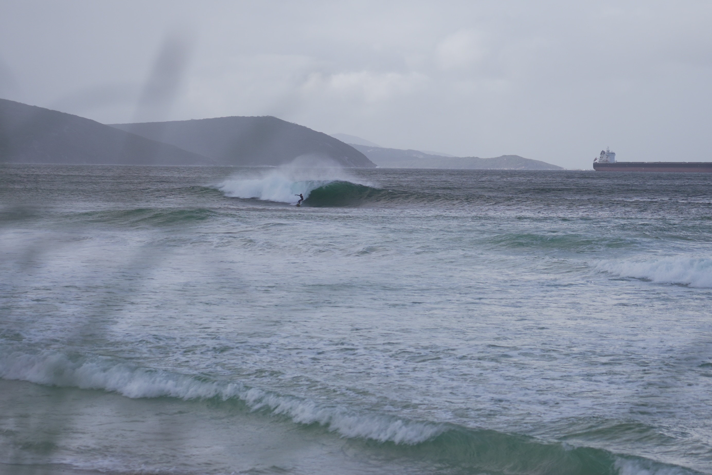

- **file**: `03_images/reefs/southern-ocean-surf-reef-albany/southern-ocean-surf-reef-albany_abc-wide-wave-ship_2025.jpg`
- **kind**: photo
- **shows**: Wide coastal shot: hills framing King George Sound, a surfer riding a peeling wave, an anchored bulk carrier offshore. The reef is fully submerged (crest -1.0 m AHD) so no structure is visible.
- **structure visible**: False
- **state shown**: as-built, in service (2025)
- **image date**: 2025 (article 2025-07-16; surf photos after the 2025 opening; construction photo before it)
- **citation**: ABC News: Daniel Mercer (2025-07-16). Photo in: Artificial reef at Middleton Beach transforms Albany's surf scene (article by Daniel Mercer; caption 'The Albany surf reef is already gaining a formidable reputation. (ABC News: Daniel Mercer)'). ABC News, https://www.abc.net.au/news/2025-07-16/southern-ocean-surf-reef-transforms-albany-wa/105530202. Image file https://live-production.wcms.abc-cdn.net.au/1acef1f70b0ceb5b17916201362c656d (card used a cropped/resized variant of the same file). Accessed 2026-10-06.
- **image URL**: https://live-production.wcms.abc-cdn.net.au/1acef1f70b0ceb5b17916201362c656d
- **source page**: https://www.abc.net.au/news/2025-07-16/southern-ocean-surf-reef-transforms-albany-wa/105530202
- **page / figure**: article photo 1 (caption: The Albany surf reef is already gaining a formidable reputation. (ABC News: Daniel Mercer))
- **credit**: ABC News: Daniel Mercer
- **licence**: ABC News copyright (all rights reserved; news editorial); link/research copy only - NOT cleared
- **retrieved**: 2026-10-06
- **used for**: context
- **How used for the model**: Page illustration of the reef working (hero candidate). No dimension read; no scale.
- **3D check pending**: YES - Break position and wave direction: where the wave peels relative to the headland, the ship and the beach could be compared with the design crest orientation 270-305 deg N and 140 m cross-shore position; weak (no scale) (values: planform, position)
- **linked records**: 02_research/reefs/southern-ocean-surf-reef-albany.json images[0]; 05_qa/reef/southern-ocean-surf-reef-albany_media_recheck.json images[0]
- **size**: 0.62 MB, 2768x1848 px
- **sha256**: 9e4074cc6ea3189589eb8ec97864055cfff635bd0d706b35e2cd9edf1c8bf3a8
- **rights**: Private research copy; reuse rights to be checked before any public release.
- **display in HTML**: True
- **added by**: image-registry backfill, 2026-10-06

## southern-ocean-surf-reef-albany-img-02 - A clean wave breaks on the Albany surf reef, seen through dune grass (ABC)

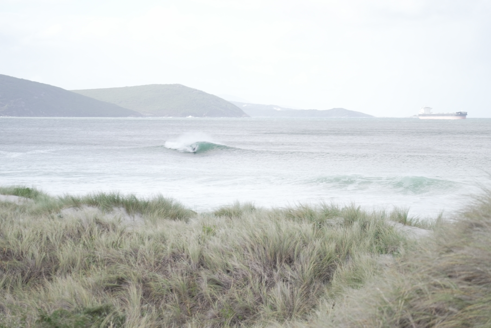

- **file**: `03_images/reefs/southern-ocean-surf-reef-albany/southern-ocean-surf-reef-albany_abc-clean-wave-dunes_2025.jpg`
- **kind**: photo
- **shows**: Beach-level shot through dune grass of a clean left-breaking wave peeling with a surfer visible; same hills and ship in the background.
- **structure visible**: False
- **state shown**: as-built, in service (2025)
- **image date**: 2025 (article 2025-07-16; surf photos after the 2025 opening; construction photo before it)
- **citation**: ABC News: Daniel Mercer (2025-07-16). Photo in: Artificial reef at Middleton Beach transforms Albany's surf scene (article by Daniel Mercer; caption 'A clean wave breaks on the Albany surf reef. (ABC News: Daniel Mercer)'). ABC News, https://www.abc.net.au/news/2025-07-16/southern-ocean-surf-reef-transforms-albany-wa/105530202. Image file https://live-production.wcms.abc-cdn.net.au/1927a3b21137e3775326b744d308276e (card used a cropped/resized variant of the same file). Accessed 2026-10-06.
- **image URL**: https://live-production.wcms.abc-cdn.net.au/1927a3b21137e3775326b744d308276e
- **source page**: https://www.abc.net.au/news/2025-07-16/southern-ocean-surf-reef-transforms-albany-wa/105530202
- **page / figure**: article photo 2 (caption: A clean wave breaks on the Albany surf reef. (ABC News: Daniel Mercer))
- **credit**: ABC News: Daniel Mercer
- **licence**: ABC News copyright (all rights reserved; news editorial); link/research copy only - NOT cleared
- **retrieved**: 2026-10-06
- **used for**: context
- **How used for the model**: Page illustration of the reef working (recommended hero image in the 2026-09-25 recheck). No dimension read.
- **3D check pending**: no - none: surf photo without scale
- **linked records**: 02_research/reefs/southern-ocean-surf-reef-albany.json images[1]; 05_qa/reef/southern-ocean-surf-reef-albany_media_recheck.json images[1]
- **size**: 1.08 MB, 4240x2832 px
- **sha256**: da01594327ef22f84221f4a7543feba7f31b4708df6ceb3f8fc43d82a00a2e0c
- **rights**: Private research copy; reuse rights to be checked before any public release.
- **display in HTML**: True
- **added by**: image-registry backfill, 2026-10-06

## southern-ocean-surf-reef-albany-img-03 - Specialised vessels building the Albany surf reef: a barge working over the submerged rock berm (ABC, supplied)

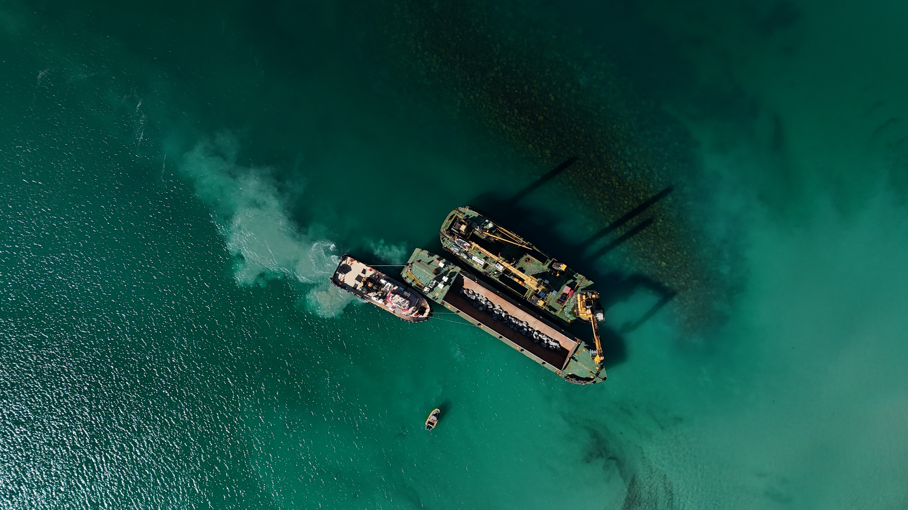

- **file**: `03_images/reefs/southern-ocean-surf-reef-albany/southern-ocean-surf-reef-albany_abc-vessels-building-reef_2025.jpg`
- **kind**: aerial
- **shows**: Aerial/drone shot of a dredge/crane barge and a tug working directly over a submerged elongated dark rock berm in turquoise water.
- **structure visible**: True
- **state shown**: under construction (about April-May 2025)
- **image date**: 2025 (article 2025-07-16; surf photos after the 2025 opening; construction photo before it)
- **citation**: 'Supplied' (photographer not named by ABC) (2025-07-16). Photo in: Artificial reef at Middleton Beach transforms Albany's surf scene (article by Daniel Mercer; caption 'Specialised vessels came from around the world to build the Albany surf reef. (Supplied)'). ABC News, https://www.abc.net.au/news/2025-07-16/southern-ocean-surf-reef-transforms-albany-wa/105530202. Image file https://live-production.wcms.abc-cdn.net.au/8ffae200f1ff9606775f71f627b5dc7e (card used a cropped/resized variant of the same file). Accessed 2026-10-06.
- **image URL**: https://live-production.wcms.abc-cdn.net.au/8ffae200f1ff9606775f71f627b5dc7e
- **source page**: https://www.abc.net.au/news/2025-07-16/southern-ocean-surf-reef-transforms-albany-wa/105530202
- **page / figure**: article photo 3 (caption: Specialised vessels came from around the world to build the Albany surf reef. (Supplied))
- **credit**: 'Supplied' (photographer not named by ABC)
- **licence**: ABC News copyright (all rights reserved; news editorial); link/research copy only - NOT cleared
- **retrieved**: 2026-10-06
- **used for**: context
- **How used for the model**: Page illustration of the construction state. No scale in the file, so not traced; the berm shape is consistent with the ~165 m footprint.
- **3D check pending**: no - Planform and length: if the barge size is known (jack-up barge, tug) the berm outline could be scaled and compared with the design crest length 110 m @ -2 m AHD and the ~165 m footprint; also the berm's curvature (values: planform, volume)
- **linked records**: 02_research/reefs/southern-ocean-surf-reef-albany.json images[2]; 05_qa/reef/southern-ocean-surf-reef-albany_media_recheck.json images[2]
- **size**: 1.44 MB, 4032x2268 px
- **sha256**: 05c42e7327578a34d18227f9280ff3ffb5e34be7c4a460bcc3fc19c2e3b5f68c
- **rights**: Private research copy; reuse rights to be checked before any public release.
- **display in HTML**: True
- **added by**: image-registry backfill, 2026-10-06
- **3D check result (2026-10-10)**: Viewed: near-vertical drone view of barges over the partly built berm, no known-length scale reference: not traceable. Qualitative only.
- **How used (update 2026-10-10)**: Context only, not traced (METHOD.md 2c).

## southern-ocean-surf-reef-albany-img-04 - Surfer bottom-turning on a breaking wave at the Albany reef (RWR)

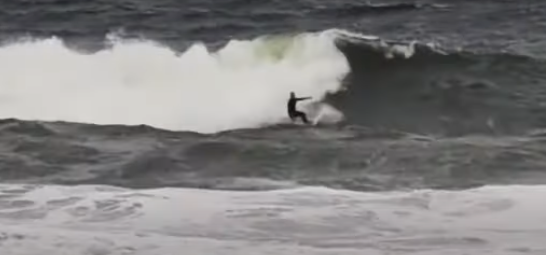

- **file**: `03_images/reefs/southern-ocean-surf-reef-albany/southern-ocean-surf-reef-albany_rwr-surfing-wave_2025.png`
- **kind**: photo
- **shows**: Surfer bottom-turning on a breaking wave with whitewater peeling left; reef submerged, not visible.
- **structure visible**: False
- **state shown**: as-built, in service (2025)
- **image date**: 2025 (upload path 2025/05)
- **citation**: Raised Water Research (2025). Midds Reef [spot profile page for the Albany / Southern Ocean Surf Reef]; image 'Southern Ocean Surf Reef Surfing Waves Artificial Reef'. https://raisedwaterresearch.com/spot/artificial-reef/australia/western-australia/albany-artificial-surf-reef/. Image file https://raisedwaterresearch.com/wp-content/uploads/2025/05/Southern-Ocean-Surf-Reef-Surfing-Waves-Artificial-Reef.png. Accessed 2026-10-06.
- **image URL**: https://raisedwaterresearch.com/wp-content/uploads/2025/05/Southern-Ocean-Surf-Reef-Surfing-Waves-Artificial-Reef.png
- **source page**: https://raisedwaterresearch.com/spot/artificial-reef/australia/western-australia/albany-artificial-surf-reef/
- **page / figure**: page gallery image 'Southern-Ocean-Surf-Reef-Surfing-Waves-Artificial-Reef.png'
- **credit**: Raised Water Research
- **licence**: Copyright Raised Water Research per the card (no licence on the page); link/research copy only - NOT cleared
- **retrieved**: 2026-10-06
- **used for**: context
- **How used for the model**: Page illustration of the surf effect. No dimension read.
- **3D check pending**: no - none: surf photo without scale
- **linked records**: 02_research/reefs/southern-ocean-surf-reef-albany.json images (card image); 05_qa/reef/southern-ocean-surf-reef-albany_media_recheck.json
- **size**: 0.15 MB, 546x255 px
- **sha256**: 97ffe155677ce636068626c22ac6c50220da084812b298f82d104d318ace7214
- **rights**: Private research copy; reuse rights to be checked before any public release.
- **display in HTML**: True
- **added by**: image-registry backfill, 2026-10-06

## southern-ocean-surf-reef-albany-img-05 - Aerial of the Albany artificial surf reef under construction, May 2025 (RWR)

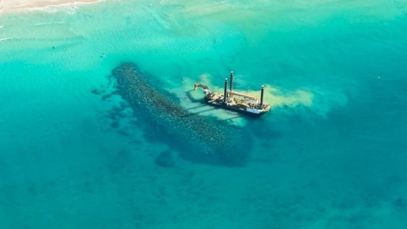

- **file**: `03_images/reefs/southern-ocean-surf-reef-albany/southern-ocean-surf-reef-albany_rwr-construction-overview_2025.jpg`
- **kind**: aerial
- **shows**: Aerial shot of the sandy beach and shallow turquoise water with a clear elongated dark submerged rock-berm shadow and a small dredge vessel alongside; embedded caption 'An aerial shot of the Great Southern's artificial surf reef under construction in May, 2025.'
- **structure visible**: True
- **state shown**: under construction (May 2025)
- **image date**: 2025-05 (embedded caption)
- **citation**: Raised Water Research (2025). Midds Reef [spot profile page for the Albany / Southern Ocean Surf Reef]; image 'Southern Ocean Surf Reef Albany artificial surf reef construction overview'. https://raisedwaterresearch.com/spot/artificial-reef/australia/western-australia/albany-artificial-surf-reef/. Image file https://raisedwaterresearch.com/wp-content/uploads/2025/05/Southern-Ocean-Surf-Reef-Albany-artificial-surf-reef-construction-overview.jpg. Accessed 2026-10-06.
- **image URL**: https://raisedwaterresearch.com/wp-content/uploads/2025/05/Southern-Ocean-Surf-Reef-Albany-artificial-surf-reef-construction-overview.jpg
- **source page**: https://raisedwaterresearch.com/spot/artificial-reef/australia/western-australia/albany-artificial-surf-reef/
- **page / figure**: page gallery image 'Southern-Ocean-Surf-Reef-Albany-artificial-surf-reef-construction-overview.jpg'
- **credit**: Raised Water Research (the file carries an embedded caption only; photographer not named)
- **licence**: Copyright Raised Water Research per the card (no licence on the page); link/research copy only - NOT cleared
- **retrieved**: 2026-10-06
- **used for**: context
- **How used for the model**: Page illustration of the construction state; oblique view with no scale, so not traced. The berm shadow is visible, so it could support a planform check.
- **3D check pending**: no - Planform: the berm shadow outline vs the design crest length 110 m @ -2 m AHD and the ~165 m footprint, orientation 270-305 deg N, ~140 m offshore (values: planform, position)
- **linked records**: 02_research/reefs/southern-ocean-surf-reef-albany.json images (card image); 05_qa/reef/southern-ocean-surf-reef-albany_media_recheck.json
- **size**: 0.03 MB, 810x456 px
- **sha256**: df3460ac80d21764f04f4a7b044ed70a73644fd52c62c835cae03f8fa7b80b76
- **rights**: Private research copy; reuse rights to be checked before any public release.
- **display in HTML**: True
- **added by**: image-registry backfill, 2026-10-06
- **3D check result (2026-10-10)**: Viewed: oblique aerial, no scale, berm only partly built (May 2025): not traceable. Qualitative only: elongated dark berm tapering seaward, consistent with the wedge planform. No depth value.
- **How used (update 2026-10-10)**: Context for the planform, not traced (METHOD.md 2c).

## southern-ocean-surf-reef-albany-img-06 - Excavator on a jack-up barge deploying rock for the Albany reef (RWR)

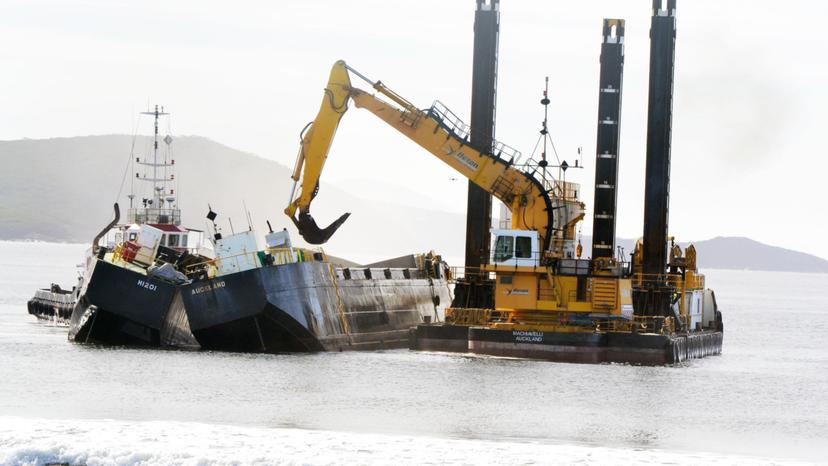

- **file**: `03_images/reefs/southern-ocean-surf-reef-albany/southern-ocean-surf-reef-albany_rwr-barge-deploy_2025.jpg`
- **kind**: photo
- **shows**: A tracked excavator on a jack-up work barge with spud legs, beside a tug, placing rock offshore; hills of the sound behind.
- **structure visible**: False
- **state shown**: under construction (2025)
- **image date**: 2025 (upload path 2025/05)
- **citation**: Raised Water Research (2025). Midds Reef [spot profile page for the Albany / Southern Ocean Surf Reef]; image 'Southern Ocean Surf Reef Barge Deploy'. https://raisedwaterresearch.com/spot/artificial-reef/australia/western-australia/albany-artificial-surf-reef/. Image file https://raisedwaterresearch.com/wp-content/uploads/2025/05/Southern-Ocean-Surf-Reef-Barge-Deploy.jpg. Accessed 2026-10-06.
- **image URL**: https://raisedwaterresearch.com/wp-content/uploads/2025/05/Southern-Ocean-Surf-Reef-Barge-Deploy.jpg
- **source page**: https://raisedwaterresearch.com/spot/artificial-reef/australia/western-australia/albany-artificial-surf-reef/
- **page / figure**: page gallery image 'Southern-Ocean-Surf-Reef-Barge-Deploy.jpg'
- **credit**: Raised Water Research (photographer not named)
- **licence**: Copyright Raised Water Research per the card (no licence on the page); link/research copy only - NOT cleared
- **retrieved**: 2026-10-06
- **used for**: context
- **How used for the model**: Page illustration of the construction method (rock placed from a jack-up barge). No dimension read.
- **3D check pending**: no - none: construction method photo
- **linked records**: 02_research/reefs/southern-ocean-surf-reef-albany.json images (not on the card; found on the RWR page 2026-10-06); 05_qa/reef/southern-ocean-surf-reef-albany_media_recheck.json
- **size**: 0.05 MB, 828x466 px
- **sha256**: e626ef011c6a39b98650e0e97b350032924495d4904e63bb86cda73648dbce67
- **rights**: Private research copy; reuse rights to be checked before any public release.
- **display in HTML**: True
- **added by**: image-registry backfill, 2026-10-06

## southern-ocean-surf-reef-albany-img-07 - Jack-up barge offshore of Middleton Beach with small waves breaking, at dusk (RWR)

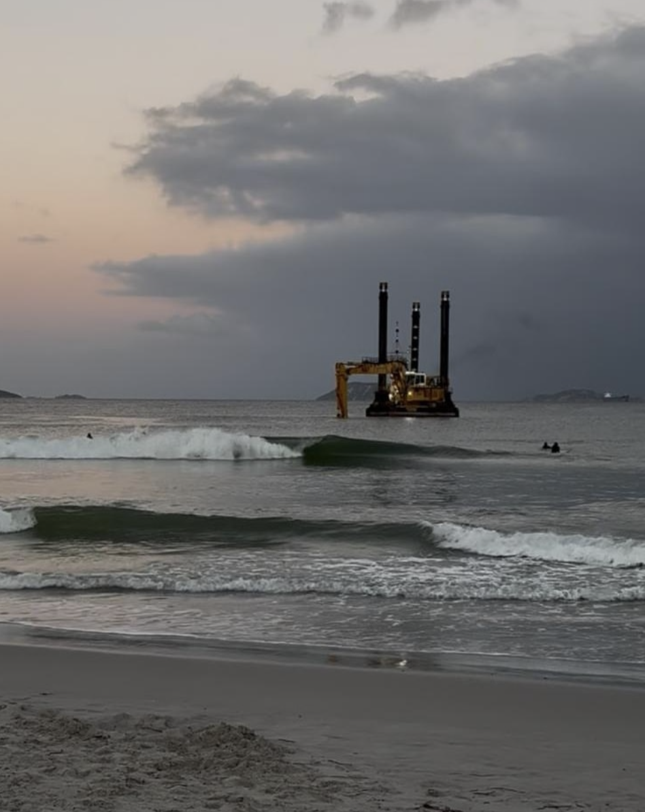

- **file**: `03_images/reefs/southern-ocean-surf-reef-albany/southern-ocean-surf-reef-albany_rwr-construction-2_2025.png`
- **kind**: photo
- **shows**: Dusk view from the beach of a jack-up barge with excavator working offshore, small waves breaking on the sandbar and two surfers in the water.
- **structure visible**: False
- **state shown**: under construction (2025)
- **image date**: 2025 (upload path 2025/05)
- **citation**: Raised Water Research (2025). Midds Reef [spot profile page for the Albany / Southern Ocean Surf Reef]; image 'Southern Ocean Surf Reef Albany Middleton Beach Construction 2'. https://raisedwaterresearch.com/spot/artificial-reef/australia/western-australia/albany-artificial-surf-reef/. Image file https://raisedwaterresearch.com/wp-content/uploads/2025/05/Southern-Ocean-Surf-Reef-Albany-Middleton-Beach-Construction-2.png. Accessed 2026-10-06.
- **image URL**: https://raisedwaterresearch.com/wp-content/uploads/2025/05/Southern-Ocean-Surf-Reef-Albany-Middleton-Beach-Construction-2.png
- **source page**: https://raisedwaterresearch.com/spot/artificial-reef/australia/western-australia/albany-artificial-surf-reef/
- **page / figure**: page gallery image 'Southern-Ocean-Surf-Reef-Albany-Middleton-Beach-Construction-2.png'
- **credit**: Raised Water Research (photographer not named)
- **licence**: Copyright Raised Water Research per the card (no licence on the page); link/research copy only - NOT cleared
- **retrieved**: 2026-10-06
- **used for**: context
- **How used for the model**: Page illustration of the construction site from the beach. No dimension read.
- **3D check pending**: YES - Barge distance offshore and break position from the beach could check the 140 m cross-shore design position (need camera position) (values: position)
- **linked records**: 02_research/reefs/southern-ocean-surf-reef-albany.json images (not on the card; found on the RWR page 2026-10-06); 05_qa/reef/southern-ocean-surf-reef-albany_media_recheck.json
- **size**: 0.94 MB, 948x1192 px
- **sha256**: 6c6cef623a17285d75835a6d24f2bd5ea52266d75d8b7fba4d3666ddd6587828
- **rights**: Private research copy; reuse rights to be checked before any public release.
- **display in HTML**: True
- **added by**: image-registry backfill, 2026-10-06

## southern-ocean-surf-reef-albany-img-08 - Granite boulder stockpiles at the quarry supplying the Albany reef (RWR)

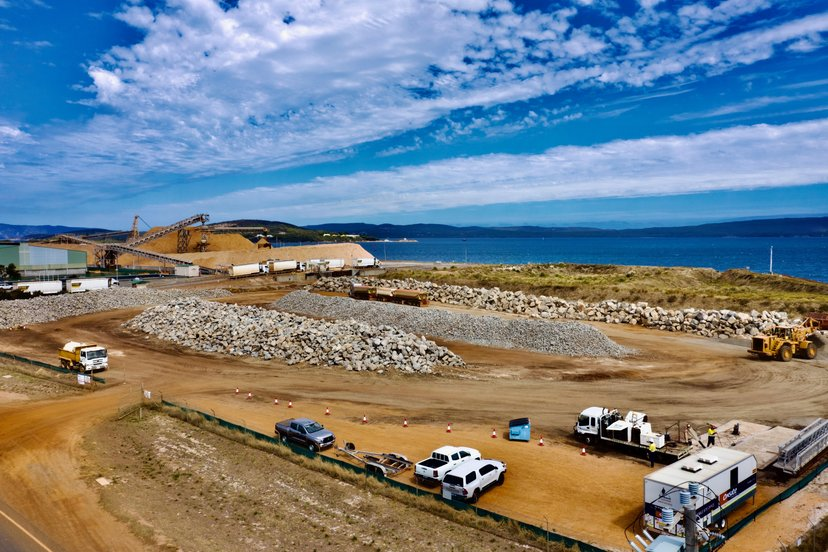

- **file**: `03_images/reefs/southern-ocean-surf-reef-albany/southern-ocean-surf-reef-albany_rwr-granite-quarry_2025.jpg`
- **kind**: photo
- **shows**: Quarry/port stockpiles of granite boulders and trucks beside the sound: the rock source, not the reef.
- **structure visible**: False
- **state shown**: not applicable (material supply)
- **image date**: 2025 (upload path 2025/05)
- **citation**: Raised Water Research (2025). Midds Reef [spot profile page for the Albany / Southern Ocean Surf Reef]; image 'Southern Ocean Surf Reef Granite Boulder Source'. https://raisedwaterresearch.com/spot/artificial-reef/australia/western-australia/albany-artificial-surf-reef/. Image file https://raisedwaterresearch.com/wp-content/uploads/2025/05/Southern-Ocean-Surf-Reef-Granite-Boulder-Source.jpg. Accessed 2026-10-06.
- **image URL**: https://raisedwaterresearch.com/wp-content/uploads/2025/05/Southern-Ocean-Surf-Reef-Granite-Boulder-Source.jpg
- **source page**: https://raisedwaterresearch.com/spot/artificial-reef/australia/western-australia/albany-artificial-surf-reef/
- **page / figure**: page gallery image 'Southern-Ocean-Surf-Reef-Granite-Boulder-Source.jpg'
- **credit**: Raised Water Research (photographer not named)
- **licence**: Copyright Raised Water Research per the card (no licence on the page); link/research copy only - NOT cleared
- **retrieved**: 2026-10-06
- **used for**: not_used
- **How used for the model**: Not used: shows the rock supply, not the reef, its site or its surf.
- **3D check pending**: no - none: not a reef image
- **linked records**: 02_research/reefs/southern-ocean-surf-reef-albany.json images (not on the card; found on the RWR page 2026-10-06); 05_qa/reef/southern-ocean-surf-reef-albany_media_recheck.json
- **size**: 0.12 MB, 828x552 px
- **sha256**: 5c5af46a3e795caa80441e1f21367444e653fa1db9c7e1abf76f836917f28aa8
- **rights**: Private research copy; reuse rights to be checked before any public release.
- **display in HTML**: False
- **added by**: image-registry backfill, 2026-10-06

## southern-ocean-surf-reef-albany-img-09 - Vessel track map between the quarry (Port of Albany) and Middleton Beach (RWR)

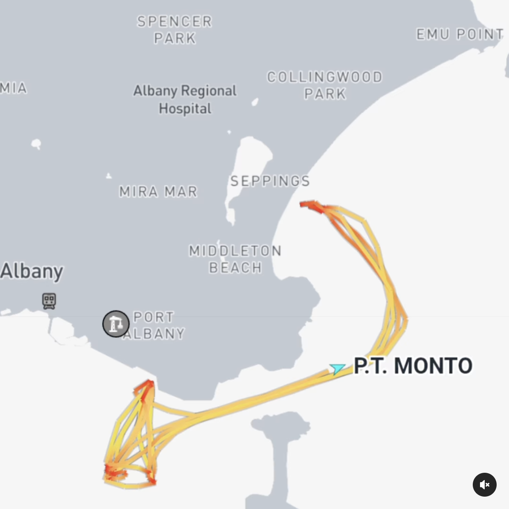

- **file**: `03_images/reefs/southern-ocean-surf-reef-albany/southern-ocean-surf-reef-albany_rwr-vessel-track-map_2025.png`
- **kind**: diagram
- **shows**: Map screenshot of AIS-style vessel tracks (vessel 'P.T. MONTO') running between the Port Albany area and the Middleton Beach site: the rock-carrying route.
- **structure visible**: False
- **state shown**: not applicable (logistics)
- **image date**: 2025 (upload path 2025/05)
- **citation**: Raised Water Research (2025). Midds Reef [spot profile page for the Albany / Southern Ocean Surf Reef]; image 'Southern Ocean Surf Reef Albany Middleton Beach Sourcing'. https://raisedwaterresearch.com/spot/artificial-reef/australia/western-australia/albany-artificial-surf-reef/. Image file https://raisedwaterresearch.com/wp-content/uploads/2025/05/Southern-Ocean-Surf-Reef-Albany-Middleton-Beach-Sourcing.png. Accessed 2026-10-06.
- **image URL**: https://raisedwaterresearch.com/wp-content/uploads/2025/05/Southern-Ocean-Surf-Reef-Albany-Middleton-Beach-Sourcing.png
- **source page**: https://raisedwaterresearch.com/spot/artificial-reef/australia/western-australia/albany-artificial-surf-reef/
- **page / figure**: page gallery image 'Southern-Ocean-Surf-Reef-Albany-Middleton-Beach-Sourcing.png'
- **credit**: Raised Water Research (map screenshot of a vessel-tracking service; provider not named)
- **licence**: Copyright Raised Water Research per the card (no licence on the page); link/research copy only - NOT cleared
- **retrieved**: 2026-10-06
- **used for**: not_used
- **How used for the model**: Not used: shows vessel tracks, not the reef or seabed.
- **3D check pending**: no - none: not a reef image
- **linked records**: 02_research/reefs/southern-ocean-surf-reef-albany.json images (not on the card; found on the RWR page 2026-10-06); 05_qa/reef/southern-ocean-surf-reef-albany_media_recheck.json
- **size**: 0.50 MB, 1194x1194 px
- **sha256**: dc43078f544039ab96e56cc32d11d766ba25c615158542de0ff5e20ecd0e9c74
- **rights**: Private research copy; reuse rights to be checked before any public release.
- **display in HTML**: False
- **added by**: image-registry backfill, 2026-10-06

## southern-ocean-surf-reef-albany-img-10 - City of Albany / Bluecoast design table and plan diagram: crest 110 m @ -2 m AHD, 140 m offshore, left-hander, 41% surfability

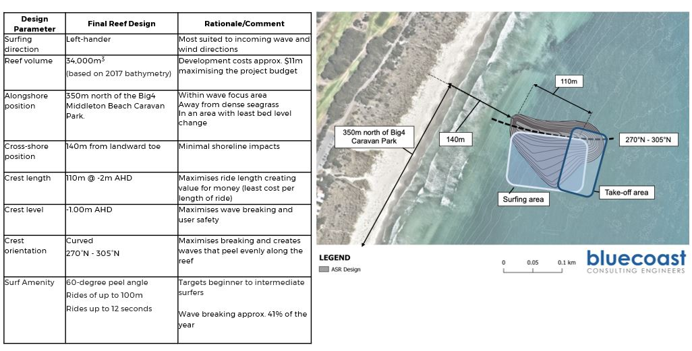

- **file**: `07_scale/shapes/southern-ocean-surf-reef-albany/src/design.jpg`
- **kind**: design_drawing
- **shows**: Left: Bluecoast design table (surfing direction left-hander, volume 34,000 m3 (2017 bathymetry), alongshore position 350 m north of the Big4 Middleton Beach Caravan Park, cross-shore 140 m from the landward toe, crest length 110 m @ -2 m AHD, crest level -1.00 m AHD, crest orientation curved 270-305 deg N, 60-degree peel angle, rides up to 100 m / 12 s, surfable ~41% of the year). Right: plan diagram of the ASR design over an aerial with the 110 m crest, 140 m offshore and 350 m alongshore labels, surfing and take-off areas.
- **structure visible**: True
- **state shown**: design (Bluecoast final design, before construction)
- **image date**: design stage (before 2025 construction; design volume based on 2017 bathymetry)
- **citation**: City of Albany / Bluecoast Consulting Engineers (n.d.; design based on 2017 bathymetry). Southern Ocean Surf Reef (SOSR) - Final Reef Design table and plan diagram. City of Albany, completed-projects page, https://www.albany.wa.gov.au/council/projects/completed-projects/southern-ocean-surf-reef-sosr.aspx. Image file https://www.albany.wa.gov.au/Profiles/albany/Assets/ClientData/Surf_Reef/design.jpg. Accessed 2026-10-04 (identical copy re-fetched 2026-10-06).
- **image URL**: https://www.albany.wa.gov.au/Profiles/albany/Assets/ClientData/Surf_Reef/design.jpg
- **source page**: https://www.albany.wa.gov.au/council/projects/completed-projects/southern-ocean-surf-reef-sosr.aspx
- **page / figure**: design table + plan diagram (1026 x 521 px)
- **credit**: City of Albany / Bluecoast Consulting Engineers
- **licence**: City of Albany (local government); no licence stated - link/research copy only, NOT cleared
- **retrieved**: 2026-10-04
- **used for**: cross_check; scale
- **How used for the model**: Source of the design parameters in the card (crest length 110 m, offshore 140 m, crest -1.0 m AHD, orientation 270-305 deg N, 34,000 m3 (corrected 2026-10-10)). The plan diagram carries a 0.05/0.1 km scale bar but the shape was not traced (no sources.md / shape.json for Albany yet); the as-built outline must be traced on esri_current_2026-01-20_z18.png.
- **3D check pending**: no - Crest -1.0 m AHD vs the as-built crest; 110 m crest length and 140 m offshore vs the dark berm outline on the 2026-01-20 Esri image; volume 34,000 m3 (values: crest_z, planform, volume, position)
- **linked records**: 02_research/reefs/southern-ocean-surf-reef-albany.json images[5]; 05_qa/reef/southern-ocean-surf-reef-albany_media_recheck.json images[5]
- **size**: 0.10 MB, 1026x521 px
- **sha256**: e546ed448473eb3bf1a3d7f49bf9b56f5f645875a853322343f96f646832d65f
- **rights**: Private research copy; reuse rights to be checked before any public release.
- **display in HTML**: True
- **added by**: image-registry backfill, 2026-10-06
- **3D check result (2026-10-10)**: Table read again on the image: volume 34,000 m3 (NOT 54,000 m3 as an earlier text said), crest level -1.00 m AHD, crest length 110 m @ -2 m AHD, 140 m from landward toe, orientation curved 270N-305N. Volume consistent with 62,800 t / 1.85 t/m3. No as-built crest value found to compare with.
- **How used (update 2026-10-10)**: Values read into METHOD.md step 1/3 and shape.json dimensions_check (source id design_table). Correction: volume is 34,000 m3, not 54,000 m3.

## southern-ocean-surf-reef-albany-img-11 - Southern-Ocean-Surf-Reef-Design-by-Bluecoast.png: Bluecoast plan diagram (RWR copy; scale bar 0.05 / 0.1 km)

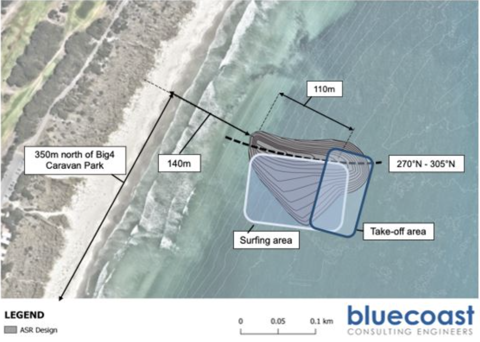

- **file**: `07_scale/shapes/southern-ocean-surf-reef-albany/src/rwr_bluecoast_design_diagram.png`
- **kind**: design_drawing
- **shows**: Plan diagram of the ASR design over an aerial: 110 m crest, 140 m offshore, 350 m north of Big4 Caravan Park, 270-305 deg N crest orientation, surfing and take-off areas, bathymetric contours, scale bar 0-0.05-0.1 km.
- **structure visible**: True
- **state shown**: design (Bluecoast final design)
- **image date**: design stage (before 2025 construction)
- **citation**: Bluecoast Consulting Engineers (n.d.), via Raised Water Research (2025). Southern Ocean Surf Reef Design by Bluecoast [plan diagram] on: Midds Reef [spot page]. https://raisedwaterresearch.com/spot/artificial-reef/australia/western-australia/albany-artificial-surf-reef/. Image file https://raisedwaterresearch.com/wp-content/uploads/2019/12/Souther-Ocean-Surf-Reef-Design-by-Bluecoast.png (file name misspelled 'Souther'). Accessed 2026-10-04 (sha256 re-verified 2026-10-06).
- **image URL**: https://raisedwaterresearch.com/wp-content/uploads/2019/12/Souther-Ocean-Surf-Reef-Design-by-Bluecoast.png
- **source page**: https://raisedwaterresearch.com/spot/artificial-reef/australia/western-australia/albany-artificial-surf-reef/
- **page / figure**: page gallery image (984 x 702 px)
- **credit**: Bluecoast Consulting Engineers via Raised Water Research
- **licence**: not stated - NOT cleared
- **retrieved**: 2026-10-04
- **used for**: cross_check; scale
- **How used for the model**: Higher-resolution version of the plan diagram in design.jpg: a candidate for tracing the design planform with its scale bar; not traced yet (no shape.json for Albany).
- **3D check pending**: no - Trace the design planform and contours using the scale bar and compare with the as-built dark berm on the 2026-01-20 Esri image and with crest -1.0 m AHD (values: planform, crest_z, seabed)
- **linked records**: 07_scale/shapes/southern-ocean-surf-reef-albany/src/design.jpg
- **size**: 0.95 MB, 984x702 px
- **sha256**: 7cc2069f3e075e06928eec152a9619718468d084dd9c7807a8081990b5b99706
- **rights**: Private research copy; reuse rights to be checked before any public release.
- **display in HTML**: True
- **added by**: image-registry backfill, 2026-10-06
- **3D check result (2026-10-10)**: Outermost design contour traced (25 vertices); scale bar 1.52 px/m, north up (crest line 278 deg; free fit -3 deg); positioned on the satellite by translation (IoU 0.81). Area 13,104 m2, along-crest length 164.6 m (text 165 m). Faint seabed contours east of the reef carry no labels: no depth read.
- **How used (update 2026-10-10)**: TRACED 2026-10-10: planform -> shape.json source design_plan / default outline design_bluecoast (METHOD.md 2b).
- **annotated versions (added 2026-10-10)**: 07_scale/shapes/southern-ocean-surf-reef-albany/overlays/design_diagram_trace.png, 07_scale/shapes/southern-ocean-surf-reef-albany/overlays/canonical_versions_m.png

## southern-ocean-surf-reef-albany-img-12 - Esri Wayback release 13192, Middleton Beach, z18, r=250 m (2025-01-16, before construction)

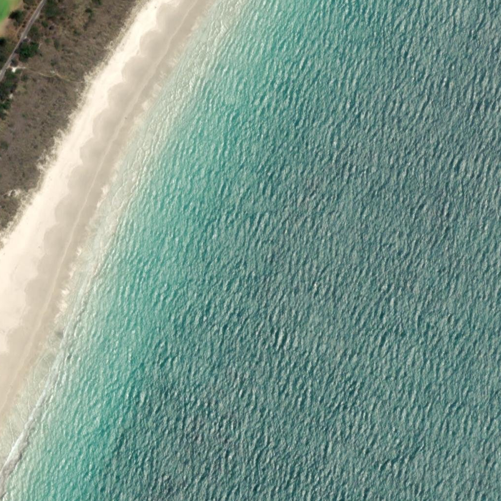

- **file**: `07_scale/shapes/southern-ocean-surf-reef-albany/src/esri_wayback13192_2025-01-16_z18.png`
- **kind**: satellite
- **shows**: Beach and nearshore water with ripple texture; no structure (before the reef was built in 2025).
- **structure visible**: False
- **state shown**: pre-construction (2025-01-16)
- **image date**: 2025-01-16
- **citation**: Esri, Maxar, Earthstar Geographics, and the GIS User Community (2025). World Imagery Wayback release 13192, image captured 2025-01-16. Esri World Imagery tile service, https://server.arcgisonline.com/ArcGIS/rest/services/World_Imagery/MapServer, via Esri Wayback https://livingatlas.arcgis.com/wayback/. Accessed 2026-10-04.
- **image URL**: https://wayback.maptiles.arcgis.com/arcgis/rest/services/World_Imagery/WMTS/1.0.0/default028mm/MapServer/tile/13192/{z}/{y}/{x}
- **source page**: Esri World Imagery Wayback
- **page / figure**: centre -35.018, 117.9207, r=250 m, z18, 1022 x 1022 px, 0.489 m/px; sidecar esri_wayback13192_2025-01-16_z18.png.geo.json
- **credit**: Esri, Maxar, Earthstar Geographics, and the GIS User Community
- **licence**: Esri/Maxar imagery terms (not an open licence); private research copy only
- **retrieved**: 2026-10-04
- **used for**: context
- **How used for the model**: Pre-construction baseline of the site (no reef): comparison with the 2026 frame isolates the reef. Not traced.
- **3D check pending**: no - Seabed/sand-bar pattern before construction vs the design bathymetry (2017) and the berm position (values: seabed)
- **linked records**: 07_scale/shapes/southern-ocean-surf-reef-albany/src/esri_wayback13192_2025-01-16_z18.png.geo.json
- **size**: 1.54 MB, 1022x1022 px
- **sha256**: 1296953655b9d5f218694b4afdf60467774b4f69ffcdf7558b8dcb0701e1e6c2
- **rights**: Private research copy; reuse rights to be checked before any public release.
- **display in HTML**: True
- **added by**: image-registry backfill, 2026-10-06
- **3D check result (2026-10-10)**: Before/after: inside the traced polygon mean green 137 (2025) vs 129 offshore = no structure; 57 vs 68 in 2026. Confirms the dark wedge is the new reef. No depth information extractable from the RGB image.
- **How used (update 2026-10-10)**: Pre-construction control for the planform trace (VERIFY.md check 1).
- **annotated versions (added 2026-10-10)**: 07_scale/shapes/southern-ocean-surf-reef-albany/overlays/before_after_2025-01-16_vs_2026-01-20.png

## southern-ocean-surf-reef-albany-img-13 - Esri World Imagery current, Middleton Beach, z18, r=250 m (2026-01-20)

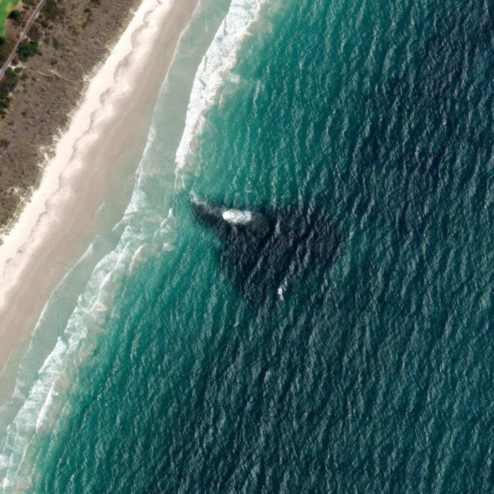

- **file**: `07_scale/shapes/southern-ocean-surf-reef-albany/src/esri_current_2026-01-20_z18.png`
- **kind**: satellite
- **shows**: The completed reef visible as a dark triangular/wedge-shaped patch offshore with a wave breaking at its shoreward apex; beach, dunes and surf zone around it.
- **structure visible**: True
- **state shown**: as-built, in service (2026-01-20)
- **image date**: 2026-01-20
- **citation**: Esri, Maxar, Earthstar Geographics, and the GIS User Community (2026). World Imagery (current layer), image captured 2026-01-20. Esri World Imagery tile service, https://server.arcgisonline.com/ArcGIS/rest/services/World_Imagery/MapServer. Accessed 2026-10-04.
- **image URL**: https://server.arcgisonline.com/ArcGIS/rest/services/World_Imagery/MapServer/tile/{z}/{y}/{x}
- **source page**: Esri World Imagery (identify DATE field)
- **page / figure**: centre -35.018, 117.9207, r=250 m, z18, 1022 x 1022 px, 0.489 m/px; sidecar esri_current_2026-01-20_z18.png.geo.json
- **credit**: Esri, Maxar, Earthstar Geographics, and the GIS User Community
- **licence**: Esri/Maxar imagery terms (not an open licence); private research copy only
- **retrieved**: 2026-10-04
- **used for**: context
- **How used for the model**: Best satellite view of the as-built reef (visible dark berm + breaking wave). The planform has not been traced yet (no shape.json); this is the primary candidate image for the trace and for the crest length / 140 m offshore check.
- **3D check pending**: no - Trace the dark berm (length vs 110 m crest @ -2 m AHD, 165 m footprint; distance offshore vs 140 m; orientation vs 270-305 deg N) and set shape.json/3D from it (values: planform, position, volume)
- **linked records**: 07_scale/shapes/southern-ocean-surf-reef-albany/src/esri_current_2026-01-20_z18.png.geo.json
- **size**: 1.49 MB, 1022x1022 px
- **sha256**: ce13860296c89262a48e7f69cf359d4aa61e26b0aeceaaf115bcae3d496aa4db
- **rights**: Private research copy; reuse rights to be checked before any public release.
- **display in HTML**: True
- **added by**: image-registry backfill, 2026-10-06
- **3D check result (2026-10-10)**: Traced (20 vertices): area 10,918 m2; along-crest length 157 m (text 165 m, -4.7 %), across 117 m (text up to 110 m); crest edge bearing 281.5 deg (design 270-305). Nearest edge 71 m from the dry-sand beach-face line (about 150 m from the vegetation edge; text 140 m from landward toe, reference undefined). No depth information in the image.
- **How used (update 2026-10-10)**: TRACED 2026-10-10: source sat2026 (primary as-built visible outline), outline version sat_2026 (METHOD.md 2a).
- **annotated versions (added 2026-10-10)**: 07_scale/shapes/southern-ocean-surf-reef-albany/overlays/sat2026-01-20_trace.png, 07_scale/shapes/southern-ocean-surf-reef-albany/overlays/shoreline_fit.png, 07_scale/shapes/southern-ocean-surf-reef-albany/overlays/before_after_2025-01-16_vs_2026-01-20.png

## southern-ocean-surf-reef-albany-img-14 - BMT 2018 EIA Figure 6.9: Option B and development footprint with depth contours (spot soundings in m CD), Middleton Beach
- **file**: 07_scale/shapes/southern-ocean-surf-reef-albany/src/epa/EIA_page42_fig6-9_render130dpi.png
- **kind**: survey_plot
- **shows**: Aerial of Middleton Beach with spot depths in metres below chart datum (2.7, 3.4, 5, 5.7, 7.2, 7.3, 8.4), a thin 5 m line, MHW/MLW lines, the 2018 development area (red) and the concept Option B footprint (green), UTM50 GDA94 grid.
- **state**: pre-construction (2014 imagery, 2018 figure)
- **image date**: Produced 13 Aug 2018 (BMT); imagery Landgate Dec 2014
- **citation**: BMT Western Australia Pty Ltd (2018). Middleton Beach Artificial Surf Reef Environmental Impact Assessment. Report 1345_001/1_Rev2, September 2018, prepared for City of Albany. EPA WA referral documentation, https://epa.wa.gov.au/sites/default/files/Referral_Documentation/Environmental%20Impact%20Assessment_0.pdf. Accessed 2026-10-10. Page 32 (PDF p. 42), Figure 6.9 (raster also saved as src/epa/EIA_fig6-9_embedded_raster.png).
- **image URL**: https://epa.wa.gov.au/sites/default/files/Referral_Documentation/Environmental%20Impact%20Assessment_0.pdf
- **source page**: https://www.epa.wa.gov.au/proposals/albany-artificial-surf-reef
- **page / figure**: p. 32, Fig 6.9
- **credit**: BMT / City of Albany; imagery Landgate
- **licence**: not stated
- **retrieved**: 2026-10-10
- **used for**: 3d_seabed, cross_check
- **How used for the model**: Soundings read at the printed labels and georeferenced with the UTM grid labels (annotated A3). 8.4 m CD at (x 188, y 315) agrees with the seabed profile (-8.0 m AHD); the 2.7 m near shore (x -53, y 32) is 1.6 m deeper than the profile: unresolved (METHODS_3D 4). Not used for the profile.
- **annotated versions**: 07_scale/shapes/southern-ocean-surf-reef-albany/3d/annotated/A3_bmt2018_fig6-9_soundings_georeferenced.png
- **3D check**: pending False - result 2026-10-10: far-field agrees, near-shore conflicts by 1.6 m (open).
- **size**: 0.95 MB, [1075, 1521] px
- **sha256**: 1629ed99d6ac42e93cafff27bc2d8fe2590b1c6b1e264df6bc4df52ac119dc67
- **rights**: Private research copy; reuse rights to be checked before any public release.
- **display in HTML**: True
- **added by**: 3D network run (fresh agent), 2026-10-10

## southern-ocean-surf-reef-albany-img-15 - RHDHV 2018 appendix Figure 29: interpolated bathymetry of the base case (2016 survey) and four layouts, Middleton Beach
- **file**: 07_scale/shapes/southern-ocean-surf-reef-albany/src/epa/EIA_appendix_page140_fig29_bathymetry_150dpi.png
- **kind**: survey_plot
- **shows**: Regional bathymetry colour map in 1 m bins (above 2 ... below -12 m, datum not stated) for the whole bay and close-ups of the model mesh with four candidate reef layouts.
- **state**: pre-construction (2016 survey)
- **image date**: bathymetry: 2016 survey
- **citation**: BMT Western Australia Pty Ltd (2018). Middleton Beach Artificial Surf Reef Environmental Impact Assessment. Report 1345_001/1_Rev2, September 2018, prepared for City of Albany. EPA WA referral documentation, https://epa.wa.gov.au/sites/default/files/Referral_Documentation/Environmental%20Impact%20Assessment_0.pdf. Accessed 2026-10-10. Appendix: Royal HaskoningDHV (2018) AASR Shoreline Modelling, M&APA1805R001F0.0, 27 Jun 2018, page 40, Figure 29 (PDF p. 140).
- **image URL**: https://epa.wa.gov.au/sites/default/files/Referral_Documentation/Environmental%20Impact%20Assessment_0.pdf
- **source page**: https://www.epa.wa.gov.au/proposals/albany-artificial-surf-reef
- **page / figure**: appendix p. 40, Fig 29
- **credit**: Royal HaskoningDHV / City of Albany
- **licence**: not stated
- **retrieved**: 2026-10-10
- **used for**: context, not_used
- **How used for the model**: Registered for the record: source pixels are about 10 m and the datum is not stated, so it was not used for values. A future agent could digitise it to cross-check the -3 to -6 m bands (about 100-150 m offshore).
- **annotated versions**: -
- **3D check**: pending False - not used (resolution)
- **size**: 2.14 MB, [1241, 1754] px
- **sha256**: c67264805e62c15f695ba6be13ee6087e209c7fc6ee1c7f14a2fbf471cdae8d8
- **rights**: Private research copy; reuse rights to be checked before any public release.
- **display in HTML**: True
- **added by**: 3D network run (fresh agent), 2026-10-10

## southern-ocean-surf-reef-albany-img-16 - RHDHV 2015 Option B "Long Right" plan with depth contours over Google Earth, Middleton Beach (Raised Water Research gallery)
- **file**: 07_scale/shapes/southern-ocean-surf-reef-albany/src/rwr_images/rwr_RHDHV_optionB_contours_plan_2015.jpg
- **kind**: plan_figure
- **shows**: Plan view of the beach and surf zone with coloured seabed contours (legend -0.5, -1 ... -8 m) and the 2015 concept reef (crest -0.75 m, 46,620 m3, 120 m crest, toe slope 1:15), about 180-375 m offshore.
- **state**: pre-construction concept (2015)
- **image date**: 2015 (RHDHV feasibility)
- **citation**: Royal HaskoningDHV (2015). Option B "Long Right" artificial surf reef, depth contours -0.5 to -8 m on Google Earth imagery (c) 2015 Google, DigitalGlobe; as reproduced by Raised Water Research (2019 upload) on its Albany spot page. Accessed 2026-10-10. Original report figure not located (City document 435 is the executive summary only).
- **image URL**: https://raisedwaterresearch.com/wp-content/uploads/2019/12/Albany-Model2.jpg
- **source page**: https://raisedwaterresearch.com/spot/artificial-reef/australia/western-australia/albany-artificial-surf-reef/
- **page / figure**: gallery image Albany-Model2
- **credit**: Royal HaskoningDHV; imagery Google / DigitalGlobe
- **licence**: not stated
- **retrieved**: 2026-10-10
- **used for**: 3d_seabed
- **How used for the model**: SEABED SOURCE: contour crossings -1 ... -7 m read along 8 shore-normal transects after georeferencing on Esri 2025-01-16 (4 control points, residual 3-6 m); medians give the profile in model.js (annotated A1). Datum not printed; read as AHD (assumption A3). The concept structure drawn here is not the built reef.
- **annotated versions**: 07_scale/shapes/southern-ocean-surf-reef-albany/3d/annotated/A1_rhdhv_2015_contours_read_on_plan.png
- **3D check**: pending False - used 2026-10-10: seabed profile; datum assumed AHD
- **size**: 0.29 MB, [609, 354] px
- **sha256**: 5278ae892368be056c8c6d7bcf2ca701bdf8e20fefd8a43cac19081d7a14b1a4
- **rights**: Private research copy; reuse rights to be checked before any public release.
- **display in HTML**: True
- **added by**: 3D network run (fresh agent), 2026-10-10

## southern-ocean-surf-reef-albany-img-17 - RHDHV 2015 Option B concept, oblique Google Earth view with depth contours and legend (Raised Water Research gallery)
- **file**: 07_scale/shapes/southern-ocean-surf-reef-albany/src/rwr_images/rwr_RHDHV_optionB_contours_oblique_2015.jpg
- **kind**: plan_figure
- **shows**: Oblique view of the concept reef mound on the 2015 seabed contours with the colour legend (-0.5 ... -8 m, 0, +1).
- **state**: pre-construction concept (2015)
- **image date**: 2015
- **citation**: Royal HaskoningDHV (2015). Option B "Long Right" (46,620 m3, crest -0.75 m, crest length 120 m, toe slope 1:15), depth contours over Google Earth (c) 2015 Google, Image (c) 2015 DigitalGlobe; as reproduced by Raised Water Research. Accessed 2026-10-10.
- **image URL**: https://raisedwaterresearch.com/wp-content/uploads/2019/12/Albany-Model1.jpg
- **source page**: https://raisedwaterresearch.com/spot/artificial-reef/australia/western-australia/albany-artificial-surf-reef/
- **page / figure**: gallery image Albany-Model1
- **credit**: Royal HaskoningDHV; imagery Google / DigitalGlobe
- **licence**: not stated
- **retrieved**: 2026-10-10
- **used for**: 3d_seabed, context
- **How used for the model**: Legend source for the contour colours (read from this image) and a visual check that the contours run parallel to the beach about 100-150 m wide for -1 to -5 m. No measurement taken from it.
- **annotated versions**: -
- **3D check**: pending False - context 2026-10-10
- **size**: 0.30 MB, [645, 363] px
- **sha256**: 2b25f22a257ca15c67b6e0330dc6d3437c040e47b446c610adeb9c3061690466
- **rights**: Private research copy; reuse rights to be checked before any public release.
- **display in HTML**: True
- **added by**: 3D network run (fresh agent), 2026-10-10

## southern-ocean-surf-reef-albany-img-18 - Artist rendering of the Albany reef and Middleton Beach with inset of a breaking wave (Raised Water Research)
- **file**: 07_scale/shapes/southern-ocean-surf-reef-albany/src/rwr_images/rwr_albany_reef_rendering.jpg
- **kind**: diagram
- **shows**: Artist impression of the bay with a wave on the future reef.
- **state**: design (rendering)
- **image date**: 2019 upload (design stage)
- **citation**: Raised Water Research (2019). Albany Artificial Surf Reef, rendering. https://raisedwaterresearch.com/spot/artificial-reef/australia/western-australia/albany-artificial-surf-reef/. Accessed 2026-10-10.
- **image URL**: https://raisedwaterresearch.com/wp-content/uploads/2019/12/Albany-Reef-Rendering.jpg
- **source page**: https://raisedwaterresearch.com/spot/artificial-reef/australia/western-australia/albany-artificial-surf-reef/
- **page / figure**: gallery
- **credit**: Raised Water Research / City of Albany
- **licence**: not stated
- **retrieved**: 2026-10-10
- **used for**: context
- **How used for the model**: Context only; not to scale.
- **annotated versions**: -
- **3D check**: pending False - not used
- **size**: 0.42 MB, [842, 474] px
- **sha256**: 90408c7a1403adfa396b7a519ab142685fdc0f30fec4240dd1113e492b5da654
- **rights**: Private research copy; reuse rights to be checked before any public release.
- **display in HTML**: True
- **added by**: 3D network run (fresh agent), 2026-10-10

## southern-ocean-surf-reef-albany-img-19 - Aerial rendering of the submerged reef off Middleton Beach (Raised Water Research)
- **file**: 07_scale/shapes/southern-ocean-surf-reef-albany/src/rwr_images/rwr_albany_rendering_aerial.jpg
- **kind**: diagram
- **shows**: Rendered dark footprint of the reef offshore of the beach and car park.
- **state**: design (rendering)
- **image date**: 2019 upload (design stage)
- **citation**: Raised Water Research (2019). Albany Artificial Surf Reef, aerial rendering. https://raisedwaterresearch.com/spot/artificial-reef/australia/western-australia/albany-artificial-surf-reef/. Accessed 2026-10-10.
- **image URL**: https://raisedwaterresearch.com/wp-content/uploads/2019/12/Albany-Rendering.jpg
- **source page**: https://raisedwaterresearch.com/spot/artificial-reef/australia/western-australia/albany-artificial-surf-reef/
- **page / figure**: gallery
- **credit**: Raised Water Research / City of Albany
- **licence**: not stated
- **retrieved**: 2026-10-10
- **used for**: context
- **How used for the model**: Context only; not to scale.
- **annotated versions**: -
- **3D check**: pending False - not used
- **size**: 0.21 MB, [641, 373] px
- **sha256**: 3502adca74199f9136c86f6c8a938998d83d4e675a28f1854ea08f2f2a6c8981
- **rights**: Private research copy; reuse rights to be checked before any public release.
- **display in HTML**: True
- **added by**: 3D network run (fresh agent), 2026-10-10

## southern-ocean-surf-reef-albany-img-20 - Early render of the Albany reef from the air (Raised Water Research)
- **file**: 07_scale/shapes/southern-ocean-surf-reef-albany/src/rwr_images/rwr_albany_artificial_surfing_reef_render.jpg
- **kind**: diagram
- **shows**: Conceptual render with rock mound and waves.
- **state**: concept (rendering)
- **image date**: 2019 upload (concept)
- **citation**: Raised Water Research (2019). Albany Artificial Surfing Reef render. https://raisedwaterresearch.com/spot/artificial-reef/australia/western-australia/albany-artificial-surf-reef/. Accessed 2026-10-10.
- **image URL**: https://raisedwaterresearch.com/wp-content/uploads/2019/12/Albany-Artificial-Surfing-Reef.jpg
- **source page**: https://raisedwaterresearch.com/spot/artificial-reef/australia/western-australia/albany-artificial-surf-reef/
- **page / figure**: gallery
- **credit**: Raised Water Research
- **licence**: not stated
- **retrieved**: 2026-10-10
- **used for**: context
- **How used for the model**: Context only.
- **annotated versions**: -
- **3D check**: pending False - not used
- **size**: 0.04 MB, [619, 464] px
- **sha256**: 669febb987a5b4ab1da8ad115552db92bda3bf87361e9b7a3cc8c7c839512c4e
- **rights**: Private research copy; reuse rights to be checked before any public release.
- **display in HTML**: True
- **added by**: 3D network run (fresh agent), 2026-10-10

## southern-ocean-surf-reef-albany-img-21 - Still from a video titled "Midds Reef": wave breaking on the reef with the Albany coast behind (Raised Water Research gallery)
- **file**: 07_scale/shapes/southern-ocean-surf-reef-albany/src/rwr_images/rwr_midds_reef_title_screenshot_2026-04-02.png
- **kind**: video_frame
- **shows**: Title card "Midds Reef - Western Australian Man Made Wave" over a clean left-hand wave breaking on the reef; headland and ship in the background.
- **state**: as-built, in service
- **image date**: about 2026 (video)
- **citation**: Raised Water Research gallery still, uploaded 2026-04-02 (screenshot of a video; the video itself was not identified). https://raisedwaterresearch.com/spot/artificial-reef/australia/western-australia/albany-artificial-surf-reef/. Accessed 2026-10-10.
- **image URL**: https://raisedwaterresearch.com/wp-content/uploads/2019/12/Screenshot-2026-04-02-at-4.03.07-PM.png
- **source page**: https://raisedwaterresearch.com/spot/artificial-reef/australia/western-australia/albany-artificial-surf-reef/
- **page / figure**: gallery
- **credit**: Raised Water Research (video credit not stated)
- **licence**: not stated
- **retrieved**: 2026-10-10
- **used for**: context, camera_match
- **How used for the model**: Not measured. Possible camera-match candidate (wave breaking over the crest), no camera data.
- **annotated versions**: -
- **3D check**: pending False - not used
- **size**: 7.05 MB, [2390, 1392] px
- **sha256**: 104399bab168eaab71ff04693480ad7d79e60fa3450b25cee2433fe054937aea
- **rights**: Private research copy; reuse rights to be checked before any public release.
- **display in HTML**: True
- **added by**: 3D network run (fresh agent), 2026-10-10

## southern-ocean-surf-reef-albany-img-22 - Still of a physical model test of the reef in the Queensland Government Hydraulics Laboratory (Raised Water Research gallery)
- **file**: 07_scale/shapes/southern-ocean-surf-reef-albany/src/rwr_images/rwr_physical_model_QLD_hydraulics_lab_screenshot_2026-04-02.png
- **kind**: video_frame
- **shows**: Two technicians surveying a gravel mock-up of a reef in a wave basin (physical modelling mentioned in the Detailed Design Report).
- **state**: design (physical model)
- **image date**: design stage (about 2019-2020)
- **citation**: Raised Water Research gallery still, uploaded 2026-04-02 (video screenshot). https://raisedwaterresearch.com/spot/artificial-reef/australia/western-australia/albany-artificial-surf-reef/. Accessed 2026-10-10.
- **image URL**: https://raisedwaterresearch.com/wp-content/uploads/2019/12/Screenshot-2026-04-02-at-4.50.30-PM.png
- **source page**: https://raisedwaterresearch.com/spot/artificial-reef/australia/western-australia/albany-artificial-surf-reef/
- **page / figure**: gallery
- **credit**: Raised Water Research / Queensland Government Hydraulics Laboratory
- **licence**: not stated
- **retrieved**: 2026-10-10
- **used for**: context
- **How used for the model**: Context only: confirms physical model testing; no dimensions legible.
- **annotated versions**: -
- **3D check**: pending False - not used
- **size**: 3.76 MB, [2518, 1414] px
- **sha256**: adf5ad05de3f31531162e516316dcde336fd0070f48b62ff1ab8e10566f11e9b
- **rights**: Private research copy; reuse rights to be checked before any public release.
- **display in HTML**: True
- **added by**: 3D network run (fresh agent), 2026-10-10

## southern-ocean-surf-reef-albany-img-23 - Esri World Imagery Wayback release 6543, Middleton Beach, z18, r=250 m (captured 2022-12-19)
- **file**: 07_scale/shapes/southern-ocean-surf-reef-albany/src/esri_wayback6543_2022-12-19_z18.png
- **kind**: satellite
- **shows**: The site before construction: surf zone and bar, no rock. Identical in 8 Wayback releases (2024-10 ... 2025-09).
- **state**: pre-construction (2022-12-19)
- **image date**: 2022-12-19
- **citation**: Esri, Maxar, Earthstar Geographics, and the GIS User Community (2022). World Imagery Wayback release 6543, image captured 2022-12-19. https://wayback.maptiles.arcgis.com/arcgis/rest/services/World_Imagery/WMTS/1.0.0/default028mm/MapServer/tile/6543/{z}/{y}/{x}. Retrieved 2026-10-10.
- **image URL**: https://wayback.maptiles.arcgis.com/arcgis/rest/services/World_Imagery/WMTS/1.0.0/default028mm/MapServer/tile/6543/{z}/{y}/{x}
- **source page**: Esri Wayback (metadata layer SRC_DATE2)
- **page / figure**: centre -35.018, 117.9207, r=250 m, z18, 1022 x 1022 px; sidecar .geo.json
- **credit**: Esri, Maxar, Earthstar Geographics, and the GIS User Community
- **licence**: Esri/Maxar imagery terms (not an open licence); private research copy only
- **retrieved**: 2026-10-10
- **used for**: context, cross_check
- **How used for the model**: Shows the pre-construction bar and water colour; confirms no earlier structure. No values taken. The Wayback survey of 2024-10 ... 2026-09 found only three distinct captures (2022-12-19, 2025-01-16, 2026-01-20).
- **annotated versions**: -
- **3D check**: pending False - context
- **size**: 1.55 MB, [1022, 1022] px
- **sha256**: 7b07f0ff1a789734602be107ff31d2fea8e1bcb6e51ab436a91819cf89453300
- **rights**: Private research copy; reuse rights to be checked before any public release.
- **display in HTML**: True
- **added by**: 3D network run (fresh agent), 2026-10-10

## southern-ocean-surf-reef-albany-img-24 - Albany 3D model: seabed profile (contour crossings, BMT soundings) and crest-ridge section
- **file**: 07_scale/shapes/southern-ocean-surf-reef-albany/3d/annotated/A2_seabed_profile_and_crest_section.png
- **kind**: diagram
- **shows**: Profile used in the model against the contour crossings (median, IQR) and the two BMT soundings under both datum readings; section along the ridge.
- **state**: model (LOW confidence)
- **image date**: 2026-10-10
- **citation**: Own figure from RHDHV (2015), BMT (2018) and City of Albany design values; generated by 3d/scripts/make_annotations.py, 2026-10-10.
- **image URL**: 
- **source page**: 
- **page / figure**: A2
- **credit**: this project
- **licence**: private
- **retrieved**: 2026-10-10
- **used for**: 3d_seabed, 3d_crest, cross_check
- **How used for the model**: Documents the seabed profile and the unresolved near-shore conflict.
- **annotated versions**: -
- **3D check**: pending False - made 2026-10-10
- **size**: 0.14 MB, [1540, 572] px
- **sha256**: 50609013df1b6d13a1c29f2de35fb192fe8c076c3ec680eff5fda20a92a416ed
- **rights**: Private research copy; reuse rights to be checked before any public release.
- **display in HTML**: True
- **added by**: 3D network run (fresh agent), 2026-10-10

## southern-ocean-surf-reef-albany-img-25 - Albany 3D model: plan view preview (design outline, 0 m AHD)
- **file**: 07_scale/shapes/southern-ocean-surf-reef-albany/3d/preview_plan.png
- **kind**: diagram
- **shows**: Plan view of the modelled reef on the modelled seabed with grid and scale bars.
- **state**: model
- **image date**: 2026-10-10
- **citation**: Own render of 3d/index.html (three.js), 2026-10-10.
- **image URL**: 
- **source page**: 
- **page / figure**: preview
- **credit**: this project
- **licence**: private
- **retrieved**: 2026-10-10
- **used for**: context
- **How used for the model**: Model preview.
- **annotated versions**: -
- **3D check**: pending False - made 2026-10-10
- **size**: 0.35 MB, [1400, 900] px
- **sha256**: d7aaf9c493dc7ac80e244376965e66aea5ca3d93788e8b8bce93131464a234d7
- **rights**: Private research copy; reuse rights to be checked before any public release.
- **display in HTML**: True
- **added by**: 3D network run (fresh agent), 2026-10-10

## southern-ocean-surf-reef-albany-img-26 - Albany 3D model: oblique view from the sea, vertical exaggeration x2
- **file**: 07_scale/shapes/southern-ocean-surf-reef-albany/3d/preview_oblique.png
- **kind**: diagram
- **shows**: Oblique view of the modelled reef under a translucent water surface at 0 m AHD.
- **state**: model
- **image date**: 2026-10-10
- **citation**: Own render of 3d/index.html (three.js), 2026-10-10.
- **image URL**: 
- **source page**: 
- **page / figure**: preview
- **credit**: this project
- **licence**: private
- **retrieved**: 2026-10-10
- **used for**: context
- **How used for the model**: Model preview.
- **annotated versions**: -
- **3D check**: pending False - made 2026-10-10
- **size**: 0.42 MB, [1400, 900] px
- **sha256**: 68d81dbf2230a57784bc05ce73a94ec393f333f66c25adff0ae89a02ce985341
- **rights**: Private research copy; reuse rights to be checked before any public release.
- **display in HTML**: True
- **added by**: 3D network run (fresh agent), 2026-10-10

## southern-ocean-surf-reef-albany-img-27 - BMT 2018 EIA Figure 6.9, embedded raster at original resolution (950 x 669 px)
- **file**: 07_scale/shapes/southern-ocean-surf-reef-albany/src/epa/EIA_fig6-9_embedded_raster.png
- **kind**: survey_plot
- **shows**: Same figure as img-14 at the native resolution of the PDF; this raster was used for the georeferencing (UTM grid labels at x = 230, 499, 768 px and y = 265.5, 535.5 px).
- **state**: pre-construction (2014 imagery, 2018 figure)
- **image date**: Produced 13 Aug 2018 (BMT); imagery Landgate Dec 2014
- **citation**: BMT Western Australia Pty Ltd (2018). Middleton Beach Artificial Surf Reef Environmental Impact Assessment. Report 1345_001/1_Rev2, September 2018, prepared for City of Albany. EPA WA referral documentation, https://epa.wa.gov.au/sites/default/files/Referral_Documentation/Environmental%20Impact%20Assessment_0.pdf. Accessed 2026-10-10. Page 32 (PDF p. 42), Figure 6.9; raster extracted with pdfimages.
- **image URL**: https://epa.wa.gov.au/sites/default/files/Referral_Documentation/Environmental%20Impact%20Assessment_0.pdf
- **source page**: https://www.epa.wa.gov.au/proposals/albany-artificial-surf-reef
- **page / figure**: p. 32, Fig 6.9 (raster)
- **credit**: BMT / City of Albany; imagery Landgate
- **licence**: not stated
- **retrieved**: 2026-10-10
- **used for**: 3d_seabed, cross_check
- **How used for the model**: Working copy for img-14 (annotated A3).
- **annotated versions**: -
- **3D check**: pending False - see img-14
- **size**: 0.71 MB, [950, 669] px
- **sha256**: 28b6b2182c54ac52d2d2a465f02ce10bba9e55871fef0b6ed947b1d9a9022b48
- **rights**: Private research copy; reuse rights to be checked before any public release.
- **display in HTML**: True
- **added by**: 3D network run (fresh agent), 2026-10-10

## southern-ocean-surf-reef-albany-img-28 - Esri World Imagery Wayback release 13192, Middleton Beach, z18, 1200 m wide mosaic (captured 2025-01-16)
- **file**: 07_scale/shapes/southern-ocean-surf-reef-albany/3d/src/esri_wayback13192_2025-01-16_z18_wide1200m.png
- **kind**: satellite
- **shows**: Wider view of the same pre-construction image as img-12: beach, car park, caravan park, golf course; no rock.
- **state**: pre-construction (2025-01-16)
- **image date**: 2025-01-16
- **citation**: Esri, Maxar, Earthstar Geographics, and the GIS User Community (2025). World Imagery Wayback release 13192, image captured 2025-01-16 (identify date field). https://wayback.maptiles.arcgis.com/arcgis/rest/services/World_Imagery/WMTS/1.0.0/default028mm/MapServer/tile/13192/{z}/{y}/{x}. Retrieved 2026-10-10.
- **image URL**: https://wayback.maptiles.arcgis.com/arcgis/rest/services/World_Imagery/WMTS/1.0.0/default028mm/MapServer/tile/13192/{z}/{y}/{x}
- **source page**: Esri Wayback
- **page / figure**: centre -35.0195, 117.9195, r=600 m, z18, 2454 x 2453 px, 0.489 m/px; sidecar .geo.json
- **credit**: Esri, Maxar, Earthstar Geographics, and the GIS User Community
- **licence**: Esri/Maxar imagery terms (not an open licence); private research copy only
- **retrieved**: 2026-10-10
- **used for**: 3d_seabed, cross_check
- **How used for the model**: Base for georeferencing the RHDHV 2015 plan (4 control points) and for the water-colour check; frame as shape.json.
- **annotated versions**: -
- **3D check**: pending False - used 2026-10-10
- **size**: 9.38 MB, [2454, 2453] px
- **sha256**: 8430bec869a8906163e2f6b9749fa628b1b33ce4d64739cd53dcc601dc24ed02
- **rights**: Private research copy; reuse rights to be checked before any public release.
- **display in HTML**: True
- **added by**: 3D network run (fresh agent), 2026-10-10

## southern-ocean-surf-reef-albany-img-29 - Rocks moved shoreward by the 26 May 2025 storm, Albany reef under construction (ABC Great Southern photo, via RWR)
- **file**: `03_images/reefs/southern-ocean-surf-reef-albany/southern-ocean-surf-reef-albany_rwr-abc-moved-rocks_2025-05.png`
- **kind**: photo
- **citation**: Indelicato, P. (2025). More waves, and a few moved rocks, at Southern Ocean Surf Reef. Raised Water Research, 28 May 2025; photo credit Sam Carmody and Albany Boardriders, ABC Great Southern frame. https://raisedwaterresearch.com/more-waves-and-a-few-moved-rocks-at-southern-ocean-surf-reef/ . Image file https://raisedwaterresearch.com/wp-content/uploads/2025/05/Rocks-at-Southern-Ocean-Surf-Reef.png (482 x 282 px: the largest size on the site). Accessed 2026-10-13.
- **image url**: https://raisedwaterresearch.com/wp-content/uploads/2025/05/Rocks-at-Southern-Ocean-Surf-Reef.png
- **source page**: https://raisedwaterresearch.com/more-waves-and-a-few-moved-rocks-at-southern-ocean-surf-reef/
- **image date**: late May 2025 (after the storm of Monday 26 May 2025)
- **credit / licence**: Sam Carmody and Albany Boardriders; ABC Great Southern (logo on the frame); Raised Water Research / not stated; copyright ABC / photographers: link/research copy only, NOT cleared
- **shows**: Dark rocks showing above the whitewater close to the beach at Middleton Beach with a circular inset of a wave breaking on the reef; the rocks are core rock moved shoreward during construction (per Peter Bolt).
- **How used for the model**: Evidence for the Methods 3.4 note on the May 2025 move of core rock (S17). No position or size read: no scale, camera unknown; not used for any model value.
- **3D check**: pending False
- **size**: 203236 bytes, [482, 282] px
- **sha256**: 8b32ee1bf35abe8141a4e042f8015979061cf72b38f0f28339c41bc61be3a1c6
- **rights**: Private research copy; reuse rights to be checked before any public release.
- **display in HTML**: True
- **added by**: Albany uploads agent, 2026-10-13

## southern-ocean-surf-reef-albany-img-30 - W8 how-to: reef centre on Esri imagery 2026-01-20 with the 5 steps for the AusSeabed portal
- **file**: `07_scale/shapes/southern-ocean-surf-reef-albany/3d/W8_how_to.png`
- **kind**: diagram
- **citation**: Own figure (2026-10-13) on Esri, Maxar, Earthstar Geographics and the GIS User Community (2026), World Imagery capture 2026-01-20 (registry img-13).
- **image url**: local file
- **source page**: local figure (made by this project)
- **image date**: 2026-10-13
- **credit / licence**: this project; imagery Esri et al. / private
- **shows**: Esri image of Middleton Beach with the rock reef (dark patch) and the point lat -35.018005, lon 117.920991 marked; text with the steps for the GA AusSeabed portal.
- **How used for the model**: Instruction for Lior (request W8); not a model input. The point is the reef centroid of the model (shape.json).
- **3D check**: pending False
- **size**: 970544 bytes, [1000, 976] px
- **sha256**: 483a5a262f89cbbc5b49b2290441e399494ba5c6765c4905d5a4d02ad19521ea
- **rights**: Private research copy; reuse rights to be checked before any public release.
- **display in HTML**: True
- **added by**: Albany uploads agent, 2026-10-13
